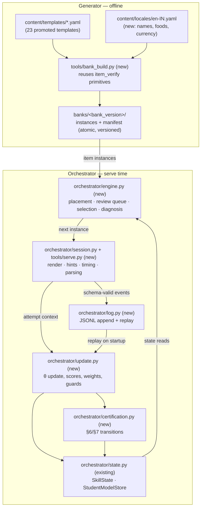
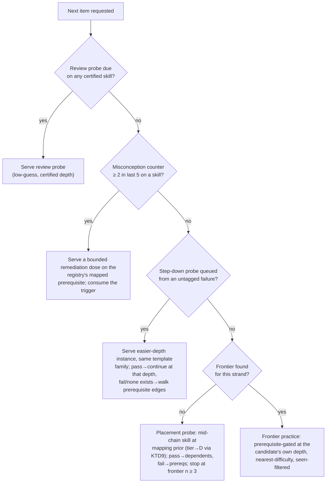

# Close the Serving Loop - Plan

## Goal Capsule

- **Objective:** close the Generator→Orchestrator loop for the v1 fractions slice — implement the student-model update rule, certification and review scheduling, placement, a Stage 5 bank builder, a rule-based adaptive engine, and an interactive CLI session runner, proven end-to-end by simulated students in pytest.
- **Authority hierarchy:** the two design docs (`mathiqo-qb-core-design.md`, `mathiqo-student-model.md`) govern behavior — section references below (core §N, SM §N) are the owning spec text. This plan governs scope and sequencing. Existing repo conventions (module docstrings citing sections, constants in `orchestrator/constants.py`, tools as standalone CLIs in `tools/`) govern style.
- **Stop conditions:** if implementation reveals a contradiction between a design doc and this plan, the doc wins — surface it rather than improvising. If a change to `schemas/attempt-event.schema.json` or `schemas/item-record.schema.json` appears necessary, stop and surface: those are the two-schema system contract (core §5.3).
- **Execution profile:** pure Python, no new dependencies beyond the existing four (`pyyaml`, `jsonschema`, `pytest`, `sympy`). No database, no web framework.

---

## Product Contract

### Summary

Implement the serve-time half of Mathiqo for the fractions slice: verified templates are materialized into a versioned bank of concrete, locale-dressed item instances; a rule-based engine selects what each student sees next; a terminal session runner serves it; every attempt updates θ and certification per the student-model spec and lands in a replayable on-disk log.

### Problem Frame

The authoring half of the pipeline (Stages 1–3: drafting harnesses, lint and verify gates, 23 promoted templates across 14 skills) is built and tested, but nothing exercises the Generator→Orchestrator contract. The item-record schema exists with no bank builder producing served content; the student-model state container exists with no update rule moving θ; there is no selection logic and no way to run a session. The core doc's build order (core §4) says to prove the whole pipe on the narrow slice before scaling content — the unproven half is the serving path, and its design flaws stay hidden until a student (real or simulated) can complete a session end-to-end.

### Key Decisions

- **Serving loop over content scale-up.** (session-settled: user-directed — chosen over pushing fractions content to the core §4 targets first: proving the pipe end-to-end is the §4 goal, and content volume has working harnesses already pointed at it.) Governs R1–R16.
- **Through a real session runner, not simulation-only.** (session-settled: user-directed — chosen over a headless-simulation-only or update-rule-only scope.) Governs R12–R14.

### Requirements

**Student model**

- R1. Every attempt updates θ per SM §3: `θ ← θ + K·(s − E)` with the effective-score table (clean 1.0 / hint-assisted 0.5 / wrong 0.0), the K schedule `K₀/(1 + n/n₀)` floored at `K_min`, and n incremented by the update's weight.
- R2. 4-option MCQ uses the guessing-adjusted expectation `E′ = 0.25 + 0.75·E`; low-guess formats use unadjusted E (SM §3).
- R3. The abandonment guard holds (SM §3): a no-interaction timeout that is the session's last event is discarded; a mid-session no-interaction timeout scores 0.0.
- R4. Multi-skill and lesson-context weights are implemented per SM §3 (full score at weight 0.5 / 0.25; lesson context suspends the hint-assisted score row; multi-skill failure updates nothing and queues single-skill probes) even though v1 content contains no such items — the rule is complete, only single-skill practice is exercisable.
- R5. Certification follows SM §7: set only by unassisted correct responses in low-guess formats at depth with `E(θ, d) ≥ 0.8`; never by MCQ; `due` satisfies prerequisite checks; only `lapsed` blocks dependents.
- R6. Review scheduling follows SM §6: initial 7-day interval; probe pass → interval ×2.5 capped at 90 days with θ unchanged; probe fail → scored as a wrong attempt, interval reset, certification lapsed; due review probes are served before new practice. Due-ness is evaluated against a single session timestamp (KTD10), not an ad hoc per-check clock.
- R7. Placement follows SM §5: prior one tier below the mapping's `depth_expectation` (converted via KTD9's tier→D table, floored at the `easy` band when the mapping is already `easy`), graph walk (pass → dependents, fail → prerequisites), stopping at the frontier once n ≥ 3 there.

**Bank build (Stage 5)**

- R8. A bank builder materializes promoted templates into an atomic, versioned bank of concrete instances: variables assigned, answer and distractors computed exactly, stems rendered with locale dressing, collision variants dropped — reusing the Stage 3 enumeration machinery, not reimplementing it.
- R9. Each instance stores its full distractor set with misconception tags (core §5.1 bank requirement) — for `mcq_4` this is the offered on-screen option set; for `numeric_entry` the same set is stored, unrendered, for wrong-answer matching (R14) — its difficulty, and provenance fields (`template_version`, `bank_version`, `graph_version`).
- R10. Instance pools are capped per (template, tier), not exhaustively materialized (core §5.1), and the builder validates every instance against a new item-instance schema.

**Selection**

- R11. The Orchestrator never constructs mathematics — selection and lookup only (core §5.1). The session runner renders pre-materialized instances verbatim.
- R12. Selection is rule-based (SM §10's honest v1 choice), in priority order: due review probes → confirmed-misconception remediation → placement probes (until frontier found) → frontier practice, prerequisite-gated at the required depth — the candidate instance's own `difficulty`, checked via `is_certified` — with a per-student seen filter that never repeats an instance while alternatives exist (core §5.4).
- R13. Diagnosis: a misconception counter reaching 2 within the last 5 attempts on a skill triggers remediation on the registry's mapped prerequisite (SM §4, core §2.5), consumed per KTD12 so it can only refire on fresh evidence. An untagged wrong answer — matched first against the instance's stored distractor set (R9) regardless of question type, so "untagged" means no match — triggers a depth-step-down probe from the same template family: a pass continues practice at that shallower depth (Scope Boundaries defers the fluency-probe branch); a fail, or no easier instance existing, falls back to the prerequisite walk.

**Session runner and persistence**

- R14. An interactive terminal session runner serves real bank instances: renders MCQ (shuffled options) and numeric-entry items, applies the hint ladder with auto-offer at ~1.5× `estimated_time_sec`, times out an unanswered item per a named threshold (Assumptions), measures time taken, parses responses (KTD8), matches wrong picks — MCQ or numeric-entry — to their distractor tags (R9), and shows feedback with solution steps.
- R15. Every attempt is validated against `schemas/attempt-event.schema.json` and appended to an on-disk JSONL log; student state and engine-derived state (KTD11) are rebuilt at startup by replaying the log (SM's reconstructible-from-the-log principle made literal).
- R16. Simulated students with a hidden true ability exercise the whole loop headlessly in pytest, using the same guess-adjusted response model as R2 and an injected session clock (KTD10): placement converges, practice moves θ toward the true value, certification fires only through low-guess unassisted responses, the review cycle runs, and the misconception-remediation path triggers and then clears (KTD12).

### Scope Boundaries

**Deferred to Follow-Up Work**

- Content scale-up to the core §4 targets (25–40 nodes, 15–20 misconceptions, 150–300 templates) — the existing Stage 1/2 harnesses own this.
- The §2.5 escalation triggers (post-remediation persistence, fires-only-at-depth measured against opportunity) and the concept-vs-fluency fluency-skill probe on a passed step-down (core §2.5's second refinement, e.g. probing `NUM.MULT.TABLES` directly) — the basic 2-in-5 trigger, its consumption (KTD12), and continuing practice at a passed step-down's shallower depth (R13) are in scope; the escalation layer and the fluency-probe branch are not.
- Migration execution (SM §8) — `graph_version` is stamped everywhere, but no split/merge migration runs in this plan.
- Stage 6 telemetry analytics (calibration, discrimination, retirement). The one §5.4 signal in scope is a pool-utilization warning from the seen filter.
- README documentation of the new tools ships with this plan (U6); a fuller operator guide does not.

**Outside this plan's identity**

- Teaching layer (core §6), TTS/audio, Classes 1–3 interactive types, multi-language rendering (schemas carry `_i18n`; serving is `en-IN` only), web or mobile UI, exam-context multi-skill serving, and any generative component in the serving path.

---

## Planning Contract

### Key Technical Decisions

- KTD1. **Terminal CLI session runner** (`tools/serve.py`), matching the repo's tools-as-CLIs convention. (session-settled: user-approved — chosen over a minimal local web page: no new dependencies, and the headless/interactive split in core §5.2 keeps a future UI swap cheap.) Governs R14.
- KTD2. **Persistence is a JSONL attempt log plus replay.** The log is the only durable artifact; `StudentModelStore` is rebuilt at startup by replaying events through the update rule. (session-settled: user-approved — chosen over in-memory-only sessions: it makes SM §1's "reconstructible from the attempt log alone" a tested property, not a claim.) Governs R15.
- KTD3. **Diagnosis scope is the 2-in-5 trigger plus basic step-down.** (session-settled: user-approved — chosen over implementing the full §2.5 escalation triggers: they need remediation-history bookkeeping that pilot-scale content can't yet exercise.) Governs R13.
- KTD4. **Instances get their own schema** (`schemas/item-instance.schema.json`). The existing item-record schema is template-level; the attempt event's `item_instance_id` needs a defined concrete shape: instance id, template provenance, assigned variable values, rendered stem, exact answer (canonical rational string), the full distractor set (value + misconception tag + `unsimplified` flag — offered on-screen for `mcq_4`, stored for wrong-answer matching only on `numeric_entry`), a `simplest_form_only` boolean (KTD8), difficulty, question type, language, locale. The item-record schema is untouched.
- KTD5. **The bank builder imports `item_verify`'s primitives** (`build_domains`, `evaluate_expression`, `evaluate_condition`, `distractor_offered`, `check_variant`) rather than duplicating enumeration or solving logic. If import friction demands it, extract a shared module — but the default is direct reuse; two implementations of "what is a valid variant" is how Stage 3's guarantee silently forks.
- KTD6. **Pool capping is deterministic**: enumerate all valid variants (Stage 3 already proves this is cheap), then take an evenly spaced sample of N per (template, tier) with a fixed seed derived from template id + bank version. Reproducible builds — same inputs, same bank.
- KTD7. **The update engine is pure functions** over `SkillState` plus an attempt context, returning the new state and the event fields (`theta_before/after`, `n_before`). Session runner and log replay both call the same function — replay equivalence is then a property test, not a hope. `ENGINE_VERSION` joins `orchestrator/constants.py`.
- KTD8. **Numeric-entry parsing** accepts integers, `a/b` fraction strings, and mixed-number strings `W n/d` (whitespace-separated whole part); comparison is by exact rational value, except instances flagged `simplest_form_only` (KTD4), which require the literal simplest form (an unsimplified equal value is wrong — that is the `MISC.FRAC.NO-SIMPLIFY` design, core §2.2). The bank builder (U3) sets `simplest_form_only: true` iff the template's `accepted_answer_forms` starts with "simplest form only" (case-insensitive), false when the field is absent or phrased otherwise — grading reads the flag, never the template's free-text field.
- KTD9. **Depth targeting is nearest-difficulty**: serve the un-seen instance whose difficulty is closest to the student's target depth (θ plus a small challenge offset, capped by the mapping's `depth_expectation` ceiling where a mapping row exists; default ceiling = top tier otherwise). Tier labels (`easy`/`medium`/`hard`) convert to the D ∈ [0,1] scale via a fixed `TIER_DEPTH` constant table (aligned with the authored template difficulties); "one tier below" (R7's placement prior) steps down that table and floors at the `easy` value rather than underflowing the scale. The offset is a named constant, tuned later — SM §10 defers real policy to pilot data.
- KTD10. **A single session timestamp, not scattered `now()` calls.** The engine and session runner take one `now` value resolved once per session — real wall-clock time by default, overridable via a `--session-time` flag on `tools/serve.py` and by direct injection in tests. Every review-due read (`certification_status`, the engine's due-review query) and the simulation's clock-advance scenarios consume this one value.
- KTD11. **Engine-derived state rebuilds from replay too, not just the student-model store.** The per-student seen filter and any pending remediation/step-down/prerequisite probe queues (R13) are not fields on `SkillState` — they are re-derived at startup by feeding the replayed attempt log through the engine's own result-consumption logic (the same code path U5 runs live), so a restart mid-diagnosis resumes with the same pending probes an uninterrupted session would have queued.
- KTD12. **Remediation triggers are consumed, not standing.** The misconception counter's 5-attempt window slides only on the *triggering* skill (SM §4) while remediation practice serves the *prerequisite* skill, so the window cannot self-clear the trigger. On firing, the engine queues a bounded remediation dose (`REMEDIATION_DOSE_SIZE` attempts, a named constant) and resets the counter, so selection returns to the normal priority chain once the dose completes and the trigger can only refire on fresh evidence.

### High-Level Technical Design

System shape — what gets built (bold) and how it connects to what exists:

Selection policy per turn (engine.py) — the decision order R12/R13 commit to:

### Assumptions and deferred implementation notes

- The CLI auto-hint at 1.5× expected time and the `TIMEOUT_MULTIPLIER` timeout (R14) share the same asynchronous input handling (threaded timer or select-based); the exact mechanism is an implementation-time choice. Falling back to offer-on-slow-submit / judge-on-next-submit is acceptable for v1 if threading proves fragile, as long as `hint_auto_offered` and `timed_out` are recorded honestly. A mid-session no-interaction timeout is held as a pending event and scored 0.0 only if a later event proves it mid-session (SM §3); one that is also the session's last event is discarded.
- Exact constants introduced here (pool cap N, challenge offset, placement default prior, the `TIER_DEPTH` table (KTD9), `TIMEOUT_MULTIPLIER` (R14), `REMEDIATION_DOSE_SIZE` (KTD12)) join `orchestrator/constants.py` as named placeholders, same convention as the existing tuning constants.
- The bank directory layout (`banks/<version>/`) and manifest fields are settled at implementation; the contract is atomicity + a pinnable `bank_version`.

### Risks & Dependencies

- **Thin instance pools.** 23 templates across 14 skills means some (skill, tier) pools are one template deep. The seen filter and step-down probes must degrade gracefully: repeat the least-recently-seen instance when the pool is exhausted (with a §5.4-style utilization warning printed), and skip the step-down when no easier instance exists (falling back to the prerequisite walk). Test scenarios cover both.
- **Sparse mappings.** Only Ontario has substantial mapping rows; NCERT has one. Placement needs a default prior for unmapped (skill, grade) pairs — start at the easy tier. Ontario grade 5 is the realistic demo path.
- **Broad type enum, narrow engine.** The schemas admit 11 question types; the engine and runner handle `mcq_4` and `numeric_entry` only (core §4 v1 scope). The bank builder must refuse templates of other types with a clear error rather than emitting instances the runner can't serve.
- **Replay drift.** If replay ever produces different state than the live session did, the audit-trail principle is broken. KTD7 (one pure function for both paths) and KTD11 (engine-derived state also rebuilds from replay) are the mitigation; U7 asserts replay equivalence — including pending probe queues — explicitly.

---

## Implementation Units

### U1. Update rule engine

- **Goal:** the SM §3 update rule as pure functions: expectation, effective score, K schedule, weights, guards — everything that turns one attempt into a state delta and event fields.
- **Requirements:** R1, R2, R3, R4.
- **Dependencies:** none.
- **Files:** `orchestrator/update.py`, `tests/test_update.py`; extend `orchestrator/constants.py` (`ENGINE_VERSION`).
- **Approach:**
  1. `expectation(theta, b, question_type)` — logistic E with the MCQ guess floor applied per format class (constants already exist).
  2. `effective_score(attempt)` — the outcome table plus the abandonment guard (discard vs. 0.0) and the lesson-context precedence rule.
  3. `apply_attempt(state, attempt) -> UpdateResult` — computes K from n, mutates a copy of `SkillState` (θ, n, `record_attempt` for misconception windows), returns the fields the attempt event needs (`theta_before`, `theta_after`, `n_before`). Multi-skill: full score at half weight on success, no-op with probe-queue signal on failure.
- **Patterns to follow:** section-citing docstrings and constants-only tuning values, as in `orchestrator/state.py` / `constants.py`.
- **Execution note:** implement test-first — the SM doc states exact expected behaviors (worked margins, sign of updates); encode them as failing tests before writing the rule.
- **Test scenarios:**
  - Clean correct at E = 0.5 raises θ by exactly K·0.5; wrong lowers it symmetrically.
  - Hint-assisted correct when E > 0.5 *lowers* θ (SM §3's stated marginal behavior).
  - Pure-guess MCQ neutrality: with E′ adjustment, expected θ drift of a random 4-option guesser is ~0 over many attempts.
  - Numeric entry uses unadjusted E (no guess floor).
  - Abandonment guard: no-interaction timeout as session's last event → discarded, no state change, no n increment; mid-session no-interaction timeout → scores 0.0.
  - K schedule: early attempts move θ more than late ones; K never falls below `K_MIN`; n increments by 1.0 / 0.5 / 0.25 per weight class.
  - Multi-skill success updates every listed skill at half weight with full score; multi-skill failure changes nothing and signals probe queueing.
  - Lesson context: correct-with-hints scores s = 1 at weight 0.25 (the suspended hint row); lesson attempts never feed certification (asserted at the U2 boundary).

### U2. Certification and review scheduling

- **Goal:** the SM §6/§7 transitions: certification writes, review intervals, lapse handling.
- **Requirements:** R5, R6.
- **Dependencies:** U1.
- **Files:** `orchestrator/certification.py`, `tests/test_certification.py`.
- **Approach:**
  1. `maybe_certify(state, attempt)` — on unassisted correct in a `LOW_GUESS_FORMATS` type outside lesson context: `certified_depth = max(existing, min(depth_served, θ − MASTERY_MARGIN))`, set `review_due`, clear `lapsed`.
  2. `apply_review_outcome(state, passed)` — pass: interval ×2.5 capped, θ untouched; fail: caller routes the attempt through U1 as wrong, interval resets, `lapsed = True`.
  3. Review-due read for the engine: which skills have `certification_status == due`, ordered by due date.
- **Patterns to follow:** `certification_status` / `is_certified` in `orchestrator/state.py` — extend that vocabulary, don't parallel it.
- **Test scenarios:**
  - Certification fires on unassisted numeric-entry correct with sufficient θ margin; the certified depth respects both caps (`depth_served`, θ − margin).
  - MCQ correct never certifies regardless of θ; hint-assisted low-guess correct never certifies; lesson-context correct never certifies.
  - Review pass: interval 7 → 17.5 → … capped at 90; θ unchanged by the pass itself.
  - Review fail: θ drops (via U1), interval back to 7, status `lapsed`; `is_certified` now false for dependents' checks, but `certified_depth` value is retained (blocked, not revoked).
  - Re-earning after lapse clears the flag and restores prerequisite satisfaction.
  - `due` status still satisfies `is_certified` (already covered in `tests/test_state.py` — extend, don't duplicate).

### U3. Bank builder, instance schema, and locale pack

- **Goal:** Stage 5 made real: a versioned, atomic bank of concrete, dressed, schema-valid item instances.
- **Requirements:** R8, R9, R10; boundary rule R11 (everything a child sees is computed here, offline).
- **Dependencies:** none (parallel with U1/U2).
- **Files:** `tools/bank_build.py`, `schemas/item-instance.schema.json`, `content/locales/en-IN.yaml`, `tests/test_bank_build.py`.
- **Approach:**
  1. Load and re-verify each template (schema + `verify_template`); refuse non-`mcq_4`/`numeric_entry` types.
  2. Enumerate valid variants via `item_verify` primitives; drop collision variants exactly as Stage 3 does (KTD5).
  3. Cap per (template, tier) with the deterministic sample (KTD6).
  4. Dress: fill `localization_slots` from the locale pack (rotating deterministically), substitute variables into stems/hints/solution steps, compute the canonical answer string and the full distractor set's values (`unsimplified` distractors render unreduced) — for `mcq_4` these are the offered on-screen options; for `numeric_entry` the same set is stored, unrendered, for wrong-answer matching (R9).
  5. Normalize `accepted_answer_forms` into `simplest_form_only: true`/`false` per KTD8's prefix rule.
  6. Emit `banks/<bank_version>/` — instance files plus a manifest (bank version, graph version, template list, pool sizes, build inputs' hashes) — written to a temp dir and renamed into place (atomic).
- **Patterns to follow:** CLI structure, staging discipline, and exit-code conventions of `tools/item_verify.py` and `tools/stage2_draft.py`.
- **Test scenarios:**
  - Instances validate against the new item-instance schema; the build refuses a template that fails `item_verify`.
  - Determinism: two builds from identical inputs are byte-identical.
  - Collision variants (distractor equals answer) never appear in the pool; `only_if`-guarded distractors appear only where the guard holds; `unsimplified` distractors display unreduced while sharing the answer's value.
  - Pool cap honored; a template with fewer valid variants than N yields them all.
  - Every localization slot is filled — no `{{name1}}` survives into a rendered stem (mirrors `check_slots`).
  - A `mcq_4` instance carries exactly its offered distractor set with tags; a `numeric_entry` instance carries the canonical answer plus the same tagged distractor set, stored for matching rather than display.
  - A template whose `accepted_answer_forms` starts with "simplest form only" yields instances with `simplest_form_only: true`; a template omitting the field or phrasing it differently yields `false`.
  - Non-v1 question type → hard error naming the template.

### U4. Attempt-log persistence and replay

- **Goal:** the on-disk JSONL attempt log and the replay path that rebuilds `StudentModelStore` from it.
- **Requirements:** R15.
- **Dependencies:** U1, U2.
- **Files:** `orchestrator/log.py`, `tests/test_log.py`.
- **Approach:**
  1. Append-only JSONL writer that schema-validates each event against `attempt-event.schema.json` before writing (a malformed event is a bug, not data).
  2. `replay(log_path) -> StudentModelStore` — feeds events in order through the same U1/U2 functions the live session uses (KTD7), including the abandonment-guard re-evaluation (an event discarded at serve time was never logged as an update; replay respects `theta_before == theta_after` markers if the discarded event is logged for audit — settle the discarded-event representation here and document it in the module docstring). This function rebuilds student-model state only; engine-derived state (seen filter, pending probe queues) is rebuilt separately by U5's own replay pass over the same log (KTD11).
- **Test scenarios:**
  - Round trip: a synthetic session's final store equals the replayed store exactly (θ, n, certification, windows).
  - A hand-corrupted event (missing field, bad enum) is rejected at write time with a clear error.
  - Replay is idempotent and ordering-stable across interleaved students and sessions.
  - Empty/missing log yields an empty store (fresh student).

### U5. Adaptive engine

- **Goal:** the selection policy — placement, review queue, frontier practice, diagnosis — as pure decision logic over (store, bank, graph, mappings). No I/O, no UI (core §5.2: testable headlessly).
- **Requirements:** R7, R12, R13.
- **Dependencies:** U1, U2, U3, U4.
- **Files:** `orchestrator/engine.py`, `tests/test_engine.py`; extend `orchestrator/constants.py` (`TIER_DEPTH`, `REMEDIATION_DOSE_SIZE`).
- **Approach:**
  1. Load graph + misconceptions from `content/fractions/`, mappings for the student's (country, grade), bank from `banks/<version>/`; accept a single `now` timestamp for the session (KTD10).
  2. Implement the priority chain from the selection flowchart: review probes (due against `now`) → misconception remediation → queued step-down probes → placement → frontier practice.
  3. Placement per SM §5 (mid-chain start at the mapping prior — converted from tier label to D via `TIER_DEPTH`, floored at `easy` per KTD9 — walk edges, frontier at n ≥ 3); default easy-tier prior for unmapped skills.
  4. Frontier practice: prerequisite gating via `is_certified` at the required depth (the candidate instance's own `difficulty`, R12), nearest-difficulty targeting (KTD9), per-student seen filter with least-recently-seen fallback plus a pool-utilization warning.
  5. On each result: consume U1's probe-queue signal (untagged wrong on any question type, matched against the instance's distractor set first per R9 → queue step-down; step-down pass → continue at the shallower depth, no fluency probe in v1; no easier instance → queue prerequisite probes) and consume the misconception-remediation trigger (queue a bounded dose, reset the counter — KTD12).
  6. At startup, rebuild engine-derived state (seen filter, pending probe queues) by replaying the attempt log through this same result-consumption logic (KTD11).
- **Patterns to follow:** keep it a library module like `state.py`, not a CLI.
- **Test scenarios:**
  - A student with a due review — due against the session's injected `now` — is served the review probe before anything else, in a low-guess format at the certified depth.
  - Two same-tag misconception hits within 5 attempts → next serve is a bounded remediation dose on the registry's mapped prerequisite; after the dose completes, serving returns to the frontier chain; a fresh pair of hits after that is required to retrigger.
  - Untagged wrong on a deep item (no distractor value match) → an easier same-family instance is served next; a pass there continues practice at that shallower depth; when no easier instance exists, or the shallow probe also fails, prerequisite probes are queued instead.
  - Prerequisite gating: `FRAC.ADD.UNLIKE` is not served while `FRAC.EQUIV` is uncertified at the required depth — the candidate instance's own difficulty; a `due` prerequisite does not block; a `lapsed` one does.
  - Placement: a fresh Ontario grade-5 student's first serves walk the graph and stop at a frontier with n ≥ 3; unmapped skills use the default prior; an NCERT student mapped at `easy` gets a placement prior floored at `easy`, not an out-of-range value.
  - Seen filter: no instance repeats while alternatives exist; exhausted pool → least-recently-seen repeat plus warning.
  - Engine-state replay: a log ending right after an untagged deep failure, when replayed, reproduces the same queued step-down probe the live session had pending (KTD11).

### U6. Session runner CLI

- **Goal:** the interactive terminal loop a person can actually sit at: render, time, hint, parse, feedback, log.
- **Requirements:** R14, R11 (render verbatim, look up feedback, construct nothing).
- **Dependencies:** U3, U4, U5.
- **Files:** `orchestrator/session.py` (loop logic, testable with an injected I/O interface), `tools/serve.py` (CLI entry: `--bank`, `--student`, `--country`, `--grade`, `--log`, `--session-time`), `tests/test_session.py`; extend `orchestrator/constants.py` (`TIMEOUT_MULTIPLIER`); README section documenting `bank_build` and `serve`.
- **Approach:**
  1. Startup: resolve the session `now` (real time, or `--session-time` for reproducible runs — KTD10), replay log and engine-derived state (U4, U5), print a short state summary (frontier, due reviews).
  2. Per item: render stem (MCQ options shuffled with a per-instance seed, correct position recorded), start the clock, run the hint ladder (auto-offer at ~1.5× `estimated_time_sec`) and the `TIMEOUT_MULTIPLIER` timeout via the same deferred-note async mechanism; manual `hint` command always available. A mid-session no-interaction timeout is held as a pending event, scored 0.0 only if a later event proves it mid-session, and discarded if the session ends first (R3).
  3. Parse and judge: numeric entry per KTD8 (including mixed-number strings); MCQ pick or numeric-entry value matched against the instance's stored distractor set (R9) to populate the misconception tag; a wrong answer with no match is untagged.
  4. Assemble the full attempt event (all schema-required fields, including `b_prior_at_serve`, `depth_served`, `hint_auto_offered`), apply U1/U2, append via U4, show feedback with solution steps on wrong answers.
  5. Session end (quit command or queue exhausted): summary of θ movement and certifications earned.
- **Execution note:** mostly wiring — prefer an end-to-end scripted-session smoke test (piped input) as the first proof, then unit-test the parsing and shuffling edges.
- **Test scenarios:**
  - Scripted session (injected I/O): answers flow through to state changes and schema-valid logged events; a second startup replays to the same state, including any pending step-down or remediation probe queued right before the session ended.
  - Numeric parsing: `5/6` correct; `1 5/6` accepted and correct on `TPL.FRAC.MIXED.ADD.DIRECT.001`; `10/12` wrong on a `simplest_form_only` template but correct on an equivalence-accepted one; `0.83` rejected with a re-prompt, not a crash; garbage input re-prompts without consuming the attempt.
  - MCQ: shuffle is deterministic per instance; picking the `MISC.FRAC.ADD-ACROSS` distractor logs that `misconception_id`.
  - Numeric entry: entering a value equal to a tagged distractor's value logs that `misconception_id`; entering any other wrong value logs untagged and queues a step-down probe.
  - Hint flow: requested hints increment `hints_used` and demote the outcome to hint-assisted; `hint_auto_offered` recorded when the offer fired.
  - Timeout paths: an engaged timeout scores wrong; a timeout at `TIMEOUT_MULTIPLIER × estimated_time_sec` with no interaction that is also the session's last event is discarded and not applied; a mid-session no-interaction timeout scores 0.0.
  - Restart preserves engine state: quitting immediately after an untagged deep failure, then restarting, still serves the queued step-down probe next (KTD11).

### U7. Simulated-student end-to-end proof

- **Goal:** the closing argument — synthetic students run the whole loop headlessly and the system behaves as the spec predicts.
- **Requirements:** R16; exercises R1–R15 in integration.
- **Dependencies:** U1–U6.
- **Files:** `tests/test_simulation.py` (simulated responder + scenarios; promote the responder to `tests/fixtures/` if U6's tests want it too).
- **Approach:**
  1. A `SimulatedStudent` with hidden per-skill true ability answers know-or-guess (R2): with probability `E(θ_true, b)` they know and answer correctly; otherwise, for `mcq_4`, they guess among the options (habit-weighted toward a configured misconception distractor when one is present); low-guess formats answer correctly with probability `E(θ_true, b)` directly, no guess floor. This embodies the same guess adjustment the update rule assumes (U1), so convergence isn't structurally biased low.
  2. Drive `session.py`'s loop with the simulated responder and an injected, advanceable clock (KTD10) against a real built bank (U3 output built in a fixture).
  3. Assert system-level properties rather than exact trajectories.
- **Test scenarios:**
  - Convergence: after enough attempts, θ estimates land near true abilities (tolerance band, fixed seed) — the know-or-guess responder keeps this unbiased on MCQ-containing diets.
  - A strong student certifies frontier skills through numeric-entry items only, and their certifications carry review dates.
  - Clock advance past `review_due` (the injected session clock, KTD10) → next session serves review probes first; a failed probe lapses and blocks dependents.
  - A student with the adds-across habit triggers remediation on the mapped prerequisite within a bounded number of attempts, then returns to frontier practice once the remediation dose completes (KTD12).
  - Placement: strong and weak students stop at different frontiers from the same starting point.
  - Replay equivalence at scale: full simulated history replayed equals live final state, including engine-derived state (KTD7/KTD11/R15 property, end-to-end).

---

## Verification Contract

| Gate | Command | Proves |
|---|---|---|
| Full suite | `.venv/bin/python -m pytest tests/ -q` | all units, including simulation (U7) |
| Content lint | `python tools/graph_lint.py content/fractions/` | fixture untouched by this work |
| Template gate | `python tools/item_verify.py content/templates/<id>.yaml` | bank inputs still verify (run via U3's tests across all templates) |
| Bank build smoke | `python tools/bank_build.py --templates-dir content/templates --content-dir content/fractions --out banks/` | deterministic, schema-valid bank on real content |
| Interactive smoke | `python tools/serve.py --bank banks/<version> --student demo --country CA --grade 5` | a human can complete a session; state survives restart |

New tests follow the existing suite's conventions (temp-dir copies for anything destructive; the real fixture is never modified).

## Definition of Done

- All seven units landed with their test scenarios green; full suite passes.
- The simulation proves, in one test run: placement converges, θ tracks true ability, certification fires only via unassisted low-guess responses, review probes cycle with lapse blocking dependents, and misconception remediation triggers — the core §4 "expose every design flaw" bar for the serving half.
- A human can run `bank_build` then `serve`, answer items including hints and wrong answers, quit, restart, and resume from replayed state.
- README documents the two new tools at the same depth as the existing harness sections.
- No dead experimental code from abandoned approaches remains in the diff; every new module carries the repo's section-citing docstring convention.
