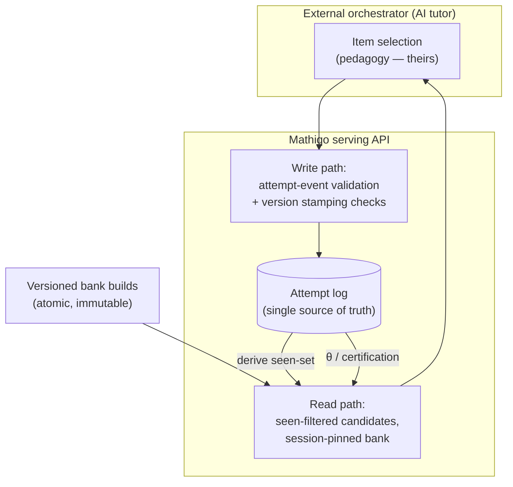
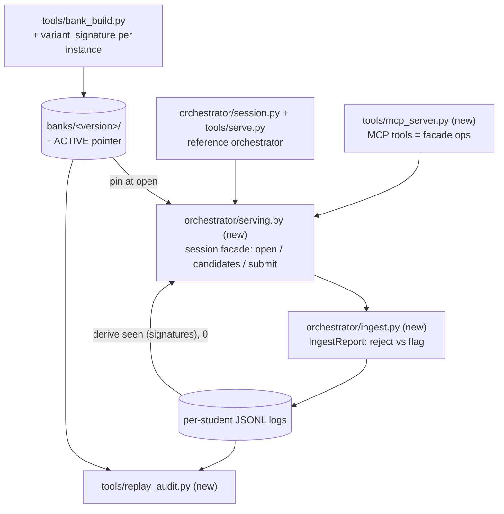
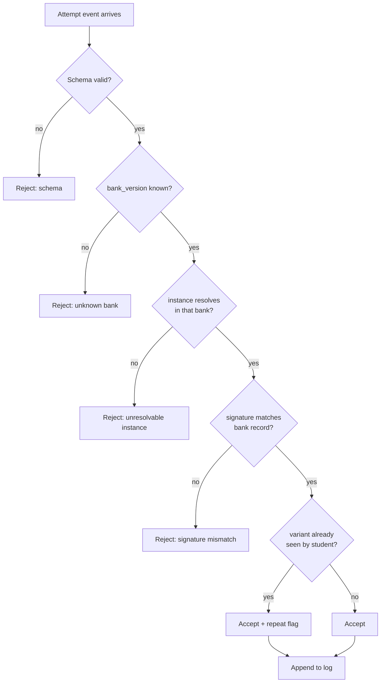

# Serving Integrity Contract - Plan

## Goal Capsule

- **Objective:** implement the serving-integrity contract for external orchestrators — variant signatures at bank-build time, session-pinned seen-filtered serving, validating attempt ingest, a replay-audit tool, adoption by the internal reference orchestrator, and the MCP server that exposes the same operations to external AI tutors.
- **Product authority:** `STRATEGY.md` (infra-first; the QB + student model exposed via MCP/API are the product). Behavioral specs: `mathiqo-qb-core-design.md` §5.3–§5.4, `mathiqo-student-model.md` §9. The Product Contract below (R1–R10, KD1–KD5) governs product behavior; the Planning Contract governs mechanism.
- **Product Contract preservation:** unchanged from the requirements-only version, except the Outstanding Questions section (all four items were Deferred to Planning) is resolved into KTD1–KTD7 below.
- **Execution profile:** Python ≥3.10 — a runtime migration from the repo's current 3.9 venv, landed by U9 before any other unit. Existing deps (`pyyaml`, `jsonschema`, `pytest`, `sympy`) plus one new dependency: the MCP Python SDK, pinned `mcp>=1.0,<2` and imported only by the server module (U8). No database, no web framework; attempt logs remain JSONL files.
- **Stop conditions:** if implementation reveals a contradiction between the Product Contract and a design doc, surface it rather than improvising. Schema edits beyond those named in KTD2 (attempt-event) and U1 (item-instance) stop and surface.

---

## Product Contract

### Summary

A hosted serving-integrity layer: Mathiqo's API serves seen-filtered candidate pools computed from the attempt log it already owns, pins one bank build per session server-side, and validates every incoming attempt event against the build it was served from. External orchestrators keep all pedagogical choice; Mathiqo enforces integrity in both directions of the interface.

### Problem Frame

The strategy makes outside orchestrators — agentic AI tutors Mathiqo does not control — the primary consumers of the question bank and student model. The two serving disciplines that §5.4 assigns to "the Orchestrator" (never repeat an instance while alternatives exist; pin an atomic bank version and stamp it on every attempt) currently live inside Mathiqo's own in-process reference orchestrator (`orchestrator/engine.py`, `tools/serve.py`). As published conventions they would be requests, not guarantees: a sloppy consumer that repeats items feeds memorized answers into Stage 6 calibration as if they were skill, and a consumer that mixes or omits bank versions breaks the audit trail every mastery claim rests on. The trust bet fails silently at exactly the boundary the strategy stakes it on.

One fact reshapes the solution space: the seen filter is already a pure function of the attempt log — the reference implementation derives `seen_history` by replay rather than storing it (`orchestrator/engine.py`, replay-equivalence tested). Since the strategy already routes every attempt event into Mathiqo for the student model, the ledger needed to compute serving integrity is data Mathiqo holds regardless.

### Key Decisions

- KD1. **Log-anchored hybrid enforcement** (session-settled: user-approved — chosen over contract-side conformance and full server-side selection: keeps Mathiqo generator + system-of-record while consistency stays guaranteed where checkable). The attempt log is the single source of truth; integrity is derived from it and enforced at the API boundary; item *selection* remains the orchestrator's. Governs R1, R2, R5, R6.
- KD2. **Online-only v1** (session-settled: user-directed — chosen over first-class offline packs: smallest surface, strongest guarantees; the internal app's §5.1 pack story is unchanged). Governs R1, R5.
- KD3. **Server pins the bank per session** (session-settled: user-directed — chosen over consumer-managed pins and always-latest: consumers never manage versions, and content never shifts under a child mid-session). Governs R3, R4.
- KD4. **Seen-filter identity is content-based across builds** (session-settled: user-directed — chosen over instance-id identity: weekly rebuilds re-sample overlapping variants, so id-based filtering silently resets and readmits memorization). Governs R2, R8, R9.
- KD5. **Repeats are accepted-but-flagged at ingest, not rejected** (session-settled: user-approved — a post-exhaustion least-recently-seen repeat is legitimate today; only inconsistency is rejected). Governs R6, R7.

### Requirements

**Read path (serving)**

- R1. An orchestrator can request candidate items for a (student, skill) and receives only instances the student has not seen, drawn from the session's pinned bank; when the pool is exhausted, the response repeats the least-recently-seen instance and says so explicitly.
- R2. The seen determination is computed from the student's attempt log using content-based variant identity (per KD4), not instance ids.
- R3. Each session opens pinned to the current active bank build; every item served within the session comes from that build, and the pinned `bank_version` is visible on every response.
- R4. Activating a new bank build (or rolling one back) affects only sessions opened afterward; open sessions keep their pin.

**Write path (ingest)**

- R5. Every attempt event is validated at ingest: its `bank_version` must name a known build, and its `item_instance_id` must resolve within that build. Events failing these checks are rejected with a reason.
- R6. An event reporting an instance whose variant content the student has already seen is accepted and flagged as a repeat (per KD5); flags are queryable per orchestrator.
- R7. Repeat-flag rates are attributable per consumer, so a misbehaving orchestrator is identifiable from its own ingest record.

**Bank and build contract**

- R8. Every published item instance carries a stable variant signature — an identity for what the student actually sees (template + concrete variable assignment) that is equal across bank builds when the rendered item is the same.
- R9. The variant signature is produced at bank-build time and is part of the published instance record, so consumers and the serving layer never compute it independently.

**Auditability**

- R10. Any student's attempt log can be replayed end-to-end: every logged event resolves against its stamped bank build, and the replay reproduces the student's serving history and progress trajectory (θ, certifications) without any state outside the log.

### Actors

- A1. External orchestrator — an agentic AI tutor consuming the API; owns item selection and all pedagogy; untrusted with integrity.
- A2. Mathiqo serving API — owns the attempt log, the derived seen-state, session pins, and ingest validation.
- A3. Internal reference orchestrator (`orchestrator/`) — first consumer of the same contract; proves the interface.

### Key Flows

- F1. Serving loop
  - **Trigger:** A1 opens a session for a student.
  - **Steps:** API pins the active bank to the session → A1 requests candidates for (student, skill) → API returns seen-filtered instances from the pinned build → A1 selects and shows one → A1 logs the attempt event → API validates, stamps, appends to the log → the next candidate request reflects it.
  - **Covers:** R1, R2, R3, R5.
- F2. Build activation
  - **Trigger:** a new bank build passes review and is activated (weekly cadence).
  - **Steps:** new sessions pin the new build; open sessions finish on their pinned build; seen-state carries across the boundary via variant signatures.
  - **Covers:** R4, R8.
- F3. Replay audit
  - **Trigger:** any mastery claim or served item is questioned.
  - **Steps:** fetch the student's log → resolve every event against its stamped build → replay to reproduce serving history and progress.
  - **Covers:** R10.

### Acceptance Examples

- AE1. **Covers R1, R6.** Given a (student, skill) pool of 3 instances all previously served, when the orchestrator requests candidates, then the response contains the least-recently-seen instance and an explicit exhaustion signal; if the orchestrator logs the resulting attempt, the event is accepted and carries a repeat flag.
- AE2. **Covers R5.** Given an attempt event whose `bank_version` names no known build (or whose `item_instance_id` does not resolve in the named build), when it is submitted, then ingest rejects it with the failing check named.
- AE3. **Covers R2, R8.** Given a student who answered variant (template T, values a=1 b=2) in last week's build, when this week's build re-samples the same variant under a new instance id and the orchestrator requests candidates, then that variant is treated as seen.
- AE4. **Covers R3, R4.** Given a session opened before a build activation, when the orchestrator requests candidates after the activation, then instances still come from the session's original pinned build.
- AE5. **Covers R10.** Given any student's complete attempt log, when it is replayed against the retained bank builds, then every event resolves and the replayed progress (θ trajectory, certifications, seen history) matches the live record exactly.

### Success Criteria

- The acceptance bar stated by the user: replay any student's log — every served item resolves against its stamped bank, and the student's progress is visible from the replay alone (AE5 is its test form).
- A simulated external-orchestrator integration run produces zero unflagged repeats and zero accepted events that fail version resolution.

### Scope Boundaries

- Offline/pack export for external consumers — deferred; online-only v1 (KD2). The internal app's §5.1 pack design is untouched.
- Aggregate pool-utilization alerting (§5.4's telemetry threshold) — deferred; ingest data enables it, but the telemetry loop is separate work.
- Consumer-managed bank pinning and always-latest serving — rejected (KD3).
- Server-side item *selection* for external consumers — rejected (KD1); selection policy stays with the orchestrator.
- Hardening against actively adversarial consumers — out of scope; see Assumptions.
- Authentication/transport security for the MCP server — v1 runs for credentialed partners in a trusted deployment; auth hardening is follow-up work.

### Dependencies / Assumptions

- v1 assumes a small set of known, credentialed partner orchestrators. Enforcement is detect-and-attribute (R6, R7), not prevent: a misbehaving consumer can still display a repeat to a child before Mathiqo flags it.
- Assumes attempt-event ingest and the student-model read API are the same surface (STRATEGY.md track 2); this contract adds requirements to that surface rather than creating a second one.
- Bank builds must be retained (not garbage-collected) for as long as logs reference them, or R10's replay breaks.
- Pre-production status: no real student logs exist, so the attempt-event contract can evolve by regenerating fixtures rather than migrating data (KTD2).

### Sources / Research

- `mathiqo-qb-core-design.md` §5.3 (contract, bank versioning), §5.4 (seen filter, pool exhaustion, staleness cadence); `mathiqo-student-model.md` §9 (attempt-event schema).
- Verified current state: seen filter with LRU fallback in `orchestrator/engine.py` (`pick_instance`); log-replay derivation of `seen_history` (`rebuild_session_state`, equivalence tested in `tests/test_engine.py`); atomic immutable builds refusing overwrite in `tools/bank_build.py` (`write_bank`); instance ids embed the bank version; the four version fields are schema-required (`schemas/attempt-event.schema.json`).
- The concrete variable assignment is already retained in every published instance (`variables`, schema-required in `schemas/item-instance.schema.json`) — the signature hashes data the bank already publishes.
- Locale dressing rotates by sample rank (`dress_slots(..., base_index=rank)` in `tools/bank_build.py`), and rank shifts across builds — so stems are not stable across builds and dressing must be excluded from the signature.
- Cross-build overlap is the common case: `derive_seed` only shifts the sample phase, and pools at or under `pool_cap` (default 40) are identical across builds — the fact motivating KD4.
- Ingest validation today is schema-only (`orchestrator/log.py` `append_attempt`); no bank-resolution check exists anywhere.
- `seen_history` is marked at both selection time and consume time (documented quirk, `tests/test_simulation.py`); replay reproduces the log-derived view.

---

## Planning Contract

### Key Technical Decisions

- KTD1. **Variant signature = sha256 over canonical JSON of (template_id, template_version, variables)** (session-settled: user-approved — chosen over hashing the rendered stem: dressing and rank rotate across builds, so rendered text is unstable; the mathematical content is the identity). Excludes stem, locale, dressing, language, rank, and bank_version. Canonicalization mirrors the repo's existing `json.dumps(..., sort_keys=True)` + `hashlib.sha256` precedent. Implements KD4 for R8, R9. Algorithm constant lives in `tools/bank_build.py` beside `DEFAULT_POOL_CAP`.
- KTD2. **Attempt events gain `variant_signature` and `consumer_id` as required fields; fixtures regenerate, no migration** (session-settled: user-approved — chosen over optional fields with fallbacks: the log is pre-production, and a required field keeps every future event auditable without branching). The schema is `additionalProperties: false` with all fields required by convention; both new fields follow that convention. The reference orchestrator stamps `consumer_id: "internal.reference"` (constant in `orchestrator/constants.py`). Implements R7 and the event-side half of KD4.
- KTD3. **Active-bank registry is a pointer file in the banks directory; sessions pin by loading once at open** (session-settled: user-approved — chosen over an always-latest resolver: a pointer swap is atomic, inspectable, and rollback is re-pointing). `ACTIVE` file contains the active `bank_version`; written via temp-file + rename, mirroring `write_bank`'s staging discipline. A session's `BankIndex` is loaded at open and held for the session's life, which satisfies R4 with no further mechanism. Implements KD3 for R3, R4.
- KTD4. **`EngineState.seen_history` entries become variant signatures; the identity extractor in `pick_instance` and `_mark_served` switches from instance id to signature.** Copy-on-write replay performance is preserved (only the entry values change). The selection-time + consume-time double-marking quirk is preserved as-is; the replay audit reproduces the log-derived (consume-side) view, matching the existing set-level equivalence precedent in `tests/test_simulation.py`. Implements KD4 for R1, R2.
- KTD5. **Ingest validation is a report object, not an exception** — `IngestReport` (rejections + flags) modeled on `tools/graph_lint.py`'s `LintResult`. Hard-reject: schema failure; a `bank_version` that names no retained build; an `item_instance_id` that does not resolve within that build; an event `variant_signature` mismatching the bank's record for that instance; and — for any event submitted through a session — a `bank_version`, `student_id`, or `session_id` that differs from the submitting session's. Flag, never reject: repeat of a seen signature (KD5). Validation takes the session context alongside the event, runs before `log.append_attempt`, and rejected events are never appended. Implements R5, R6.
- KTD6. **Transport = MCP server now, as a thin adapter over a transport-free serving facade** (session-settled: user-directed — chosen over library-first-defer-MCP and over a REST API: the MCP surface is the product per STRATEGY.md, and the user chose to ship it in this plan). `orchestrator/serving.py` is the facade (no network, no MCP imports); `tools/mcp_server.py` adapts it using the `mcp` SDK — the plan's only new dependency, imported nowhere else. **Parity rule, both directions:** every serving/ingest operation the reference orchestrator uses is exposed as an MCP tool, so the internal app never has capabilities external tutors lack; and every MCP tool resolves to a facade operation, so the transport layer never grows surface the facade does not own.
- KTD7. **Replay and ingest resolve any retained build, not the active one** — a bank lookup keyed by `bank_version` loads any build still on disk (small LRU cache), distinct from KTD3's `ACTIVE` pointer, which only answers "what do new sessions pin?". Every replay path resolves each event against its own stamped build rather than one index for the whole log, because the diagnosis path consults the bank per event (`_find_easier_instance`) and a cross-build log would otherwise replay decisions the live session never made. Governs the replay half of R10 and the resolution half of R5.

### High-Level Technical Design

Component and data-flow shape (modules in parentheses are new):

Ingest decision path:

Directional guidance, not implementation specification: the prose in KTDs and units is authoritative.

### Assumptions (planning-level)

- Single-process v1: the facade serves one process at a time; concurrent multi-consumer writes to one student's log are out of scope for this plan's tests.
- Per-student logs live in a directory keyed by student id; the facade owns the path convention and the id-format constraint (settled in U4).
- Authorization: v1 gives all credentialed partners one shared student namespace — any consumer may address any student. Per-consumer student scoping lands with the deferred auth hardening; recording the model here keeps the boundary deliberate.
- Bank retention backs R10: a build stays on disk while any log references it. No unit enforces this; it is an operational obligation the replay audit detects violations of rather than prevents.

---

## Implementation Units

Units are listed in dependency order. U9 carries the highest number but lands first — U-IDs are stable and never renumbered, so a unit added after the plan was written keeps the next unused id regardless of where it sits in the order.

### U9. Runtime migration to Python ≥3.10

- **Goal:** put the repo on an interpreter the MCP SDK can install on, before any other unit starts.
- **Requirements:** none directly; unblocks U8.
- **Dependencies:** none — lands first.
- **Files:** `requirements.txt`, `README.md`.
- **Approach:** recreate `.venv` on Python 3.10+, reinstall the four existing dependencies, and run the full suite green on the new interpreter before U1 begins. The code is already forward-compatible (`from __future__ import annotations` throughout), so this is expected to be an environment change rather than a code change; any 3.10 incompatibility that does surface is fixed here rather than inside a later unit.
- **Execution note:** verification is the existing suite passing on the new interpreter — no new tests.
- **Test scenarios:** `Test expectation: none — this unit changes the environment, not behavior. The existing suite is the proof, with particular attention to the bank-build determinism tests, whose hashes must be unchanged across the interpreter bump.`
- **Verification:** full suite green on 3.10+; `python --version` in the venv reports ≥3.10.

### U1. Variant signature at bank-build time

- **Goal:** every published instance carries a stable content identity.
- **Requirements:** R8, R9 (KTD1).
- **Dependencies:** U9.
- **Files:** `tools/bank_build.py`, `schemas/item-instance.schema.json`, `tests/test_bank_build.py`.
- **Approach:** compute the signature in `materialize_instance` from data already in scope (per KTD1); add the field to the instance record and schema (required).
- **Patterns to follow:** `derive_seed`'s sha256 usage; `write_bank`'s manifest assembly; schema field conventions (required, description citing the doc section).
- **Test scenarios:**
  - Same template + same variable assignment under two different `bank_version`s yields the same signature (AE3's build-side half).
  - Different variable assignments yield different signatures.
  - Signature is unchanged by locale dressing/rank differences (build the same assignment at different ranks via pool-cap manipulation).
  - Schema validation fails an instance missing `variant_signature`.
  - Determinism: rebuilding the same version twice yields identical signatures (extends the existing determinism test).
- **Verification:** `tests/test_bank_build.py` green; a real fixture build shows the field on every instance.

### U2. Attempt-event contract: variant_signature + consumer_id

- **Goal:** the log carries content identity and consumer attribution on every event.
- **Requirements:** R2, R7 (KTD2).
- **Dependencies:** U1.
- **Files:** `schemas/attempt-event.schema.json`, `orchestrator/session.py`, `orchestrator/constants.py`, `orchestrator/log.py`, `tests/test_log.py`, `tests/test_session.py`, `tests/fixtures/`.
- **Approach:** add both fields to the schema (required, per KTD2); stamp them in `session.py`'s event assembly (`variant_signature` off the instance record, `consumer_id` from `constants.CONSUMER_ID_INTERNAL`); regenerate affected test fixtures.
- **Test scenarios:**
  - A composed event carries the served instance's signature and the internal consumer id.
  - Schema rejects an event missing either field.
  - Existing log round-trip (`append` → `iter_events` → `replay`) is unchanged with the new fields present.
- **Verification:** `tests/test_log.py`, `tests/test_session.py` green.

### U3. Signature-keyed seen filter

- **Goal:** the seen filter means "seen this content", surviving bank rebuilds.
- **Requirements:** R1, R2 (KTD4).
- **Dependencies:** U1, U2.
- **Files:** `orchestrator/engine.py`, `tests/test_engine.py`, `tests/test_simulation.py`.
- **Approach:** switch the identity extractor in `pick_instance`, `_mark_served`, and the replay path (`attempt_outcome_from_event` reads the event's `variant_signature`) from instance id to signature; preserve copy-on-write and LRU-fallback semantics per KTD4. Build the bank lookup KTD7 specifies here and give the replay entry points a per-event resolution path, so a log spanning builds replays each event against its own stamped build.
- **Test scenarios:**
  - Covers AE3. A student who answered a variant in bank A is not served the same-signature instance from bank B.
  - LRU fallback still fires on true exhaustion and returns the structured warning.
  - Replay equivalence (`rebuild_session_state`) still matches live state with signature-keyed histories.
  - Two instances with different signatures in the same pool are both servable (no false-positive collisions).
  - A log spanning two builds replays each event against its stamped build, and a step-down decision made live is reproduced rather than re-derived against the wrong pool.
- **Verification:** `tests/test_engine.py`, `tests/test_simulation.py` green.

### U4. Active-bank registry and serving facade

- **Goal:** session-pinned, seen-filtered serving as a transport-free library surface.
- **Requirements:** R1, R3, R4 (KTD3, KTD6).
- **Dependencies:** U1, U3.
- **Files:** `orchestrator/serving.py` (new), `tools/bank_activate.py` (new), `tests/test_serving.py` (new).
- **Approach:**
  1. `tools/bank_activate.py`: CLI that atomically writes the `ACTIVE` pointer (KTD3), refusing to point at a build that is not on disk — a domain error, exit 1; exit 2 stays reserved for malformed invocation.
  2. `orchestrator/serving.py`: session facade — open a session (resolve `ACTIVE`, load the pinned `BankIndex`, hold it), get candidates for (student, skill) with the exhaustion signal surfaced, submit an attempt (appends to the log; U5 inserts ingest validation ahead of that append), read the session student's progress summary (θ, certification status, seen count per skill — the same summary U7 reproduces), close.
  3. Identifier discipline: `student_id` and `session_id` arrive from callers and reach filesystem paths, so the facade validates both against a strict allowlist pattern (alphanumerics, dot, dash, underscore; bounded length; no path separators) before constructing any path, rejecting anything else. Mirror the pattern into the attempt-event schema's `student_id`.
  4. Log-path convention: one JSONL per student under a logs directory the facade is constructed with.
  5. Nil paths: opening a session when no `ACTIVE` file exists, or when it names a build no longer on disk, raises a named "no active bank" domain error rather than an undefined failure.
- **Patterns to follow:** `tools/serve.py` CLI shape; `engine.load_bank`; `graph_lint`-style pre-flight checks.
- **Test scenarios:**
  - Covers AE4. A session opened before `bank_activate` repoints continues serving from its original build; a session opened after serves the new build.
  - Candidates are seen-filtered and come only from the pinned build, with `bank_version` on every response.
  - Covers AE1 (read half). Exhausted pool returns the least-recently-seen instance plus the explicit exhaustion signal.
  - Activating a version that is not on disk fails with exit 1 and leaves `ACTIVE` unchanged.
  - A `student_id` containing a path separator or `..` is rejected, and no file is created outside the logs directory.
  - Opening a session with no `ACTIVE` file, and with an `ACTIVE` naming a deleted build, each raise the named "no active bank" error.
  - Opening a session for a student whose log spans two builds derives seen-state correctly across the boundary (the session-open half of KTD7).
  - The progress read returns the student's θ, certification status, and per-skill seen count for a student with recorded attempts.
- **Verification:** `tests/test_serving.py` green.

### U5. Ingest validation

- **Goal:** no event enters the log unvalidated; repeats are flagged and attributable.
- **Requirements:** R5, R6, R7 (KTD5).
- **Dependencies:** U2, U4.
- **Files:** `orchestrator/ingest.py` (new), `orchestrator/serving.py`, `tests/test_ingest.py` (new).
- **Approach:** `validate_event(event, session_ctx, bank_lookup, seen_state) -> IngestReport` implementing the KTD5 decision path, where `bank_lookup` resolves any retained build per KTD7 — not the `ACTIVE` pointer, since a pinned older session's events must still resolve. The facade consults it before `log.append_attempt`. The repeat flag lives only in the returned report and is never written to the event: per-consumer flag rates (R6, R7) are recomputed from the log's `variant_signature` and `consumer_id` fields at query time, which keeps KTD2's two-field schema change intact.
- **Execution note:** build this test-first — the KTD5 decision table maps one-to-one onto test cases.
- **Test scenarios:**
  - Covers AE2. A `bank_version` naming no retained build → rejected, reason names the check; unresolvable `item_instance_id` → rejected likewise.
  - Signature mismatch (event signature ≠ bank's record for that instance) → rejected.
  - An event submitted through a session but stamped with a different known build → rejected; likewise an event naming a different student than the session.
  - An event whose `bank_version` names a retained-but-no-longer-active build, submitted through a session pinned to that build → accepted.
  - Covers AE1 (write half). Repeat of a seen signature → accepted with repeat flag in the report.
  - Repeat-flag counts are recomputed per `consumer_id` from a log with no flag field present (R7).
  - A rejected event is never appended to the log.
- **Verification:** `tests/test_ingest.py` green.

### U6. Reference orchestrator adopts the facade

- **Goal:** the internal app is the first consumer of the same contract (A3; KTD6 parity).
- **Requirements:** R1–R6 as consumed behavior.
- **Dependencies:** U4, U5.
- **Files:** `orchestrator/session.py`, `tools/serve.py`, `tests/test_session.py`, `tests/test_simulation.py`.
- **Approach:** route the session runner's serve/submit path through `orchestrator/serving.py`; `tools/serve.py` resolves the bank via the `ACTIVE` pointer by default, keeping `--bank` as an explicit override; ingest warnings surface through the existing notify channel. **How selection routes through the facade is unresolved — settle the first Deferred / Open Question before starting this unit.**
- **Test scenarios:**
  - A full simulated session through the facade produces student-model outcomes identical to the direct engine path in the same commit — the post-U3 baseline, not pre-plan fixtures.
  - Ingest rejection inside a session surfaces as an error, not a silent drop.
  - `tools/serve.py` with no `--bank` uses the active build; with `--bank` uses the override.
- **Verification:** full suite green, including unchanged simulation results.

### U7. Replay-audit tool

- **Goal:** the product's acceptance bar as a runnable check (R10, AE5).
- **Requirements:** R10 (KTD4's log-derived view, KTD7's per-event resolution).
- **Dependencies:** U2, U3, U4.
- **Files:** `tools/replay_audit.py` (new), `tests/test_replay_audit.py` (new).
- **Approach:** for each event in a student's log: resolve its `bank_version` through KTD7's lookup, resolve the instance, verify the event's signature against the bank record; then rebuild student state and report the reproduced θ/certification/seen summary. Accumulate failures `graph_lint`-style; exit non-zero on any.
- **Test scenarios:**
  - Covers AE5. A simulation-produced multi-session log audits clean and the reproduced trajectory matches the live end-state.
  - Tampered event (unknown bank, wrong signature, unresolvable instance) → named failure, non-zero exit.
  - A log spanning two bank versions (pre- and post-activation sessions) audits clean.
- **Verification:** `tests/test_replay_audit.py` green; manual run over a simulation log prints the progress summary.

### U8. MCP server

- **Goal:** the external product surface — the facade's operations as MCP tools.
- **Requirements:** R1, R3, R5, R6 as the exposed surface (KTD6).
- **Dependencies:** U4, U5.
- **Files:** `tools/mcp_server.py` (new), `requirements.txt`, `tests/test_mcp_server.py` (new), `README.md`.
- **Approach:** thin adapter — tools `open_session`, `get_candidates`, `submit_attempt`, `close_session`, `get_student_progress`, each delegating to a facade operation from U4 (no tool may reach past the facade). `get_student_progress` returns exactly the U4 progress summary; that shape is the tool's declared contract, not whatever the first implementation emits. `consumer_id` comes from server configuration, never from the caller's payload. Errors return structured tool errors carrying the `IngestReport` reasons and no filesystem paths. The server declares an interface version in its metadata, and `README.md` documents the invocation, the tool surface, and that the v1 contract is pre-stable — early partners bind with stated expectations rather than inferred ones.
- **Execution note:** this is mostly integration/packaging; prefer an end-to-end smoke test (in-process MCP client against the server) over exhaustive unit coverage.
- **Test scenarios:**
  - Parity check, both directions: every facade operation used by `orchestrator/session.py` has a corresponding MCP tool, and every MCP tool resolves to a facade operation (KTD6's parity rule as an assertion).
  - Smoke: open session → get candidates → submit a correct attempt → progress reflects it (guarded with a skip when the `mcp` package is unavailable).
  - A submitted event with a forged `consumer_id` in the payload is stamped with the server's configured id, not the payload's.
  - `get_student_progress` returns the declared summary shape for a student with recorded attempts.
  - The server reports its declared interface version.
- **Verification:** `tests/test_mcp_server.py` green with the SDK installed; suite still green without it (skips).

---

## Verification Contract

| Gate | Command | Proves |
|---|---|---|
| Full suite | `.venv/bin/python -m pytest tests/ -q` | All units; AE1–AE5 each covered by a named test |
| Graph/content integrity | `.venv/bin/python tools/graph_lint.py content/fractions/` | Content untouched by this plan stays lint-clean |
| Replay audit (the product bar) | `.venv/bin/python tools/replay_audit.py` over a simulation-produced log | R10 end-to-end on real serving output |
| Simulated integration | simulation tests in `tests/test_simulation.py` via the facade (U6) | Zero unflagged repeats, zero accepted invalid events (Success Criteria) |

---

## Definition of Done

- All nine units landed in dependency order (U9 first); full suite green on Python ≥3.10.
- Each AE (1–5) is enforced by at least one test carrying a `Covers AE<N>` marker.
- The replay-audit tool runs clean over a multi-bank simulated log and prints the student's reproduced progress — the user's stated acceptance bar.
- The MCP server exposes every facade operation and no more (both-directions parity assertion passing), and the smoke flow works end-to-end.
- `requirements.txt` gains only `mcp>=1.0,<2`; no module outside `tools/mcp_server.py` imports it.
- No dead-end or experimental code from abandoned approaches remains in the diff.

---

## Deferred / Open Questions

### From 2026-07-28 review

- **Selection routing through the facade (U6, KTD6).** The engine's `select_next` is a cross-skill priority chain that reads the whole bank index with branch-specific filters, while the facade and MCP surface expose per-(student, skill) candidate reads. Two architectures satisfy U6's goal and the plan does not say which: the session runner keeps calling the engine directly and routes only submit through the facade (making the parity rule vacuous for selection), or selection is rewritten over `get_candidates` (a substantial refactor that puts U6's differential test at risk). Resolve before U6 starts. Blocking for U6 only; U1–U5 and U7 are unaffected.
- **Session-pin durability across process restarts (KTD3, R4).** The pin exists only as an in-memory `BankIndex`, so a restart mid-session — crash or redeploy — drops it and a reopened session pins to the current active build, which is the mid-session content shift KD3 exists to prevent. Weekly activation and redeploys tend to coincide, so the exposure is real but bounded. Every attempt event already stamps `bank_version`, so a resumed session could re-pin from the student's most recent event instead of `ACTIVE`; the alternative is to accept the boundary and document it. Not blocking: v1 can ship either way.
