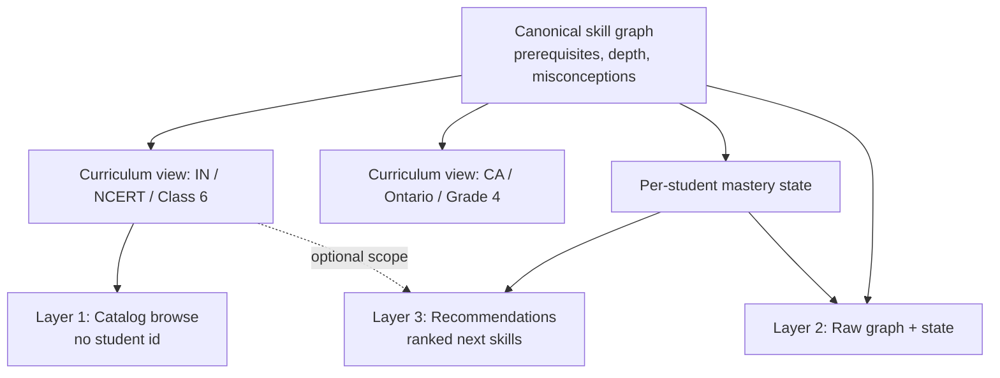
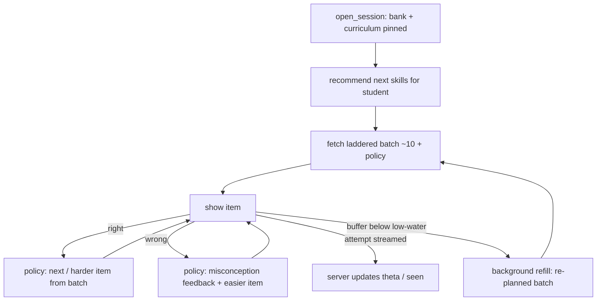
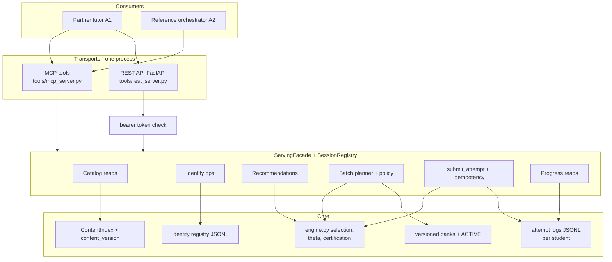

# Partner Access Layer - Plan

## Goal Capsule

- **Objective:** Extend Mathiqo's serving surface so external AI-tutor partners (and the reference orchestrator) can discover what Mathiqo covers, see what a given student should work on, and run smooth child-facing sessions via a buffered batch protocol — over MCP and a mirrored REST API on the same facade, with a Mathiqo-owned global student identity shared across partner groups.
- **Product authority:** `STRATEGY.md` track 2 (the interface surface). Builds directly on the serving-integrity contract (`docs/plans/2026-07-28-001-feat-serving-integrity-contract-plan.md`); its session pinning, variant-signature seen identity, consumer attribution, and ingest validation are assumed, not reopened.
- **Stop conditions:** Surface a blocker instead of guessing when a change would alter Product Contract scope (R-IDs, KDs) or contradict a session-settled decision; implementation-time detail forks are the executor's judgment.
- **Open blockers:** None.

---

## Product Contract

**Product Contract preservation:** R1–R15, KD1–KD8, A1–A3, F1–F3, AE1–AE5 unchanged from the requirements-only version. Added from planning-time findings and user decisions: R16–R20 (identity, feedback content, protocol safety), KD9–KD10, AE6–AE9; the former Outstanding Questions (ladder composition, batch cap, policy format, chapter representation, REST stack) are resolved in the Planning Contract.

### Summary

Add a three-layer discovery surface (curriculum catalog, raw graph + student state, per-student recommendations) and replace all-unseen candidate dumps with a server-planned, difficulty-laddered batch protocol (~10 items, versioned branching policy, background low-water refill). Students get a Mathiqo-issued global identity that multiple partner groups can link to, sharing one mastery record. Every capability is exposed as both MCP tools and REST endpoints over the one serving facade.

### Problem Frame

The MCP server is live but partners cannot find anything through it: no tool lists what curricula, chapters, or skills Mathiqo covers, and nothing turns a student id into "work on this next" — that intelligence exists in the engine (`orchestrator/engine.py` selection logic) but is unreachable from the facade. On the serving side, `get_candidates` returns every unseen instance for a skill — fully rendered, up to the pool cap — which is far too heavy for an LLM tool-calling consumer, while the alternative (one item per round-trip) would leave a child on an iPad waiting on the network between questions. Student identity is a raw caller-supplied string in a global namespace, which both risks accidental cross-partner collisions and blocks the intended model of one child reachable through multiple groups (parent app, school tutor). No external partner exists yet; the reference orchestrator is being built now and is the first consumer, so the protocol must be adaptable rather than tuned to any single integration.

### Key Decisions

- KD1. **Buffered laddered batch over live per-turn serving** (session-settled: user-directed — chosen over single-item-per-exchange: child-facing smoothness beats item-level freshness, and per-turn survives as the batch-size-1 degenerate case). Governs R8, R12.
- KD2. **The branching rule ships as a small versioned policy object from day one** (session-settled: user-directed — "A + C-lite" chosen over an informal documented convention: small contract cost now keeps the door open to richer offline session bundles later). Governs R10.
- KD3. **Discovery has three layers — curriculum catalog, raw graph + state, recommendations** (session-settled: user-directed — "both layers" chosen over recommendation-only or raw-only, with the student-independent catalog layer added after the chapter-browsing case surfaced). Governs R1–R6.
- KD4. **Pedagogical intelligence stays server-side; partners render and report** (session-settled: user-directed — "heart of intelligence with Mathiqo": the server plans batches, ranks skills, and authors the branching policy; partners execute). Governs R7, R8, R10.
- KD5. **Seen means attempted; delivery is free** (session-settled: user-approved — verified that the facade already never marks seen at delivery; the contract states the rule so prefetched-but-unattempted items return to the pool). Governs R11.
- KD6. **Full rendered items — including answers and misconception-tagged distractors — ship in batch payloads** (session-settled: user-approved with the exposure trade-off surfaced: instant local feedback requires it, and v1's trusted-credentialed-partner assumption covers the risk). Governs R9.
- KD7. **REST mirrors MCP over the same facade, both directions** (session-settled: user-approved — extends the existing parity rule: every facade operation appears on both transports; neither transport grows surface the facade does not own). Governs R14, R15.
- KD8. **The canonical skill graph stays curriculum-neutral; curricula are views** — NCERT, Ontario, and future boards map onto canonical skills per the core design's country-mapping layer; the student model never forks per curriculum. Governs R2, R6.
- KD9. **Students have a Mathiqo-issued global identity with per-group links** (session-settled: user-directed — chosen over per-consumer namespacing and email-as-id: one child keeps one mastery record across parent and school groups; opaque ids keep PII out of the serving path and append-only audit log; email and family codes are registration-time lookup attributes only). Governs R16, R17.
- KD10. **Child-facing misconception feedback is authored content, in scope now** (session-settled: user-directed — chosen over stubbing: the instant-feedback flow is a headline product behavior and must ship with real text for every existing misconception). Governs R18.



### Actors

- A1. **Partner tutor orchestrator** — an external AI tutor (typically an LLM tool-calling agent) that consumes discovery and serving on behalf of its own child-facing product.
- A2. **Reference orchestrator** — Mathiqo's own consumer app; first user of this surface and proof that it suffices, with capability parity to A1.
- A3. **Child learner** — answers questions on a partner's device (iPad-class); never talks to Mathiqo directly; must never wait on a round-trip between questions.

### Requirements

**Discovery — curriculum catalog (student-independent)**

- R1. A consumer can enumerate what Mathiqo covers by curriculum: countries, curricula, grades, and the chapters/units within a grade (e.g., "Class 6 NCERT, India" returns its chapter list).
- R2. Chapters/units have structured identity in the curriculum mapping — a consumer never parses free-text syllabus references to build a chapter list. Covers KD8.
- R3. For each chapter/unit, a consumer can list the mapped skills with curriculum-local presentation: learning objective, depth expectation, and terminology overrides from the mapping layer.

**Discovery — raw graph and student state**

- R4. A consumer can read the canonical skill graph: skills with prerequisites, depth axis, strand, and associated misconceptions.
- R5. A consumer can read a student's per-skill state (theta, certified depth, certification status, seen count) — the existing progress read, unchanged in shape.

**Discovery — recommendations**

- R6. Given a student id, a consumer can request a short ranked list of ready-to-learn skills (mastery + prerequisite closure), optionally scoped to a curriculum, grade, or chapter, with a stated reason per entry.
- R7. Recommendations expose the same selection intelligence the internal engine uses — the partner path and the internal path cannot diverge pedagogically.

**Batch serving**

- R8. A session batch request returns a server-planned, difficulty-laddered working set — default about 10 items spanning easier, target, and harder items plus misconception follow-ups — with the count partner-tunable between 1 and a server-enforced cap; batch size 1 yields per-turn behavior.
- R9. Batch items are fully rendered — stem, answer, misconception-tagged distractors, hints — so a wrong answer surfaces its misconception feedback and a right answer surfaces the next item with zero mid-batch round-trips.
- R10. Each batch carries a versioned branching policy object that tells the client how to select the next item locally (right → harder, wrong → easier or misconception follow-up); the policy is authored by the server and small enough to execute trivially.
- R11. Seen-state derives from attempts, not delivery: items delivered but never attempted return to the pool and are eligible for future batches.
- R12. Refill is explicit in the protocol: the batch names its low-water threshold, refill requests are background operations the child never waits on, and each refill is re-planned from the student's updated state.
- R13. Pool edge cases are explicit signals, not empty payloads: exhaustion returns the existing least-recently-seen repeat with its warning; an empty pool for a skill, an unknown skill id, and "nothing further for this skill" are each distinct explicit signals.

**Transport**

- R14. Every capability in this contract is available over both MCP and REST, resolving to the same facade operations — the existing parity rule extended to the new surface.
- R15. All new responses are versioned and schema-backed: catalog responses name the content version, batches name the pinned bank version (existing), and policy objects carry their own version.

**Identity**

- R16. Mathiqo issues opaque global student ids at registration; lookup attributes (guardian email, family code, school reference) are held in the identity registry only — never in the serving path or attempt log.
- R17. Access to a student requires a link: the registering consumer is linked automatically; other consumers link explicitly; unlinked reads and writes are refused. One student keeps one mastery record across all linked groups.
- R18. Every misconception referenced by a served distractor has authored child-facing feedback text, delivered with the batch so a wrong answer shows it instantly.

**Protocol safety**

- R19. Attempt submission is retry-safe: resubmitting the same attempt returns the original outcome without double-applying any state change.
- R20. At most one serving session (the batch/attempt flow of F2) is active per student at a time; a concurrent open from a different consumer is refused with an explicit conflict signal rather than silently forking state, while progress and recommendation reads (R5, R6) never require a live session and so are never blocked by this rule.

### Key Flows

- F1. **Catalog browse (no student).**
  - **Trigger:** A partner integrating Mathiqo wants to show "Class 6 NCERT" chapters to an Indian family.
  - **Steps:** Enumerate curricula → pick IN/NCERT/grade 6 → get chapter list → get skills per chapter with local terminology.
  - **Covers:** R1, R2, R3.
- F2. **Tutoring session loop.**
  - **Trigger:** A child starts practice in a partner's app.
  - **Steps:** Open session with curriculum context (bank pins) → request recommendation for the student → fetch a laddered batch for the chosen skill → client branches locally per the policy as the child answers, streaming attempts back → unshown items drop below the low-water mark → background refill re-planned from updated theta → session closes; unattempted items were never marked seen.
  - **Covers:** R6, R8–R13, R20.



- F3. **Wrong answer, instant diagnosis.**
  - **Trigger:** Child picks a distractor.
  - **Steps:** Client matches the distractor's misconception tag against the batch's feedback sidecar → shows the child-facing feedback immediately → policy directs to an easier item or misconception follow-up from the buffer. No network involved before the child sees a response.
  - **Covers:** R9, R10, R18.
- F4. **Second group joins a student.**
  - **Trigger:** A school's tutor wants to work with a child already registered by the parent app.
  - **Steps:** School consumer looks up the student by registration attributes → links to the student id → opens sessions against the same mastery record; both groups' progress reads reflect all linked-group activity.
  - **Covers:** R16, R17.

### Acceptance Examples

- AE1. **Covers R1–R3.** **Given** a partner with no student context, **when** it asks for Class 6 NCERT (India), **then** it receives a structured chapter list, and for a chapter receives the mapped fraction skills with NCERT terminology ("lowest form") and learning objectives.
- AE2. **Covers R8–R10, R12.** **Given** a batch of 10 with a ladder and policy, **when** the child answers the first three wrong, **then** the client branches to easier items and misconception feedback with zero round-trips, and the next background refill arrives re-planned at lower difficulty.
- AE3. **Covers R11.** **Given** a batch of 10 where the child attempts 6 before the session ends, **then** exactly those 6 count as seen and the other 4 are eligible in future batches.
- AE4. **Covers R8.** **Given** a partner that requests batch size 1, **then** each exchange returns one server-chosen item and the protocol degrades to live per-turn serving without a separate code path.
- AE5. **Covers R13.** **Given** a skill whose pool is exhausted, **then** the response carries the explicit exhaustion signal and least-recently-seen repeat; **given** a skill with an empty pool, **then** a distinct empty-pool signal; **given** an unknown skill id, **then** a distinct unknown-skill signal.
- AE6. **Covers R16, R17.** **Given** a student registered by consumer P, **when** consumer S reads that student's progress before linking, **then** the read is refused; **when** S links and both consumers submit attempts, **then** one merged mastery record reflects both and each attempt carries its submitting consumer's attribution.
- AE7. **Covers R19.** **Given** a `submit_attempt` whose response was lost in transit, **when** the client retries with the same attempt id, **then** the original outcome is returned and theta, seen-state, and the log reflect exactly one attempt.
- AE8. **Covers R18.** **Given** any bank build, **then** every `misconception_id` reachable from any served distractor resolves to child-facing feedback text in the batch sidecar — no distractor can strand a child without feedback.
- AE9. **Covers R20.** **Given** an active serving session for a student, **when** a different consumer opens a second serving session for the same student, **then** the open is refused with the session-conflict signal and the first session is unaffected; **when** the same consumer reopens instead, **then** takeover-on-open closes the prior session and the new one succeeds.

### Success Criteria

- A child mid-session never waits on the network: every next-question and wrong-answer-feedback decision is answerable from data already on the device.
- A partner can build a working tutor without implementing any pedagogy: catalog + recommendations + policy execution suffice.
- External attempt volume (STRATEGY.md metric 3) is measurable per consumer over this surface from day one.

### Scope Boundaries

**Deferred for later**

- Full offline session bundles and a rich branching-policy language — KD2's policy object is deliberately the first step on that road.
- Partner self-serve onboarding, API key issuance/rotation/billing, rate limiting, and public marketplace discovery — v1 remains a small set of known, credentialed partners per the serving-integrity contract, authenticated via startup-configured static tokens (KTD16) rather than a self-service key system.
- Parent-consent UX for cross-group linking; link revocation flows. v1 linking is a credentialed API call between trusted partners (R17); the identity model is designed so consent UX can be added without changing it.
- Identity matching heuristics (fuzzy dedup of the same child registered twice) — v1 lookup is exact-attribute match; duplicates are a manual merge problem until real volume exists.
- Push/webhook or streaming transports; the protocol is request/response.

**Deferred to Follow-Up Work**

- Cross-process session portability (a session opened over REST used from a separate MCP process, or a second consumer served from a separate process) — v1 requires both transports and every consumer to share one process (KTD12, KTD15).
- Session persistence across server restarts; v1 documents the recovery path (KTD4 error codes + resubmission) instead.

**Outside this product's identity**

- Anything generative in the child-facing serve path — batches select from verified banks, never synthesize.
- Per-partner pedagogy forks — one canonical graph, one student model; partners get views and parameters, not divergent intelligence.

### Dependencies / Assumptions

- Depends on the serving-integrity contract as shipped: session bank-pinning, variant-signature seen identity, startup-fixed `consumer_id`, ingest hard-reject validation.
- Assumes the LLM tool-calling agent as the payload-sizing archetype: a batch must fit comfortably in an agent's context alongside its own conversation.
- Assumes v1 partners are trusted and credentialed; shipping answers to the client device (KD6) relies on this, and enforcement stays detect-and-attribute except where a link check (R17) or transport authentication (KTD16) makes refusal cheap.
- Assumes curriculum mapping data (grade placements, chapter assignments) is verified against actual syllabus documents before a partner-facing catalog presents it as authoritative — the mapping files themselves flag current rows as illustrative.
- Assumes `content/fractions/` is the only content pack; loaders treat the pack directory as a parameter so a second pack slots in without protocol change.

---

## Planning Contract

### Key Technical Decisions

- KTD1. **FastAPI for the REST transport** (session-settled: user-directed — chosen over stdlib `http.server` and Starlette-only: auto-generated OpenAPI is partner-facing documentation for free, and the `mcp` SDK already pulls starlette + uvicorn, so the marginal dependency is mostly pydantic). Covers R14.
- KTD2. **Scratch-state batch planning.** The ladder planner clones the session's engine state, uses selection-time marks only to avoid intra-batch duplicates, then discards the clone — durable seen-state stays attempt-derived per R11. The planner builds on the facade's read-only candidate path (`pick_instance`, `_find_easier_instance`, `target_depth`), never on repeated `select_next` calls, whose selection-time `_mark_served` would pre-mark undelivered items and diverge live state from log replay. Each batch item carries a server-assigned `context` (ladder rungs are the planner's pre-materialized stepdown/remediation probes); the client echoes context verbatim and never invents it, so client branching and the engine's server-side diagnosis queues cannot double-diagnose. Covers R7, R8, R11.
- KTD3. **Curriculum context pins at session open.** `open_session` gains required country/curriculum/grade parameters, pinned for the session's life exactly like the bank pin; the engine's ceilings, placement, and recommendations all read the pinned context. This requires re-keying `ContentIndex`'s mapping and placement indexes from `(country, grade)` to `(country, curriculum, grade)` — today's engine collapses two curricula sharing a country/grade last-in-file-wins, which would silently defeat the pin the moment a second board ships in one country (KD8 explicitly names future boards). Session-scoped recommendations are bank-aware: they only rank skills servable from the session's pinned bank, annotating any graph skill the bank cannot serve. Covers R6, R7; KD8's no-fork rule is why the binding is per-session, not per-call.
- KTD4. **Client-supplied attempt ids, durable across sessions.** `submit_attempt` requires an `attempt_id`, persisted on the logged attempt event (not held only in per-session memory); `open_session` seeds the new session's accepted-id map by replaying attempt ids from the student's log, so resubmission after a restart or eviction returns the original outcome instead of double-applying — a purely in-memory, per-session map cannot survive the exact recovery scenario KTD4 exists for. Unknown-session and expired-session are distinct error signals so a client can tell a restart from an eviction; after session loss, buffered attempts resubmit under a new session and validate against their own stamped `bank_version` (the session-less validation path `tools/replay_audit.py` already uses), so a bank repoint between sessions does not silently discard a child's completed work. Covers R19.
- KTD5. **Session delivered-set for refill dedup.** The `Session` object tracks delivered variant signatures in memory; the planner filters against seen ∪ delivered-this-session. The set dies with the session, so R11 holds — unattempted items return to the pool. A refill request asserts all prior attempts for the session have been submitted (stale-theta guard), and a refill response may carry a `supersede` hint telling the client to discard its remaining buffer when the plan materially changed (certification fired, remediation queued). Covers R11, R12.
- KTD6. **Single active serving session per student, with explicit recovery.** The registry check is at open: a same-consumer reopen for a student with a live session takes over (closes the prior session, then opens fresh); a different consumer's reopen returns the `session_conflict` signal, and any linked consumer may close the orphaned session by `student_id` (U5) to recover from a crashed client. Progress and recommendation reads (R5, R6) are session-less (U8) and are never subject to this rule. Covers R20; protects replay-audit parity from interleaved-log theta divergence.
- KTD7. **One closed error-signal taxonomy for both transports.** The signal set (table in High-Level Technical Design) is shared by MCP tool errors and REST responses; REST maps client-fault signals to 4xx with the structured reason in the body, never a bare 5xx. `fetch_batch` supersedes `get_candidates` as the partner serving read; `get_candidates` remains for parity and audit, upgraded to the three-way pool signal (unknown skill / empty pool / exhausted). Covers R13.
- KTD8. **Policy v1 floor.** "Serve the remaining items in listed order" is a valid execution of every policy version, ever; a client declares its maximum supported policy version at session open, and an unrecognized version degrades to the floor instead of failing. Policy is data, not code. Covers R10.
- KTD9. **Content version manifest.** Each content pack gains a manifest carrying `content_version`; loaders surface it on `ContentIndex`, and catalog, graph, and recommendation responses stamp it (batches already stamp `bank_version`). No content-level version exists today — `graph_version` lives only on templates/instances — so this is invented here. Covers R15.
- KTD10. **Structured chapter identity.** Mapping rows gain structured curriculum-unit fields (a stable unit code plus display name), optional per row because some curricula have no chapter granularity (Ontario "Number Sense"); `syllabus_ref` is retained as display text. The mapping schema, `graph_lint` dedup/reference checks, and `engine.MappingRow` widen together. Covers R2, R3.
- KTD11. **Identity registry as an append-only log** (session-settled: user-directed — inherits KD9, chosen over a mutable store: registration and link events append to a registry JSONL and state is derived by replay, mirroring the student-model store pattern, so identity history is auditable the same way mastery is). Lookup attributes live only in this registry; attempt logs and serving payloads carry only the opaque student id. The `consumer_linked` event carries an optional caller-supplied `link_basis` string (e.g. `guardian_authorized`), recorded verbatim and unverified in v1, so link history already carries a consent-provenance field for the deferred consent UX (Scope Boundaries) to populate later without an event-shape change. Covers R16, R17.
- KTD12. **Transports share one facade-owned session registry.** The session dict moves out of the MCP server closure into a registry owned by the facade layer; MCP and REST adapters both bind to it, and v1 runs both in one process so a session is transport-agnostic. Cross-process sessions are explicitly unsupported (documented constraint). Covers R14, R20.
- KTD13. **Dual timestamps on attempts.** Attempts gain an optional client `answered_at`; the server's receive time remains authoritative for ordering and replay, with `answered_at` recorded for interval-sensitive consumers (batch flows put minutes between answering and submission).
- KTD14. **Attempts stamp `batch_id` and `policy_version`.** Two optional fields on the attempt event schema, enabling later policy-adherence audit per consumer under the detect-and-attribute posture.
- KTD15. **Multi-consumer topology: one shared process, per-connection identity.** v1 runs one shared serving process for a deployment, owning the one `SessionRegistry` and identity registry (KTD12); each partner's identity is resolved per-connection from a startup-configured credential table (one static token per partner, KTD16) rather than one process-wide flag — preserving the never-caller-supplied attribution guarantee while letting a shared process serve multiple linked consumers for the same student (F4, AE6). Per-partner processes sharing logs or the registry are explicitly unsupported: two processes cannot see each other's in-memory session or identity state, reproducing the interleaved-log divergence KTD6 exists to prevent. Covers R17, R20; supersedes the single global `--consumer-id` flag inherited from the serving-integrity contract for any deployment with more than one consumer.
- KTD16. **REST caller authentication.** Every REST route requires a bearer token checked by a FastAPI dependency; tokens are the same static per-partner credentials KTD15 uses to resolve per-connection consumer identity — configured at server startup, never a request parameter, matching MCP's never-caller-supplied posture. The server binds `127.0.0.1` by default; any non-local deployment terminates TLS at a fronting proxy. Distinct from the deferred self-serve API-key/billing scope (Scope Boundaries): v1 still authenticates every request, it just does not offer partners a self-service way to mint their own keys. Covers R14.
- KTD17. **Per-session mutex.** The `SessionRegistry` (KTD12) holds one lock per session; every facade operation that reads or mutates a session's state (`submit_attempt`, `fetch_batch`, refill, session-scoped `recommend_next`, `get_progress`) acquires it, so a background refill and a streamed attempt against the same session serialize instead of racing on `engine_state` and the log. Today's stdio MCP transport is serialized per conversation and never surfaced this; the batch protocol's own design — background refill concurrent with streamed attempts — makes it live. Covers R12; protects KTD2's scratch-state discipline from concurrent mutation mid-plan.

### High-Level Technical Design



**Error-signal taxonomy (KTD7):** the closed set both transports share.

| Signal | Meaning | REST status |
|---|---|---|
| `unknown_skill` | skill id not in the graph | 404 |
| `empty_pool` | known skill, bank has no instances | 200 + signal |
| `exhausted` | all instances seen; one LRU repeat returned | 200 + signal |
| `no_further_items` | refill produced nothing new; move to next recommendation | 200 + signal |
| `session_conflict` | student already has an active session | 409 |
| `session_unknown` | session id not in registry (restart) | 404 |
| `session_expired` | session evicted by TTL/cap | 410 |
| `not_linked` | consumer has no link to this student | 403 |
| `ingest_rejected` | attempt failed validation; structured reason | 422 |
| `discarded` | attempt accepted but not logged; reason string | 200 + signal |

**Policy object v1 (directional guidance, not implementation specification):**

```yaml
policy_version: "1.0"
floor: serve_in_listed_order        # valid execution of every version
low_water: 3
rules:
  on_correct: next_at_or_above      # next undelivered item at same or +1 rung
  on_incorrect_tagged: show_feedback_then_easier   # sidecar text, then lower rung / follow-up item
  on_incorrect_untagged: easier
  on_buffer_low: refill_in_background
```

### Assumptions

- One deployment process hosts both transports and all consumers (KTD12, KTD15); per-partner process isolation is explicitly unsupported for any two consumers linked to the same student, since session-conflict and link enforcement are in-memory and per-process.
- Batch sizing defaults live as constants beside the existing pool-cap convention: default batch 10, server cap 20, low-water 3, ladder mix ~6 target / 2 easier / 2 harder-or-follow-up — tunable numbers, not architecture.
- The `fractions` pack's ~12 YAML files carrying `mappings:` lists are the full migration surface for U1 (mapping rows are scattered across topic files, not centralized in `mappings.yaml`).

---

## Implementation Units

| U-ID | Title | Key files | Depends on |
|---|---|---|---|
| U1 | Structured chapter identity | `schemas/mapping.schema.json`, `content/fractions/*.yaml`, `tools/graph_lint.py`, `orchestrator/engine.py` | — |
| U2 | Content version manifest | `content/fractions/manifest.yaml`, `orchestrator/engine.py`, `tools/graph_lint.py` | — |
| U3 | Child-facing misconception feedback | `schemas/misconception.schema.json`, `content/fractions/*.yaml` | — |
| U4 | Student identity registry | `orchestrator/identity.py`, `orchestrator/serving.py` | — |
| U5 | Session hardening | `orchestrator/serving.py`, `tools/mcp_server.py` | U4 |
| U6 | Attempt idempotency + outcomes | `orchestrator/serving.py`, `schemas/attempt-event.schema.json` | U5 |
| U7 | Catalog + graph reads | `orchestrator/catalog.py`, `orchestrator/serving.py` | U1, U2 |
| U8 | Recommendations | `orchestrator/engine.py`, `orchestrator/serving.py` | U1, U5 |
| U9 | Ladder batch planner + policy | `orchestrator/batch.py`, `orchestrator/serving.py` | U2, U3, U5, U8 |
| U10 | Refill semantics + error taxonomy | `orchestrator/batch.py`, `orchestrator/serving.py` | U6, U9 |
| U11 | MCP tools + response schemas | `tools/mcp_server.py`, `schemas/api/` | U7–U10 |
| U12 | REST transport | `tools/rest_server.py`, `requirements.txt` | U11 |
| U13 | Replay audit extension | `tools/replay_audit.py` | U4, U6, U9 |

### Phase A — Content foundations

### U1. Structured chapter identity in curriculum mappings

- **Goal:** Mapping rows carry a structured curriculum unit (code + display name) so chapter lists are data, not string parsing.
- **Requirements:** R2, R3 (KD8, KTD10).
- **Dependencies:** None.
- **Files:** `schemas/mapping.schema.json`, all `content/fractions/*.yaml` files carrying `mappings:` lists (~12), `tools/graph_lint.py`, `orchestrator/engine.py` (`MappingRow`), `tests/test_graph_lint.py`, `tests/test_engine.py`.
- **Approach:**
  1. Add optional structured unit fields to the mapping schema per KTD10; `syllabus_ref` stays as display text.
  2. Migrate NCERT rows (chapters known in prose) and leave Ontario rows unit-less — the schema must accept both.
  3. Extend `graph_lint` dedup/reference checks to unit codes; widen `MappingRow` to carry the new fields plus `learning_objective` and `terminology_overrides` (currently dropped at load; `depth_expectation` is already loaded).
  4. Re-key `ContentIndex.mappings` from `(skill_id, country, grade)` to `(skill_id, country, curriculum, grade)`, and its country/grade skill index to `(country, curriculum, grade)`; thread a `curriculum` parameter through the engine's ceiling, placement, and selection entry points (KTD3's engine-side half).
- **Patterns to follow:** `graph_lint`'s existing `DEDUP_KEY_FIELDS` and jsonschema Draft 2020-12 validation; `additionalProperties: false` convention.
- **Test scenarios:**
  - NCERT mapping row with unit code loads and lint passes; the same row with a duplicate (skill, country, curriculum, grade, unit) key fails dedup.
  - Ontario row without unit fields still validates (optionality).
  - A row whose unit code collides with a different display name in the same curriculum/grade fails lint.
  - `MappingRow` surfaces `learning_objective` and `terminology_overrides` for a migrated row.
  - Two curricula sharing one country/grade resolve independently after re-keying — no collision.
- **Verification:** `graph_lint` clean over migrated content; engine loads the pack without error.

### U2. Content version manifest

- **Goal:** The content pack declares a `content_version` that every catalog-layer response can stamp.
- **Requirements:** R15 (KTD9).
- **Dependencies:** None.
- **Files:** `content/fractions/manifest.yaml` (new), `orchestrator/engine.py` (`load_content`, `ContentIndex`), `tools/graph_lint.py`, `tests/test_engine.py`.
- **Approach:** Manifest carries `content_version` (and pack name); both loaders (`engine.load_content`, `graph_lint.load_content`) read it; `ContentIndex` exposes it; lint fails on a pack without a manifest.
- **Test scenarios:**
  - Pack with manifest → `ContentIndex.content_version` set; pack without → lint error naming the missing manifest.
  - Version string survives the merged multi-file load.
- **Verification:** Existing content tests green; lint enforces the manifest.

### U3. Child-facing misconception feedback content

- **Goal:** Every misconception has authored child-facing feedback text; no served distractor can strand a child without feedback.
- **Requirements:** R18 (KD10).
- **Dependencies:** None.
- **Files:** `schemas/misconception.schema.json`, `content/fractions/misconceptions.yaml`, `content/fractions/fractions-ncert.yaml` (misconception entries), `tools/graph_lint.py`, `tests/test_graph_lint.py`.
- **Approach:** Add a required child-facing i18n feedback field (short, encouraging, names the error concretely — distinct from the author-facing `belief`/`signature_error` and the parent-facing `parent_summary_i18n`); author en-IN text for every existing misconception entry; lint enforces presence.
- **Execution note:** The authored strings are child-facing product content — write them for a 10–12-year-old reader, one or two sentences, no jargon; review them as content, not as fixtures.
- **Test scenarios:**
  - Misconception entry missing the feedback field fails lint.
  - Every misconception id referenced by any distractor in a built bank resolves to feedback text (Covers AE8).
- **Verification:** Lint green; bank build cross-check passes.

### Phase B — Identity and session core

### U4. Student identity registry

- **Goal:** Mathiqo-issued opaque, unguessable student ids with registration attributes and attribute-proven per-consumer links, derived from an append-only registry log.
- **Requirements:** R16, R17 (KD9, KTD11).
- **Dependencies:** None.
- **Files:** `orchestrator/identity.py` (new), `orchestrator/serving.py` (facade ops), `tests/test_identity.py`.
- **Approach:**
  1. Registry JSONL beside the logs dir, created with restrictive file permissions and excluded from any tooling that handles attempt logs (audit export, backup, replay fixtures) — it is the system's only concentration of child-linked PII. Event kinds: `student_registered` (id, attributes, registering consumer), `consumer_linked` (id, linking consumer, optional `link_basis` per KTD11).
  2. State derived by replay into an in-memory index, mirroring `StudentModelStore`'s pattern.
  3. Student ids are generated with cryptographic randomness (matching the existing `sess-{uuid4}` session-id pattern), never sequential or derived from input — the id is safe to appear in every payload and log precisely because it carries no access on its own, so it must not be guessable.
  4. Facade operations: `register_student(attributes) → student_id` (auto-links caller), `link_student(student_id, attributes)` (requires the caller to supply the same registration attributes `find_student` would match — knowing the id alone is not sufficient to link, since the id circulates freely and must never function as a bearer credential), `find_student(attributes)` (exact match), `is_linked(consumer_id, student_id)`.
- **Patterns to follow:** `orchestrator/state.py` replay-derived store; append via the same atomic append discipline as attempt logs; `sess-{uuid4}` id-generation pattern in `tools/mcp_server.py`.
- **Test scenarios:**
  - Register returns a stable opaque id; attributes never appear in the returned serving payloads.
  - Generated ids are not sequential or predictable across registrations.
  - Registering consumer is linked automatically; a second consumer is unlinked until `link_student`.
  - `link_student` with the correct id but wrong attributes is refused.
  - `find_student` exact-matches attributes; no fuzzy matching.
  - Registry replay after process restart reproduces links, including `link_basis` when present.
  - Registry file permissions are restrictive; the registry path is distinct from the attempt-logs directory.
- **Verification:** New test module green; registry file is append-only (no rewrites in the diff).

### U5. Session hardening: curriculum binding, link enforcement, conflict recovery, TTL, concurrency

- **Goal:** Sessions pin curriculum context, enforce links on transport-facing operations without breaking the internal runner, give a crashed or abandoned session an explicit recovery path, and serialize concurrent access to one session's state.
- **Requirements:** R6, R17, R20 (KTD3, KTD6, KTD12, KTD15, KTD17).
- **Dependencies:** U4.
- **Files:** `orchestrator/serving.py` (`Session`, `open_session`, new `SessionRegistry`), `orchestrator/session.py`, `tools/serve.py`, `tools/mcp_server.py`, `tests/test_serving.py`, `tests/test_mcp_server.py`.
- **Approach:**
  1. `open_session` gains required country/curriculum/grade, pinned on `Session`.
  2. The identity registry is an optional `ServingFacade` constructor dependency, matching how `banks_dir`/`logs_dir` are already optional: when configured (every MCP/REST transport deployment), every consumer-facing operation checks `is_linked` first (`not_linked` signal); when absent, link enforcement is skipped entirely. The internal CLI runner (`orchestrator/session.py`, `tools/serve.py`) constructs its facade without an identity registry and keeps working unchanged — it is not a link-gated external transport. All new `Session` fields (curriculum pins, delivered-set, accepted-id map) default such that direct `Session(...)` construction from the internal runner does not break.
  3. Move the session dict into a facade-owned `SessionRegistry` (KTD12, KTD15) with a TTL/cap eviction policy sized as an idle timeout spanning a practice-session gap, not a capacity constant; the registry also owns one per-session lock (KTD17), acquired by every operation that reads or mutates that session's state.
  4. Conflict recovery is explicit, not just a refusal: a same-consumer reopen for a student with a live session performs takeover-on-open (closes the prior session, attribution logged, then opens fresh); a cross-consumer reopen is refused with `session_conflict`, whose payload names the recovery path — the same or another linked consumer may call `close_session` by `student_id` (not just `session_id`, which a crashed client may have lost) to end the orphaned session, logged with the closing consumer's attribution.
  5. Distinct `session_unknown` vs `session_expired` signals (KTD4's recovery contract depends on the distinction).
- **Test scenarios:**
  - Open without a link is refused; after linking it succeeds (Covers AE6).
  - Cross-consumer second open while a session is live → `session_conflict`, naming the recovery path; first session still serves (Covers AE9).
  - Same-consumer reopen while a session is live → takeover-on-open closes the prior session and the new one succeeds.
  - `close_session` by `student_id` from a linked consumer (not the session's opener) ends an orphaned session with that consumer's attribution.
  - Evicted session id → `session_expired`; never-existed id → `session_unknown`.
  - Curriculum context is readable on the session and unchanged by later calls.
  - The internal runner's direct `Session(...)` construction (no identity registry configured) succeeds unchanged — link enforcement never fires.
  - Concurrent `fetch_batch`-triggered refill and `submit_attempt` on the same session serialize on the per-session lock: neither corrupts `engine_state` nor interleaves log appends.
- **Verification:** Existing serving/MCP tests updated for new `open_session` signature and green; internal runner's existing test suite unaffected.

### U6. Attempt idempotency, outcomes, and event stamps

- **Goal:** Retry-safe attempt submission with a fully explicit outcome contract.
- **Requirements:** R19 (KTD4, KTD13, KTD14).
- **Dependencies:** U5.
- **Files:** `orchestrator/serving.py` (`submit_attempt`), `schemas/attempt-event.schema.json`, `orchestrator/ingest.py` (schema knowledge only), `tests/test_serving.py`, `tests/test_ingest.py`.
- **Approach:**
  1. Required client `attempt_id`, persisted on the logged attempt event; `open_session`'s log replay seeds the session's accepted-id map from replayed events' attempt ids (KTD4), so resubmission after session loss replays the original outcome instead of double-applying.
  2. `discarded` outcomes carry a reason string (today's silent `logged: false` invites LLM-client retries).
  3. Attempt events gain `attempt_id` (required) plus optional `answered_at`, `batch_id`, `policy_version` (KTD13, KTD14) — schema delta kept to these four fields.
  4. Post-session-loss resubmission validates against the event's own stamped `bank_version` via the session-less validation path.
- **Patterns to follow:** `ingest.py` structured rejection reasons; `replay_audit.py`'s `validate_event(event, None, …)` for the session-less path.
- **Test scenarios:**
  - Same `attempt_id` submitted twice → identical outcome object, one log line, theta applied once (Covers AE7).
  - Server restart between an attempt's log-append and its response: client resubmits the same `attempt_id` under a new session → original outcome replayed, exactly one log line, theta applied once.
  - Two different attempts, same content, different ids → both logged (idempotency keys on id, not content).
  - Discarded attempt returns a reason; rejected attempt leaves zero trace and the session continues.
  - Resubmission under a new session after ACTIVE moved validates against the stamped bank and is accepted.
  - Events with/without the four fields both validate against the schema.
- **Verification:** Ingest + serving suites green; schema delta limited to the named fields.

### Phase C — Discovery and the batch protocol

### U7. Catalog and skill-graph read layer

- **Goal:** Facade operations for curriculum browse and raw graph reads.
- **Requirements:** R1–R4 (KD3, KTD9, KTD10).
- **Dependencies:** U1, U2.
- **Files:** `orchestrator/catalog.py` (new), `orchestrator/serving.py` (facade methods), `tests/test_catalog.py`.
- **Approach:** Pure reads over `ContentIndex`: `list_curricula` (distinct country/curriculum/grade triples), `list_units(country, curriculum, grade)` (from U1's structured units; curricula without units return skills directly), `list_skills(unit-scope)` with curriculum-local presentation (per R3), `get_skill_graph` (nodes + prerequisites + misconception ids + depth/strand). All responses stamp `content_version`.
- **Test scenarios:**
  - IN/NCERT/6 returns the chapter list from structured units; unit-less Ontario returns its skills without a chapter layer (Covers AE1).
  - Skill list carries terminology overrides and learning objectives.
  - Unknown curriculum/grade → empty result with explicit "not covered" shape, not an error.
  - Every response carries `content_version`.
- **Verification:** New module tests green.

### U8. Recommendations

- **Goal:** Ranked ready-to-learn skills with reasons, sharing the engine's selection intelligence read-only, without requiring the student's only active serving session.
- **Requirements:** R5, R6, R7 (KD4, KTD2, KTD3).
- **Dependencies:** U1, U5.
- **Files:** `orchestrator/engine.py` (extracted ranking function), `orchestrator/serving.py` (facade method, `get_progress` re-scoped), `tests/test_engine.py`, `tests/test_serving.py`.
- **Approach:**
  1. Extract the frontier-eligibility scan (ceiling-capped, prerequisite-gated, least-attempted-first) plus queue heads and placement cursor into a pure ranking function `select_next` also uses — one implementation, two callers (R7).
  2. Facade `recommend_next(student_id, country, curriculum, grade, scope?)` is session-less: it replays the student's log into a scratch engine state (same discipline as KTD2) and ranks read-only, so R20's single-serving-session rule never blocks a second linked consumer from reading recommendations. `get_progress` (R5) is re-scoped the same way — it already replays from the log, so this is a signature change, not a behavior change. Reasons reuse the existing `Serve.reason` vocabulary (`review`/`remediation`/`stepdown`/`prereq_probe`/`placement`/`frontier`).
  3. Bank-aware per KTD3: pass the bank to check against explicitly (a session's pinned bank when called from one, or the caller-supplied bank version otherwise) — skills that bank cannot serve are annotated, not silently ranked.
- **Test scenarios:**
  - Recommendation ranking matches what `select_next` would serve first for the same state (parity check).
  - Recommendation call mutates nothing: repeated calls identical; no seen-marks, no state change.
  - Scope filter to a chapter (Covers U1's structured units) restricts within the given curriculum, never overrides it.
  - A graph skill with no instances in the checked bank appears annotated as unservable.
  - A second linked consumer can read recommendations and progress for a student whose serving session is held by the first consumer (Covers F4's "both groups" progress reads).
- **Verification:** Engine + serving suites green; parity test asserts the shared ranking function has exactly two callers.

### U9. Ladder batch planner and policy object

- **Goal:** Server-planned laddered batches with the versioned policy and feedback sidecar.
- **Requirements:** R8, R9, R10, R11, R18 (KD1, KD2, KD6, KTD2, KTD8).
- **Dependencies:** U2, U3, U5, U8.
- **Files:** `orchestrator/batch.py` (new), `orchestrator/serving.py` (facade `fetch_batch`), `orchestrator/constants.py` (batch constants), `tests/test_batch.py`.
- **Approach:**
  1. Plan against a scratch clone of engine state per KTD2; compose the ladder from `target_depth`/`pick_instance`/`_find_easier_instance` with the Assumptions' default mix; assign per-item `context`.
  2. Batch response: `batch_id`, ordered items, ladder rung per item, policy v1 object (KTD8), low-water threshold, feedback sidecar (`misconception_id → child feedback text` for every misconception reachable from included distractors), `bank_version` + `content_version`.
  3. Filter candidates against seen ∪ session delivered-set (KTD5); record delivered signatures on the session.
  4. Batch size 1 must flow through the same planner (per-turn degenerate case, R8).
- **Technical design:** Policy v1 sketch in High-Level Technical Design — directional guidance, not implementation specification.
- **Test scenarios:**
  - Default batch: ~10 items spanning rungs, every item unseen and undelivered, contexts server-assigned.
  - Planning twice without attempts never repeats an item (delivered-set); durable seen-state unchanged by planning (scratch-state discipline).
  - Sidecar covers exactly the misconceptions reachable from included distractors (Covers AE8).
  - Batch size 1 returns one item through the same code path (Covers AE4).
  - Small pool returns a short batch with explicit `count_returned`, not padding or repeats.
- **Verification:** New module tests green; a replay of a batch session's log reproduces the same progress summary as live state (scratch-state proof).

### U10. Refill semantics and the error-signal taxonomy

- **Goal:** Explicit refill contract and the closed signal set both transports share.
- **Requirements:** R12, R13 (KTD5, KTD7).
- **Dependencies:** U6, U9.
- **Files:** `orchestrator/batch.py`, `orchestrator/serving.py`, `tests/test_batch.py`, `tests/test_serving.py`.
- **Approach:**
  1. Refill request carries the flush assertion (KTD5) and returns a re-planned batch honoring the delivered-set; `supersede` hint when the plan materially changed.
  2. Implement the KTD7 taxonomy as a single shared enumeration; upgrade `get_candidates` to the three-way pool signal; exhausted pools cap batches at the one LRU repeat regardless of requested size.
- **Test scenarios:**
  - Wrong answers lower theta → refill's rungs shift easier (Covers AE2).
  - Refill after certification carries `supersede: true`.
  - Exhausted pool: batch of 10 requested → one LRU repeat + `exhausted`; empty pool → `empty_pool`; typo skill id → `unknown_skill` (Covers AE5).
  - Refill yielding nothing new → `no_further_items`, and a repeat request does not loop.
  - A refill request concurrent with a streamed `submit_attempt` on the same session serializes on the per-session lock (KTD17): neither call observes a torn `engine_state`, and the log has no interleaved appends.
- **Verification:** Batch + serving suites green; taxonomy enumeration has a single definition site.

### Phase D — Transports and audit

### U11. MCP tools, parity, and response schemas

- **Goal:** Every new facade operation is an MCP tool with a schema-backed response.
- **Requirements:** R14, R15 (KD7, KTD15).
- **Dependencies:** U7, U8, U9, U10.
- **Files:** `tools/mcp_server.py`, `schemas/api/` (new response schemas), `tests/test_mcp_server.py`, `tests/test_fixture_schemas.py`.
- **Approach:**
  1. Extend `FACADE_OPERATIONS` and register tools for identity, catalog, graph, recommendation, batch, and refill operations — the parity test enforces facade-method + tuple + tool landing together.
  2. New `schemas/api/*.schema.json` for batch, catalog, recommendation, and identity responses (`$id` + `additionalProperties: false` convention); `_serialize_*` builders validated against them in tests.
  3. Error signals map to `ToolError` with structured reasons, no filesystem paths (existing convention).
  4. Per KTD15, resolve the calling consumer's identity from the startup credential table rather than the single process-wide flag.
- **Test scenarios:**
  - Parity test passes with the extended tuple (every tool ↔ facade method).
  - Each new tool's response validates against its schema (shape-lock tests).
  - `not_linked`, `session_conflict`, `ingest_rejected` surface as `ToolError` with the taxonomy signal name and no paths.
  - `consumer_id` remains unforgeable through every new tool's parameters.
  - PII canary: register a student with sentinel attributes, exercise every error-taxonomy signal plus a batch and progress read; the sentinel never appears in any tool response or `ToolError` message.
- **Verification:** `tests/test_mcp_server.py` green under `pytest.importorskip("mcp")`.

### U12. REST transport

- **Goal:** FastAPI app mirroring every MCP capability over the shared facade and session registry, with every route authenticated.
- **Requirements:** R14, R15 (KTD1, KTD7, KTD12, KTD15, KTD16).
- **Dependencies:** U11.
- **Files:** `tools/rest_server.py` (new), `requirements.txt` (fastapi), `tests/test_rest_server.py`, `README.md` (run instructions, including bearer-token configuration).
- **Approach:**
  1. One route per facade operation, binding the same `SessionRegistry` and facade instance (KTD12, KTD15); every route requires a bearer-token dependency (KTD16), which resolves the per-connection consumer identity from the startup credential table.
  2. Error taxonomy → status codes per the KTD7 table, structured reason in the body.
  3. OpenAPI served from the app; response models generated from the same contract the `schemas/api/` files declare (single source of truth stays the schema files — a test asserts agreement rather than hand-syncing).
- **Execution note:** Mostly transport plumbing; prefer an in-process test client and endpoint smoke coverage over re-testing facade logic.
- **Test scenarios:**
  - Session opened over REST is usable over a same-process MCP call (shared registry).
  - Each error signal returns its mapped status with the reason body.
  - A request with no token, or the wrong token, is refused with 401 before reaching the facade.
  - The configured token never appears in the OpenAPI document, a response body, or a log line.
  - OpenAPI document lists every facade operation (parity at the transport level).
  - PII canary: the same sentinel-attribute check from U11, run over every REST error response and the OpenAPI document.
  - Suite skips cleanly when fastapi is absent (`pytest.importorskip` discipline).
- **Verification:** REST suite green with fastapi installed; full suite still green without it.

### U13. Replay audit extension

- **Goal:** The audit tool covers the new surface: identity-aware paths and theta-interleaving detection.
- **Requirements:** R11; serving-integrity parity (KD5, KTD6).
- **Dependencies:** U4, U6, U9.
- **Files:** `tools/replay_audit.py`, `tests/test_replay_audit.py`.
- **Approach:** Audit reads the identity registry to resolve students; add a cross-check that each event's stamped `theta_before`/`theta_after` matches sequential replay of the log — catches any interleaving corruption class the session-conflict guard is meant to prevent, and proves batch sessions replay identically to live state.
- **Test scenarios:**
  - Batch-session fixture log replays to the same progress summary the live facade reported.
  - A hand-corrupted log with out-of-order theta stamps is flagged.
  - Unattempted delivered items appear nowhere in the replayed seen-state (Covers AE3).
- **Verification:** Audit suite green; audit run over a real recorded session fixture passes.

---

## Verification Contract

| Gate | Command | Applies to |
|---|---|---|
| Full test suite | `.venv/bin/python -m pytest tests/ -q` | every unit |
| Content lint | `.venv/bin/python tools/graph_lint.py content/fractions` | U1, U2, U3 |
| Bank build smoke | rebuild the fixture bank via `tools/bank_build.py` and confirm AE8's feedback cross-check | U3, U9 |
| MCP parity | `tests/test_mcp_server.py` (importorskip `mcp`) | U11 |
| REST smoke | `tests/test_rest_server.py` (importorskip `fastapi`) | U12 |
| REST auth | request without/with wrong bearer token → 401, over `tests/test_rest_server.py` | U12 |
| PII canary | sentinel-attribute student, every error signal + a batch/progress read, both transports — sentinel never surfaces | U4, U11, U12 |
| Replay audit | `tools/replay_audit.py` over a recorded batch-session fixture | U9, U13 |

Quality gates: the parity test's tuple discipline (facade method + `FACADE_OPERATIONS` + tool land together) holds for every new operation; the suite stays green with neither `mcp` nor `fastapi` installed (importorskip discipline); no PII (registration attributes) appears in any serving payload, attempt log, or error message, enforced by the PII canary gate above.

---

## Definition of Done

- All thirteen units implemented in dependency order; every per-unit verification passes.
- Full suite green; content lint green over migrated mappings; replay audit reproduces a batch session's progress from the log alone.
- Every AE (AE1–AE9) is enforced by at least one test.
- OpenAPI is served by the REST app and covers every facade operation.
- `README.md` documents running both transports (including REST bearer-token configuration) and registering/linking a student.
- Abandoned-attempt code from dead-end approaches is removed — the diff contains only the shipped design.

---

<!-- ce-section: work-relationships -->
## How This Work Fits Together

This plan owns the partner access layer: identity, discovery, and the batch serving protocol over MCP and REST. The surrounding breakdown is the current understanding, not a committed roadmap.

- Depends on: the serving-integrity contract (shipped) for sessions, seen identity, attribution, and ingest validation.
- Enables: the reference orchestrator's session UX (in progress separately) — it should consume this protocol rather than private interfaces, exercising the parity rule.
- Enables: future offline session bundles (grow KTD8's policy into a policy language) and parent-consent flows for linking (identity model already shaped for it).
- Can proceed independently of: content-track work (templates per strand, additional curricula) — new mappings become catalog entries without protocol change.
- Still to decide: whether recommendation quality (ranking beyond the current priority chain) becomes its own later plan once real partner traffic exists.

---

## Sources / Research

- `tools/mcp_server.py` — five facade operations plus `server_info`; `FACADE_OPERATIONS` parity tuple enforced by `tests/test_mcp_server.py`; `ToolError` conventions; `--consumer-id` fixed process-wide at startup, never caller-supplied — the constraint KTD15 and KTD16 make explicit for multi-consumer, network-exposed deployments.
- `orchestrator/serving.py` — `get_candidates` is read-only at delivery (seen folds in on accepted attempts only); `CandidatesResult` empty-pool ambiguity; per-student JSONL logs replayed at `open_session`.
- `orchestrator/engine.py` — `select_next` priority chain with `candidates_for_skill` injection hook; `target_depth`/`TIER_DEPTH`/`CHALLENGE_OFFSET` difficulty anchors; `pick_instance` + `_find_easier_instance` ladder primitives; frontier scan (ceiling-capped, prerequisite-gated); selection-time `_mark_served` — the reason KTD2 forbids batch planning through `select_next`.
- `orchestrator/state.py`, `orchestrator/ingest.py` — replay-derived store pattern (KTD11's template); structured rejection reasons; session-less validation used by `tools/replay_audit.py`.
- `content/fractions/mappings.yaml` and sibling topic files — mapping rows scattered across ~12 files; free-text `syllabus_ref`; Ontario rows lack chapter granularity (KTD10's optionality).
- `schemas/` — 8 content/event schemas, jsonschema Draft 2020-12, `additionalProperties: false`; no response schemas exist yet (U11 creates the category).
- `tests/conftest.py` — session-scoped real-content and real-bank fixtures; `pytest.importorskip` discipline for optional dependencies.
- `STRATEGY.md` — track 2 mandate and the external-attempt-volume metric.
- `docs/plans/2026-07-28-001-feat-serving-integrity-contract-plan.md` — parity rule, trusted-partner v1 posture, consumer attribution.
