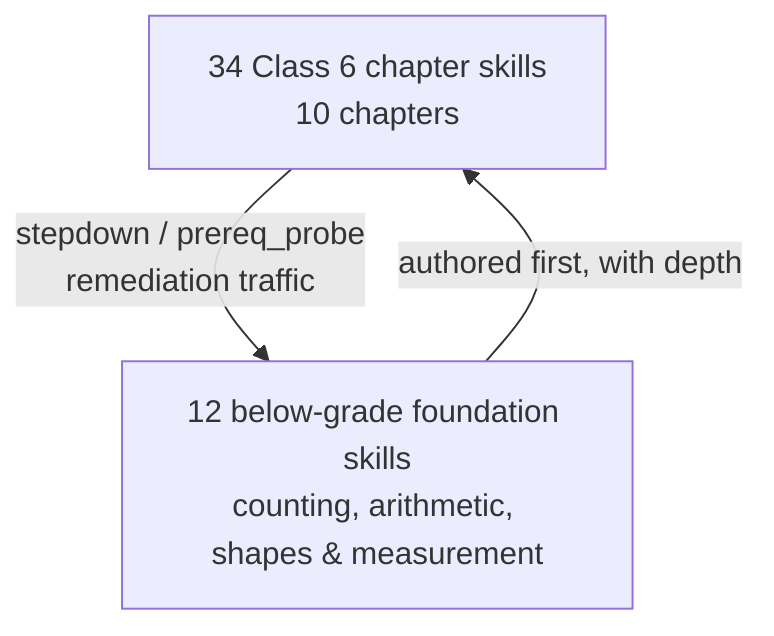
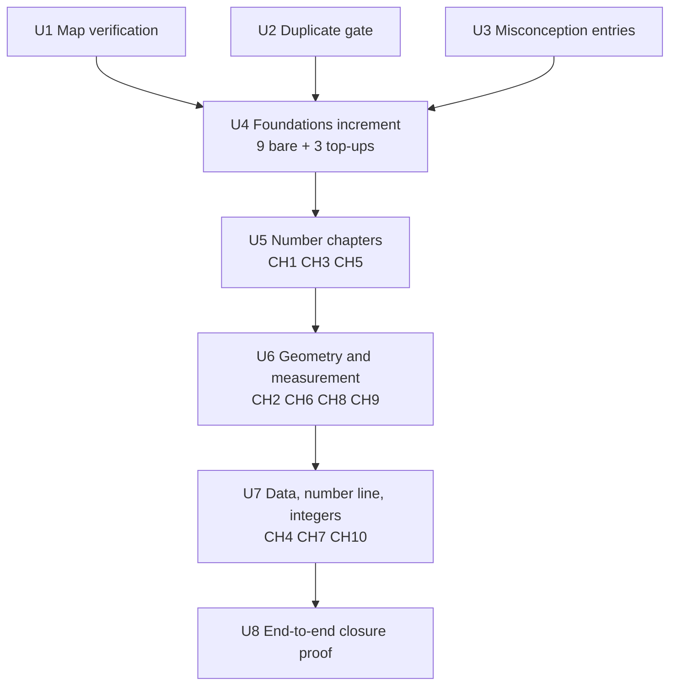

# Class 6 Servable Coverage - Plan

## Goal Capsule

- **Objective:** make IN/NCERT Class 6 fully servable end-to-end — author verified templates for the 36 bare skills in its prerequisite closure, traffic-weighted and bottom-up, delivered as incremental bank builds — so a partner evaluating the integration surface can run one class end to end.
- **Product authority:** `STRATEGY.md` track 1 (content & graph coverage). This plan deliberately overrides `mathiqo-qb-core-design.md`'s §4 sequencing rule ("scale horizontally only after Stage 6 has run on real students") — see KD1. Surrounding Track 1 areas (pipeline throughput, new curricula, diagnostic depth on already-servable content) are not active scope.
- **Open blockers:** none.

---

## Product Contract

### Summary

Author verified item templates for every skill in the Class 6 NCERT prerequisite closure that has none today (36 of 46), weighted by engine traffic rather than syllabus position: the 12 below-grade foundation skills get depth and difficulty spread first, chapter-leaf skills get a thinner floor. Shipped as incremental Stage 3-verified bank builds, with the duplicate-detection gate closed before the volume lands.

### Problem Frame

The partner access layer shipped this week and partner integration is in progress, but the catalog it exposes overstates what the bank can teach: `list_skills` advertises all 46 skills in the Class 6 closure while only 10 have any templates — every non-fractions chapter is essentially unservable, and `recommend_next` returns most of Class 6 flagged `unservable`. For a product positioned as a trust layer, the advertised-versus-servable gap is the credibility problem, not just a content gap.

Thin coverage also degrades the adaptive protocol itself: `orchestrator/batch.py` documents that current content has at most two difficulty tiers per skill, so `fetch_batch`'s target/harder/easier ladder collapses into same-difficulty items. Coverage work must widen difficulty spread, not just fill skill slots.

### Key Decisions

- KD1. **Partner-evaluation breadth over telemetry-first sequencing** (session-settled: user-directed — chosen over the design doc's "Stage 6 before scaling" order: partner integration is in progress and needs real coverage to evaluate). Governs R2, R11.
- KD2. **Scope is the Class 6 NCERT prerequisite closure, not the whole catalog or lower grades as products** (session-settled: user-directed — chosen over full Class 1–5 coverage: the closure is exactly the down-graph the engine can reach from Class 6, so a struggling student is fully served without authoring content no Class 6 path touches). Governs R2, R9.
- KD3. **Traffic-weighted depth, authored bottom-up** (session-settled: user-directed — chosen over a uniform per-skill floor and over chapter-vertical slices: below-grade foundations absorb stepdown/prereq-probe traffic from every chapter, so depth there improves all ten chapters at once). Governs R3, R4, R9.
- KD4. **Visual stems through the existing answer model now; construct/draw response models deferred** (session-settled: user-directed — narrowed from a full question-type extension: figure-based items fit `mcq_4`/`numeric_entry` today, and new answer models would force an item-instance/attempt-event contract change mid-partner-integration). Governs R7, R8.
- KD5. **Close the duplicate-detection stub before bulk authoring lands** (session-settled: user-approved — dedup is only meaningful against a corpus; retrofitting it after ~180 templates means rework instead of prevention). Governs R6.
- KD6. **Verify the Class 6 map against the textbooks before authoring at scale** (session-settled: user-approved — the map defining "done" is flagged in its own commit as illustrative pending verification; authoring against an unverified map is the expensive way to find a mapping error). Governs R1.

### Requirements

**Map verification**

- R1. Before bulk authoring begins, the Class 6 NCERT mapping (34 skills across 10 chapters) is verified against the actual textbook chapter content; corrections land as mapping updates with a `content_version` bump.

**Servable coverage**

- R2. Every skill in the Class 6 prerequisite closure (46 skills, of which 36 are bare today) is servable from the active bank via the existing `mcq_4`/`numeric_entry` types — no skill reachable by a Class 6 session returns `empty_pool` or `unservable`.
- R3. The 12 below-grade foundation skills carry depth: enough templates to span at least two distinct difficulty tiers each, so `fetch_batch`'s target and harder rungs draw from genuinely different difficulty values.
- R4. Chapter-leaf skills meet a thinner per-skill floor; exact per-skill counts and tier distribution are planning-tunable within the design doc's 5–15-per-skill band.

**Diagnostic integrity**

- R5. Every authored distractor is tagged with a misconception; the seven closure skills with no misconception entry today (GEO.CONSTRUCT.BASIC, GEO.POLYGON.PROPS, GEO.SYM.ROTATIONAL, MEAS.PERIMETER, NUM.COUNT, NUM.MULT, NUM.MULT.TABLES) get registry entries — including child-facing feedback text — alongside their first templates.
- R6. The embedding-duplicates check in the Stage 3 gate (stubbed today) is implemented and enforced before the bulk of new templates lands; a drafted template that near-duplicates existing bank content is flagged before promotion.

**Visual stems**

- R7. Skills whose items need a figure (symmetry, shapes, angles, graphs — roughly nine skills) are authored with visual stems served through the existing answer model; no new answer types, no item-instance or attempt-event contract change.
- R8. For skills whose full objective includes constructing or drawing (ruler-and-compass construction, drawing graphs), the curriculum-local `learning_objective` text reflects what is actually assessed — the concept, not the construction — so the catalog does not overstate coverage while the response-model follow-on is pending.

**Delivery**

- R9. Authoring proceeds bottom-up: the foundation tier first, then chapter skills in prerequisite order; every increment ships as a Stage 3-verified bank build activated through the existing activation flow.
- R10. Catalog and bank stay consistent at every increment: mapping or misconception changes bump `content_version`, and each new build gets its own `bank_version`.
- R11. Done means a partner can run Class 6 end to end: `recommend_next` for (IN, NCERT, 6) contains zero `unservable` entries, and every chapter's skills serve real items through `fetch_batch`.

### Key Flows

- F1. Authoring increment
  - **Trigger:** the next tier or chapter batch is selected per R9's ordering.
  - **Steps:** Stage 2 drafts templates for the batch's skills (misconception entries first where R5 requires them) → Stage 3 verifies every template including the R6 duplicate check → human review promotes into the content tree → Stage 5 builds a new versioned bank → activation repoints ACTIVE.
  - **Outcome:** the advertised catalog and the servable bank agree for every skill shipped so far; partners see the increment without any contract change.
  - **Covers:** R5, R6, R9, R10.

### Acceptance Examples

- AE1. **Covers R2, R9.** Given a Class 6 student failing target-rung items mid-chapter, when the engine queues a step-down or prerequisite probe into a below-grade skill, then a verified item is served — never an `empty_pool`/`unservable` dead end.
- AE2. **Covers R11.** Given the full scope is shipped, when a partner calls `recommend_next` for (IN, NCERT, 6), then every entry has `unservable: false`.
- AE3. **Covers R3.** Given a foundation skill (e.g., NUM.ADD.SUB) after its increment ships, when a partner fetches a default-size batch, then the target and harder rungs contain items with different difficulty values.
- AE4. **Covers R6.** Given a drafted template that near-duplicates an existing bank item, when Stage 3 runs, then the draft is flagged before promotion rather than discovered in the bank later.
- AE5. **Covers R7.** Given a symmetry item with a figure in its stem, when it is served over MCP or REST, then it flows through the existing item-instance shape and a partner renders it with no new fields.
- AE6. **Covers R1.** Given map verification finds a chapter mismatch, when the mapping is corrected, then the fix lands with a `content_version` bump before that chapter's templates are authored.

### Success Criteria

- Every skill `list_skills` advertises for (IN, NCERT, 6) is servable — the advertised-versus-servable gap is zero for Class 6.
- Total authored volume lands in the design doc's whole-slice band (~150–300 templates), weighted toward foundations per KD3.
- A partner-run adaptive session exercises a real difficulty ladder on foundation skills (AE3), not same-tier items with different numbers.

### Scope Boundaries

- **Deferred for later:** new answer models (`drag_and_drop`, ordering, matching) and the item-instance/attempt-event contract change they force — a named follow-on that should land before the partner contract stabilizes; genuine construct/draw assessment depends on it. Class 1–5 as full servable products. Stage 6 telemetry/calibration. The `language_level_vs_grade` Stage 3 stub.
- **Not this work:** authoring-pipeline throughput tooling (Stage 1–5 scaling); new countries/curricula; diagnostic-depth work on already-servable fractions skills beyond R5's six registry entries.

<!-- ce-section: work-relationships -->
### How This Work Fits Together

This plan owns closing the Class 6 servable gap. The broader Track 1 breakdown below is the current understanding, not a committed roadmap:

- **Authoring-pipeline throughput** — can proceed independently; learnings from this plan's ~215-template volume will size whether it is needed at all.
- **Diagnostic depth on servable content** — shares the misconception registry this plan extends; still to decide when it becomes its own effort.
- **New curricula/grades** — enabled by this plan's pattern (closure-scoped, traffic-weighted authoring); depends on nothing here beyond the pattern.
- **Construct/draw response models** — enabled by the R7/R8 boundary; should be scheduled against partner-contract stability (cheapest before any partner integrates).
- **Stage 6 telemetry** — still to decide; its ordering relative to content scaling was deliberately overridden by KD1, not resolved.

### Dependencies / Assumptions

- NCERT textbook content (or authoritative chapter lists) is obtainable for R1; the current mapping's source excerpts are flagged illustrative in commit 252c3c5.
- The existing skill graph is adequate — the closure covers scope with no new Stage 1 skill nodes; if R1's verification adds or moves skills, small graph deltas are in scope.
- Existing Stage 2/3 harness throughput is adequate at this volume; the 40-instances-per-template pool cap stands, so supply per skill is template count × cap.

### Outstanding Questions

**Deferred to Planning**

- Exact per-skill template counts and tier distribution (the traffic model behind KD3's weighting).
- Mechanics of visual stems: how figures are represented inside the existing stem/locale-dressing pipeline without a contract change.
- Duplicate-gate mechanism: embedding choice, similarity threshold, and whether the comparison corpus is templates, materialized instances, or both.
- Increment grouping after the foundation tier: tier-by-tier versus chapter batches.

### Sources / Research

- `mathiqo-qb-core-design.md:434` — 5–15 templates per skill (Stage 2); `:461` — whole-slice target ~150–300 templates and the Stage 6 sequencing rule KD1 overrides.
- `orchestrator/batch.py:235` — current content spans at most two difficulty tiers per skill; the ladder-collapse evidence behind R3.
- `tools/item_verify.py:467` — `language_level_vs_grade` and `embedding_duplicates` are skipped v1 stubs; R6 closes the second.
- `tools/bank_build.py:90` — `ALLOWED_QUESTION_TYPES = {mcq_4, numeric_entry}`; `:92` — 40-instance pool cap per template.
- Commit `252c3c5` — landed the 34-skill Class 6 map plus its 12-skill prerequisite closure with zero templates; flags syllabus excerpts as illustrative pending textbook verification.
- Coverage math (computed 2026-07-29): 46 closure skills; 10 with templates (all but two `FRAC.*`); 36 bare; 23 templates total today; only Ch. 7 (fractions) is meaningfully servable at 6/7 skills.
- Bare-skill split by tier: 9 below-grade foundations (GEO.POLYGON.PROPS, GEO.SHAPES.2D, MEAS.LENGTH.UNITS, NUM.ADD.SUB, NUM.CMP.ORDER, NUM.COUNT, NUM.DIV, NUM.MULT, NUM.PATTERN.EXTEND) plus 3 thin-covered foundations needing tier top-ups (FRAC.PARTWHOLE, FRAC.UNIT, NUM.MULT.TABLES); 27 chapter-level bare skills across all 10 chapters (Ch. 7 needs only FRAC.NUMLINE).
- `schemas/item-record.schema.json:219-231` — dormant optional `render` field ("Structured visual spec for early grades (§2.9): render props, not images and not prose") with component library `fraction_circle, fraction_bar, counting_set, number_line, base10_blocks, clock_face`; declared by zero templates, consumed by nothing, absent from item-instance. `diagram_required` (required boolean) is likewise consumed by nothing.
- `tools/bank_build.py:35-38` — "v1 treats each template as exactly one tier ... Do not invent a tier field the schema doesn't have." Difficulty tiers are separate template files per band; `tools/stage2_draft.py:75` maps bands easy/medium/hard → 0.2/0.5/0.8.
- `tools/graph_lint.py:68-71` — near-duplicate skill-name check via `difflib.SequenceMatcher` at threshold 0.85, commented as the sanctioned v1 stand-in for the design doc's embedding-based duplicate detection.

---

## Planning Contract

**Product Contract preservation:** unchanged — enrichment added Sources entries and the sections below; no R/KD text or IDs modified.

### Key Technical Decisions

- KTD1. **Map verification reconciles against the published Ganita Prakash 6 table of contents, keyed on the mapping identity tuple.** Diff the 34 grade-6 rows (identity `(skill_id, country, curriculum, grade, unit_code)`, the same dedup key `tools/graph_lint.py` enforces) against the real textbook's chapter list; replace the illustrative `examples/ncert-*.txt` excerpts with verified chapter lists; fill the placeholder `unit_name` values ("Class 6, Ch. N") with real chapter titles so `list_units` shows partners genuine names. Cites R1.
- KTD2. **The duplicate gate is deterministic composite text-similarity, not a literal embedding index** (session-settled: user-approved — chosen over an embedding dependency: `tools/graph_lint.py:68-71` already establishes `SequenceMatcher`-at-0.85 as the repo's sanctioned stand-in for §3's embedding check, and this repo has zero ML dependencies today). Implement the existing `check_embedding_duplicates(template, bank)` hook: compare each template against the corpus on normalized stem text (variable slots canonicalized), canonical answer expression (sympy-simplified), and shared `skill_ids`; findings produce the existing `FLAGGED_FOR_REGENERATION` verdict, which Stage 4 review adjudicates — never a hard refusal. Corpus channels: a new `--corpus <dir>` flag on `tools/item_verify.py`, the all-templates loop in `tools/bank_build.py` (which already warns on FLAGGED without refusing), and `tools/stage2_draft.py`'s in-memory validation before a draft is accepted. Cites R6; instantiates KD5.
- KTD3. **Difficulty tiers are separate template files per `difficulty_prior` band — never a new tier field** (`tools/bank_build.py:35-38` forbids inventing one). A foundation skill's ≥2 tiers means ≥2 templates spanning distinct bands (easy 0.2 / medium 0.5, hard 0.8 where the skill sensibly supports it), with tier separation expressed through constraint sets per `schemas/item-record.schema.json:142`. Cites R3, R4.
- KTD4. **Figures are precisely-described text inside ordinary stems, with `diagram_required: true` as the annotation** (session-settled: user-approved — chosen over SVG-in-stem or serving the dormant `render` field: either would change what partners must render, breaking R7's no-contract-change promise). Per-strand conventions: data skills present pictograph/bar-graph data as labeled text tables; symmetry/shape skills use named shapes and letters; angle skills use clock-face and turn descriptions; number-line items describe marked positions. The item-record `render` field stays dormant; adopting it rides the construct/draw follow-on named in Scope Boundaries. Cites R7, R8; instantiates KD4.
- KTD5. **Templates are authored directly in this pipeline's format and gated by the same Stage 3 machinery, with each increment shipped as its own reviewable PR** (session-settled: user-approved — the PR review of each authoring increment is Stage 4 human review, which has no other enforcement point in the repo). Every authored template passes `tools/item_verify.py` (including the KTD2 corpus check) before promotion into `content/templates/`; `provenance.reviewer` names the accountable human; a FLAGGED verdict is presented for explicit accept/regenerate in the PR description, mirroring the shipped `TPL.FRAC.ADD.UNLIKE.WORD.001` precedent. Cites R9, R10; instantiates KD3's delivery ordering.
- KTD6. **Volume targets: 8 templates per bare foundation skill, 5 per chapter-leaf skill, tier top-ups for the 3 thin foundations.** 9 bare foundations ×8 ≈ 72, plus ~6 top-up templates to give FRAC.PARTWHOLE, FRAC.UNIT, and NUM.MULT.TABLES a second band, plus 27 chapter skills ×5 = 135 → ~215 new templates, inside the design doc's ~150–300 slice band and its 5–15 per-skill range. Counts are floors an increment may exceed when a skill needs more shapes to span two bands. Every skill's template set includes at least one `numeric_entry` template — the low-guess certification format; an all-`mcq_4` skill can never certify, which stalls frontier progression for everything downstream of it. Cites R2, R3, R4.

### High-Level Technical Design

Delivery is four authoring increments behind three enabling units, each increment a full pipeline pass (draft → verify → review-PR → bank build):

| Increment | Skills | New templates (floor) |
|---|---|---|
| U4 Foundations | 9 bare below-grade + 3 tier top-ups | ~78 |
| U5 Number chapters (CH1, CH3, CH5) | 9 | 45 |
| U6 Geometry/measurement (CH2, CH6, CH8, CH9) | 11 | 55 |
| U7 Data, number line, integers (CH4, CH7, CH10) | 7 | 35 |

---

## Implementation Units

### U1. Verify the Class 6 map against the textbook

- **Goal:** the mapping that defines "done" is verified against the real Ganita Prakash 6 chapter structure before any authoring lands on it.
- **Requirements:** R1 (KD6); KTD1.
- **Dependencies:** none — runs first.
- **Files:** `content/fractions/*.yaml` (mapping rows), `examples/ncert-*-excerpt.txt`, `content/fractions/manifest.yaml`.
- **Approach:**
  1. Obtain the authoritative Ganita Prakash Class 6 table of contents (textbook PDF or NCERT's published contents listing).
  2. Diff chapter numbers, titles, and topic coverage against the 34 grade-6 rows; correct misassigned skills, fill real `unit_name` chapter titles, adjust `syllabus_ref`.
  3. Replace the affected `examples/` excerpts with verified text and remove their "illustrative" caveat.
  4. Bump `content_version` in `content/fractions/manifest.yaml`.
- **Patterns to follow:** mapping row shape at `content/fractions/mappings.yaml:12-23`; dedup identity at `tools/graph_lint.py:54-66`.
- **Test scenarios:**
  - `tools/graph_lint.py` passes with no new errors after corrections.
  - Covers AE6. A corrected chapter assignment lands together with the `content_version` bump in this unit's diff.
  - `list_units` for (IN, NCERT, 6) returns 10 chapters carrying real chapter titles, not "Class 6, Ch. N" placeholders.
- **Verification:** graph_lint clean; mapping diff reviewed against the named source in the PR; `content_version` bumped exactly once.

### U2. Implement the template near-duplicate gate

- **Goal:** near-duplicate templates are flagged at Stage 3 before the authoring volume lands (R6's prevention-not-rework rationale).
- **Requirements:** R6 (KD5); KTD2.
- **Dependencies:** none — parallel with U1.
- **Files:** `tools/item_verify.py`, `tools/bank_build.py`, `tools/stage2_draft.py`, `tests/test_item_verify.py`, `tests/test_bank_build.py`, `tests/test_stage2_draft.py`.
- **Approach:**
  1. Implement `check_embedding_duplicates(template, bank)` per KTD2's composite comparison; drop `embedding_duplicates` from the hardcoded `skipped_checks` list (`tools/item_verify.py:467`) when a corpus is supplied.
  2. Add `--corpus <dir>` to `item_verify.main`; without it the check reports as skipped (back-compatible single-template runs).
  3. Wire the corpus pass into `bank_build`'s existing all-templates loop as a warning (mirroring its FLAGGED tolerance at `tools/bank_build.py:460-465`) and into `stage2_draft`'s in-memory draft validation as a bounce.
- **Execution note:** test-first — the check's threshold behavior is the contract; pin it with failing tests before implementing.
- **Patterns to follow:** `tools/graph_lint.py:313-329` (normalize + `SequenceMatcher` + deterministic ordering); test idiom at `tests/test_item_verify.py:20-31` (fixture copy → break → assert exit code).
- **Test scenarios:**
  - Covers AE4. A template whose normalized stem and canonical answer near-duplicate an existing corpus template exits FLAGGED (2) with both template ids named in `reasons`.
  - Two templates for the same skill at different difficulty bands with distinct stems pass (tier siblings are not duplicates).
  - Identical stem shape under different `skill_ids` is still flagged (catches mis-tagged copies).
  - No `--corpus` flag → check reported in `skipped_checks`, exit unchanged (back-compat).
  - `bank_build` over a corpus containing a near-duplicate pair warns to stderr and still builds.
  - `stage2_draft` bounces a drafted near-duplicate back with the colliding template id in the error report.
- **Verification:** new tests green; full suite green; a dry run over the existing 23 templates produces no false-positive FLAGGED (threshold tuned if it does).

### U3. Misconception entries for the seven uncovered skills

- **Goal:** every skill authored in U4–U7 has at least one misconception with child-facing feedback before its distractors are written.
- **Requirements:** R5.
- **Dependencies:** none — parallel with U1/U2.
- **Files:** the strand files declaring GEO.CONSTRUCT.BASIC, GEO.POLYGON.PROPS, GEO.SYM.ROTATIONAL, MEAS.PERIMETER, NUM.COUNT, NUM.MULT, NUM.MULT.TABLES (`content/fractions/construct.yaml`, `symmetry.yaml`, `lines-angles.yaml`, `measure.yaml`, `arithmetic.yaml`, `skills.yaml`), `content/fractions/manifest.yaml`.
- **Approach:** 1–2 entries per skill following the registry shape at `content/fractions/misconceptions.yaml:5-13` — `belief`, `signature_error`, `remediation_target`, `remediation_asset`, `parent_summary_i18n`, `child_feedback_i18n`. Ground each in a real documented error pattern (e.g. perimeter/area confusion for MEAS.PERIMETER, multiplication-as-repeated-addition-off-by-one for NUM.MULT). Append each new `misconception_id` to its skill node's `misconceptions` list in the same strand file — the Stage 2 drafting flow surfaces misconceptions to distractor authoring only through that node-side list, not the registry.
- **Test scenarios:**
  - graph_lint reference resolution passes (every `remediation_target` names a declared skill).
  - Each new entry carries non-empty `child_feedback_i18n` (the field `fetch_batch`'s feedback sidecar serves).
  - Every U3 skill node lists at least one of the new misconception ids in its own `misconceptions` field.
- **Verification:** graph_lint clean; entries visible in the affected strand files with `content_version` bumped alongside the increment that first serves them.

### U4. Foundations authoring increment

- **Goal:** the below-grade spine every chapter's remediation lands on is deep and tier-spanning — the largest single improvement to real-session behavior.
- **Requirements:** R2, R3, R9 (KD2, KD3); KTD3, KTD5, KTD6. Covers AE1, AE3.
- **Dependencies:** U1, U2, U3.
- **Files:** `content/templates/TPL.*.yaml` (~78 new), `content/fractions/manifest.yaml`, `tests/test_fixture_schemas.py` (extend with a glob-parametrized item-record validation over `content/templates/*.yaml` — the existing glob covers only `content/fractions/`).
- **Approach:**
  1. Author 8 templates each for the 9 bare foundations (NUM.COUNT, NUM.PLACE-adjacent spine: NUM.ADD.SUB, NUM.CMP.ORDER, NUM.MULT, NUM.DIV, NUM.PATTERN.EXTEND, GEO.SHAPES.2D, GEO.POLYGON.PROPS, MEAS.LENGTH.UNITS), spanning easy+medium bands minimum per KTD3, mixing `mcq_4` and `numeric_entry` per skill (numeric_entry is the certification format — every skill needs at least one).
  2. Top up FRAC.PARTWHOLE, FRAC.UNIT, NUM.MULT.TABLES to a second band (~6 templates).
  3. Tag every distractor with a `misconception_id` where a registry entry applies; `null` only for plausible-but-undiagnostic distractors.
  4. Run `item_verify --corpus content/templates` on every template; build an increment bank; ship as one PR (KTD5's Stage 4 review).
- **Execution note:** verify-as-you-author — run the Stage 3 gate per template during drafting, not as a batch at the end; a FLAGGED verdict is a drafting signal, not a cleanup item.
- **Patterns to follow:** two-tier precedent `TPL.FRAC.ADD.UNLIKE.DIRECT.001` (easy/numeric_entry) + `TPL.FRAC.ADD.UNLIKE.WORD.001` (medium/mcq_4/constrained); band midpoints `tools/stage2_draft.py:75`.
- **Test scenarios:**
  - Every new template passes item-record schema validation via a new glob-parametrized test over `content/templates/*.yaml` (added in this unit, mirroring the existing fixture-glob idiom).
  - Covers AE3. On the increment bank, `fetch_batch` for a foundation skill returns target and harder rungs with different `difficulty` values.
  - Covers AE1. A simulated below-grade stepdown from a Class 6 skill serves a real instance (no `empty_pool`).
  - Per-skill: ≥2 distinct `difficulty` values among its templates (assert over the 12 foundations).
- **Verification:** all templates PASS or explicitly accepted-FLAGGED in the PR; bank builds; full suite green.

### U5. Number-chapters authoring increment (CH1, CH3, CH5)

- **Goal:** the number-strand chapters — patterns, estimation, primes/factors — become servable at 5+ templates per skill.
- **Requirements:** R2, R4, R9; KTD3, KTD5, KTD6.
- **Dependencies:** U4.
- **Files:** `content/templates/TPL.*.yaml` (~45 new), `content/fractions/manifest.yaml`.
- **Approach:** author NUM.PARITY, NUM.PATTERN.FIGURATE (CH1); NUM.PLACE.VALUE, NUM.ESTIMATE (CH3); NUM.FACTORS.MULTIPLES, NUM.PRIME, NUM.DIVISIBILITY, NUM.HCF, NUM.PRIME.FACTORISATION (CH5) — 5 each spanning ≥2 bands; same gate-and-PR flow as U4. NUM.LCM (CH5's covered skill) gets a second-band top-up.
- **Test scenarios:**
  - Every CH1/CH3/CH5 skill serves via `get_candidates` on the increment bank (no `empty_pool`).
  - Divisibility/prime templates: answer verified symbolically across the full variable domain (the Stage 3 exhaustive check applies — no scenario needed beyond gate passage, listed here as the acceptance signal).
- **Verification:** same gates as U4.

### U6. Geometry and measurement authoring increment (CH2, CH6, CH8, CH9)

- **Goal:** the visually-grounded chapters become servable through KTD4's text-figure conventions without touching the serving contract.
- **Requirements:** R2, R4, R7, R8, R9; KTD3, KTD4, KTD5, KTD6. Covers AE5.
- **Dependencies:** U5.
- **Files:** `content/templates/TPL.*.yaml` (~55 new), `content/fractions/*.yaml` (R8 `learning_objective` wording for GEO.CONSTRUCT.BASIC), `content/fractions/manifest.yaml`.
- **Approach:** author GEO.POINT.LINE, GEO.ANGLE.CONCEPT, GEO.ANGLE.TYPES, GEO.ANGLE.MEASURE (CH2, clock-face/turn conventions); MEAS.PERIMETER, MEAS.AREA.CONCEPT, MEAS.AREA.FORMULA (CH6); GEO.CIRCLE.PARTS, GEO.CONSTRUCT.BASIC (CH8); GEO.SYM.LINE, GEO.SYM.ROTATIONAL (CH9, named shapes/letters). Set `diagram_required: true` on figure-dependent items. Apply R8's conceptual-only wording to GEO.CONSTRUCT.BASIC's mapping `learning_objective`.
- **Test scenarios:**
  - Covers AE5. A symmetry item with a text-described figure serves over MCP and REST through the unchanged item-instance shape.
  - Angle-measure items: answers derivable from the stem's stated facts alone (no reliance on an absent image) — reviewed per-template in the PR.
  - GEO.CONSTRUCT.BASIC's `learning_objective` names concept-level assessment.
- **Verification:** same gates as U4; R8 wording visible in the mapping diff.

### U7. Data, number-line, and integers authoring increment (CH4, CH7, CH10)

- **Goal:** the remaining chapters close — Class 6 has no bare skill left.
- **Requirements:** R2, R4, R7, R8, R9; KTD3, KTD4, KTD5, KTD6.
- **Dependencies:** U6.
- **Files:** `content/templates/TPL.*.yaml` (~35 new), `content/fractions/*.yaml` (R8 wording for DATA.BARGRAPH/DATA.PICTOGRAPH drawing half), `content/fractions/manifest.yaml`.
- **Approach:** author DATA.COLLECT.TALLY, DATA.PICTOGRAPH, DATA.BARGRAPH (CH4, labeled text-table conventions per KTD4); FRAC.NUMLINE (CH7, described-positions convention); INT.CONCEPT, INT.CMP.ORDER, INT.ADD.SUB (CH10) — 5 each, ≥2 bands; R8 wording for the two data skills whose full objective includes drawing.
- **Test scenarios:**
  - Data items answerable from the text table alone; reading direction unambiguous (PR review point).
  - Integer comparison/addition answers verified across negative ranges by the exhaustive Stage 3 pass (gate passage is the signal).
- **Verification:** same gates as U4.

### U8. End-to-end closure proof

- **Goal:** the Definition of Done is machine-checked, not asserted — a partner-visible proof that Class 6 is fully servable.
- **Requirements:** R2, R3, R10, R11 (KD1, KD2). Covers AE1, AE2, AE3.
- **Dependencies:** U7.
- **Files:** `tests/test_content_coverage.py` (new), `content/fractions/manifest.yaml` if a final bump is due.
- **Approach:**
  1. Build a full bank from all promoted templates; assert every Class 6 closure skill has ≥1 instance pool including at least one low-guess (`numeric_entry`) instance, and every foundation spans ≥2 difficulty values.
  2. Through the facade: `recommend_next` for a fresh student at (IN, NCERT, 6) returns zero `unservable: true` entries (AE2); a simulated failing session steps down into a foundation and is served (AE1); `fetch_batch` tiers differ on a foundation (AE3).
  3. Assert `list_skills`-advertised skills ⊆ servable skills for the Class 6 scope — the catalog-honesty invariant, as a durable regression test.
  4. Assert diagnostic integrity across the template corpus: every `mcq_4` template's distractors each carry a `misconception_id` key, and every non-null value resolves to a registry entry (nulls pass as reviewed-null).
- **Patterns to follow:** simulated-student end-to-end idiom from the existing session-runner E2E test; bank-fixture mixing at `tests/test_bank_build.py:38-40`.
- **Test scenarios:** the three facade assertions above, plus the coverage/tier assertions, each as its own named test.
- **Verification:** `tests/test_content_coverage.py` green against the final bank; full suite green.

---

## Verification Contract

| Gate | Command | Applies to |
|---|---|---|
| Full test suite | `.venv/bin/python -m pytest tests/ -q` | every unit |
| Content lint | `.venv/bin/python tools/graph_lint.py content/fractions` | U1, U3–U7 |
| Template gate (with corpus) | `.venv/bin/python tools/item_verify.py <template> --corpus content/templates` | U4–U7, per new template |
| Bank build | `.venv/bin/python tools/bank_build.py --templates-dir content/templates --out banks --bank-version <vN>` | U4–U8 |
| Closure proof | `.venv/bin/python -m pytest tests/test_content_coverage.py -q` | U8 |

A FLAGGED template verdict is not a gate failure — it requires an explicit accept-or-regenerate decision recorded in the increment's PR (KTD5).

---

## Definition of Done

- `recommend_next` for (IN, NCERT, 6) returns zero `unservable` entries against a bank built from promoted templates (R11, AE2).
- Every Class 6 closure skill has ≥1 template; all 12 foundations span ≥2 difficulty values (R2, R3, AE3).
- The near-duplicate gate is live in Stage 3 (`--corpus` path), with no unadjudicated FLAGGED template in `content/templates/` (R6).
- Every authored distractor carries a `misconception_id` or a reviewed `null`, enforced by U8's corpus assertion; the seven new registry entries exist with child feedback text (R5).
- Mapping corrections and misconception additions each bumped `content_version`; the final bank has its own `bank_version` (R10).
- Full suite green; no abandoned experimental templates or dead code in the final diff.

---

## Deferred / Open Questions

### From 2026-07-29 review

- **Should `list_skills` carry an additive `servable` flag so catalog honesty is immediate rather than U8-gated?** (product-lens, P1) The catalog read path has no servability signal today — only `recommend_next` does — so during the partner-evaluation window that motivates this plan, `list_skills` keeps advertising skills the bank cannot serve until the final increment lands. An additive boolean (backed by the same bank-candidates check `recommend_next` uses) would make honesty immediate and each increment partner-visible. Open because it is a partner-facing contract addition: additive and non-breaking, but it changes what integrators may bind to, and whether it needs partner communication is unresolved. If taken up, it is an enabling unit parallel to U1–U3 plus a schema/docs touch, and U8's catalog-honesty regression test would assert against the flag from the first increment.
