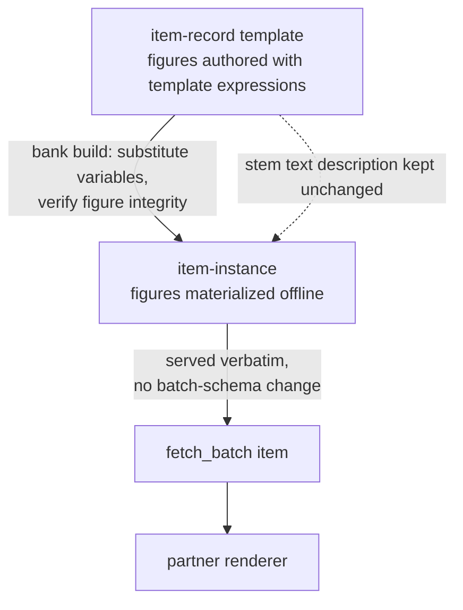

# Partner API Structured Figure Support - Plan

## Goal Capsule

- **Objective:** figure-dependent skills serve through the partner API with machine-renderable figure data — an optional, Mathiqo-owned structured `figures` field on the item schema, covering every figure-dependent template in the audited census — 78 templates, recorded in `docs/plans/2026-08-03-001-figure-census.md`.
- **Product authority:** this plan; `STRATEGY.md` for the select-only and offline-verification constraints. Supersedes the "render stays dormant" clause of KTD4 in `docs/plans/2026-07-29-001-feat-class6-servable-coverage-plan.md`; that plan's KD4 deferral of construct/draw answer models stands.
- **Execution profile:** schema and pipeline changes land first behind the existing test suite; content re-annotation follows in two waves; serving needs no code change. No `template_version` bumps anywhere (KTD3).
- **Stop conditions:** surface rather than guess if (a) the census audit finds a template whose figure cannot be expressed by the kind set even after adding grid/ruler kinds, (b) a figure-integrity rule would require weakening an existing verification gate, or (c) partner review (R12) rejects the union shape.

---

## Product Contract

### Summary

Add an optional `figures` field — one or more Mathiqo-defined, kind-tagged figure objects, seeded from the partner's five proposed kinds and extended to cover all figure-dependent content — authored on item-record templates, materialized offline at bank build behind the verification gate, and served verbatim on every item instance through `fetch_batch`. Every figure-dependent template in the audited census gains structured figures, and the partner-facing docs are updated, closing the partner's Strand D/E gap in one increment.

### Problem Frame

The first consumer of the partner API evaluated routing its app's question serving through `fetch_batch` and found that every response field is text or choice-based. Ontario Strand D (Data) and Strand E (Spatial Sense) skills routinely need a rendered figure alongside the prompt; without figure data in the response, the consumer must re-author visuals per item and pair them to `item_instance_id` themselves — reproducing the authoring cost the API exists to remove. Their stated fallback is to keep visual skills on their local engine permanently.

The gap is real but was a deliberate bet, not an oversight: the Class 6 coverage plan settled figures as precisely-described text inside stems (that plan's KTD4) to avoid a contract change mid-integration, and asserted a partner could render from that text alone (its AE5). The consumer's feedback invalidates that assertion. The figure information exists in the affected templates as precise text; what is missing is machine-readable structure.

### Key Decisions

- KD1. **Mathiqo-owned kind-tagged union as the wire format** (session-settled: user-directed — chosen over adopting the partner's five-kind union verbatim and over activating the dormant component+props `render` field: the only option that is typed enough for external consumers to validate against, expressive enough for the actual content, and owned by the side that owns the contract). Governs R1, R2.
- KD2. **Figures are stimulus-only and strictly additive** (session-settled: user-approved — chosen over extending answer models: preserves the prior plan's construct/draw deferral and keeps the attempt-event contract untouched). Governs R3, R4, R5.
- KD3. **Stems keep their text-described figures; figures never replace stem text** (session-settled: user-directed — chosen over rewording stems to reference the figure: no regression for text-only consumers, TTS, or accessibility; the cost, dual-representation consistency, is carried by verification and Stage 4 review). Governs R6, R9.
- KD4. **The full audited census re-annotates in this increment** (session-settled: user-directed — chosen over a DATA-strand pilot and over the fixed 55: answers the partner's ask completely with no second gap wave, accepting that the audit determines the final template count). Governs R10, R13.
- KD5. **Figures obey the select-only rule: materialized offline behind the verification gate, never constructed at serve time** (per `STRATEGY.md`). Governs R7, R8.
- KD6. **The dormant `render` field is superseded by the figure union**, reversing KTD4's "stays dormant" clause on the strength of first-consumer evidence. Governs R2.



### Requirements

**Contract**

- R1. The item schema carries an optional `figures` field: an array of kind-tagged figure objects covering every shape the audited census needs — the partner's five kinds (bar graph, pictograph, number line, labeled shape, angle) extended per KTD6.
- R2. Absent or null figures mean exactly today's behavior; the addition is non-breaking for consumers that tolerate unknown fields, and the dormant `render` field is removed in the same change.
- R3. Answer models are unchanged: figures appear only in the stimulus, and `mcq_4` / `numeric_entry` remain the response surface.
- R4. The attempt-event contract is untouched.
- R5. Figure data reaches partners through the existing batch response with no separate batch-schema field addition (instances serve verbatim).

**Pipeline and verification**

- R6. Stems keep their precise text description of the figure per the existing per-strand conventions; re-annotation adds figures without rewording the stem.
- R7. Figure values derive from the same template variables as the stem, authored as template expressions — no independently authored numbers. Kind-schema-level layout freedom (e.g., where an off-circle point sits) is sanctioned; authored values that duplicate or contradict variable-derived quantities are not.
- R8. Figures are materialized at bank build; nothing figure-related is computed or assembled at serve time.
- R9. The verification gate machine-checks figure integrity before an instance ships: each figure is well-formed for its kind, its values are consistent with the stem's variable assignment, and the answer-designating label is absent (per-kind leak rule). Label wording vs stem prose is Stage 4 human review, not part of the machine gate.

**Content**

- R10. Every template in the audited figure census (R13) declares structured figures consistent with its stem.
- R13. A census audit walks all templates, flips `diagram_required` to true where the item is genuinely figure-dependent (known candidates: ruler reading, area grid counting, shape rotation, pictorial figurate patterns), and fixes the final kind set before the schema freezes.

**Partner-facing docs and alignment**

- R11. The integration guide and partner deck document the figures field with per-kind schemas, at least one worked example per kind, and the schema-evolution rule stated up front: this is a versioned instance-schema revision, optional-field additions are non-breaking, and a consumer validating against a pinned schema must re-fetch it.
- R12. The union draft is shared with the partner for review before the schema freezes, confirming their five kinds map onto ours without loss and their renderer accepts reflex angles (>180°), clock/protractor contexts, half-symbol pictographs, and multi-figure items.

### Acceptance Examples

- AE1. **Covers R1, R5.** Given a DATA bar-graph template with a materialized instance, when a partner calls `fetch_batch`, then the item carries `figures` with one bar-graph object whose labels and values match the stem's data table, and no batch-level schema changed.
- AE2. **Covers R2.** Given a consumer that ignores unknown fields, when it fetches a figure-bearing item, then every field it already reads is unchanged in meaning and the item remains fully answerable from the stem text.
- AE3. **Covers R3, R4.** Given a student answering a figure-bearing item, when the attempt is submitted, then the attempt event validates against the unchanged attempt-event schema.
- AE4. **Covers R9.** Given a template whose figure expression disagrees with its stem's variables, or whose figure labels the answer value on a read-the-value item, when verification runs, then the template hard-fails and no instance of it ships.
- AE5. **Covers R10, R13.** Given the completed increment, when templates are scanned, then zero templates with `diagram_required: true` lack `figures`, and the audit's annotation flips are included in that census.

### Scope Boundaries

- Construct/draw response models (student draws or constructs an answer) — deferred; the Class 6 coverage plan's KD4 deferral stands.
- Early-grades figure kinds (fraction circles, base-10 blocks as render components) beyond what the audited census needs — deferred until early-grades content is authored.
- The partner's own rendering component — theirs to build; we supply data and examples.
- Serving pre-rendered images or SVG — outside the product's identity: the contract serves render data, never rendered artifacts, for localization and select-only reasons.
- 3D solids: `TPL.NUM.PATTERN.FIGURATE.CUBE.001` (a solid cube of unit cubes) stays text-only and out of the census — the only known exclusion, since a 3D projection kind would serve one template. Name it explicitly in the partner docs so the exclusion is visible rather than discovered.
- Figure support in the Stage 1/Stage 2 drafting prompts is limited to awareness (drafted visual templates must declare figures); richer figure-drafting assistance is follow-up work.

### Dependencies / Assumptions

- Assumption: the partner's renderer can consume a superset of their proposed union; they have offered their rendering component, which R12's review confirms.
- Resolved by U1: the census is 78 templates expressible in twelve kinds (KTD6), with one template held out of scope — see `docs/plans/2026-08-03-001-figure-census.md`.

### Sources / Research

- Partner feature request "partner-api-figure-support-request" (received 2026-08-03, external): the gap report and proposed five-kind `Figure` union this plan responds to.
- `schemas/item-instance.schema.json` — 18 required properties, `additionalProperties: false`; nullable-required (`misconception_id`, lines 116–127) is the established "sometimes absent" pattern.
- `schemas/api/batch-result.schema.json:26-29` — `instance` is an opaque object served verbatim, so an item-instance field flows through with no batch-schema change; `tools/rest_server.py:87` reuses the same serializers, so REST parity is automatic.
- `schemas/item-record.schema.json:219-233` — the dormant `render` field; declared by zero templates, read by no code (only a docstring mention at `tools/stage2_draft.py:40`).
- `tools/bank_build.py` — substitution map assembly at 313–329 (`str(int)` variables, `_fmt_rational` derived values, locale slot values), instance dict at 361–380, `variant_signature` over `(template_id, template_version, variables)` at 258–276, verification inheritance via `verify_template` at 479–484, FLAGGED templates still build at 487–492.
- `tools/item_verify.py` — schema validation 376–382, slot checks 312–345 (stem/hints/solution_steps only), expression pre-parse 428–434, per-variant enumeration 437–450, `DERIVED_VALUE_RULES` registry pattern at 107, HardFail semantics in module docstring 30–36.
- `docs/plans/2026-07-29-001-feat-class6-servable-coverage-plan.md` — KD4 (line 39), R7 (line 68), AE5 (line 91), KTD4 (line 155): the settled text-figure conventions this plan partially supersedes.
- Template census after the U1 audit: 78 of 238 templates — GEO 39, MEAS 9, DATA 13, FRAC 8, NUM 5, MEASLENGTH 3, INT 1. The pre-audit annotation had 55; see `docs/plans/2026-08-03-001-figure-census.md` for the corrections and per-kind assignment.
- Suite reference point measured at U2 (schemas in, no figures authored yet): 769 tests, 731s, dominated by the session-scoped bank build over all 238 templates.

---

## Planning Contract

**Product Contract preservation:** changed — R1 reworded from singular `figure` to `figures` array (user-approved via scoping synthesis; comparison templates need two figures); R10 rescoped from the fixed 55 to the audited census and R13 added (user-directed census expansion); KD4 annotation updated accordingly; AE1/AE4/AE5 re-pointed; the three Outstanding Questions were resolved into KTD5, KTD6, and KTD8 and the section removed. Document review then scoped R2's non-breaking claim to unknown-field-tolerant consumers and made R11's schema-evolution rule explicit — both corrections, not scope changes.

### Key Technical Decisions

- KTD1. **`figures` is an array of kind-tagged objects, not a single object** (session-settled: user-approved — chosen over the partner's singular `figure?: Figure | null`: five comparison templates show two figures — `TPL.GEO.ANGLECONCEPT.ARMLENGTH.COMPARE.001`, `ARMLENGTH.SUM.HARD.001`, `TURN.COMPARE.SIZE`, `TPL.GEO.SYM.LINE.SQUARE-NGON-SUM.001`, `SYM.ROTATIONAL.NGON-SQUARE-SUM.001` — and an array beats a composite kind for renderer simplicity). Cites R1, R5; flag the deviation in the R12 review packet.
- KTD2. **`figure` is optional on templates and optional in the item-instance schema, but `bank_build` always emits `figures` on every instance (`null` when the template declares none).** Banks built before this change lack the key entirely, and the serving layer resolves instances from retained banks during rollover (`tools/mcp_server.py:140-165`) — a required key would invalidate every in-flight pinned session and falsify R11's own evolution rule. Emitting it unconditionally keeps absence explicit on new banks without that cost. Cites R2.
- KTD3. **Re-annotation does not bump `template_version`** (session-settled: user-approved via scoping synthesis — chosen over per-template version bumps: `variant_signature` hashes `(template_id, template_version, variables)` and the seen filter and ingest guard key on it, so bumps would reset every student's seen-state; figures derive from variables, making them presentation-layer, which the signature already excludes by design). Record this rationale in the signature comment at `tools/bank_build.py:261-267`. Cites R2, R10.
- KTD4. **Figure expressions evaluate through the existing symbolic primitives** — `item_verify.evaluate_expression` for exact sympy rationals, `_fmt_rational` for formatting. Non-integer values serialize as exact rational strings matching the `answer` pattern (`^-?\d+(/\d+)?$`); integers as JSON integers; no floats anywhere in the contract. Cites R7, R8.
- KTD5. **Figure integrity is a per-kind rule registry in `item_verify`, following the `DERIVED_VALUE_RULES` pattern**: each kind declares (a) structural well-formedness, (b) value-consistency rules against the variable assignment, and (c) an answer-leak rule asserting the answer-designating label is absent (e.g., number-line read items never label the queried tick; gridline-value items never label the queried bar). Two kind-independent structural rules ride alongside: every figure label map covers every language present in `stem_i18n`, and every `{{slot}}` in a label resolves exactly as `check_slots` resolves stem slots. Checks run per-variant inside the existing enumeration loop and raise `HardFail` — a FLAG would still build (`tools/bank_build.py:487-492`). `bank_build` inherits the gate via its `verify_template` call and adds a final structural assertion at materialization. Cites R9.
- KTD6. **Kind set: twelve kinds, fixed by the census audit and frozen after partner review (R12)** — `bar-graph` (bars, gridline scale, unit), `pictograph` (rows with whole + half counts, key value), `tally-chart` (rows with five-bundles + loose strokes), `number-line` (min/max/divisions, marked points with rational or negative positions), `angle` (degrees expression plus a context: bare, clock face with numbered hour marks, protractor overlay naming the emphasised scale, or a reflex arc), `circle` (shown parts, lengths, unit, and construction context — a segment drawn as diameter with endpoints and centre marked), `point-line` (element count expressions with labels), `shape` (named polygon, sides expression, per-side labels, applied rotation, symmetry axis or order), `region` (a whole divided into parts with per-part weights and a shaded-index set — the parts are deliberately unequal — plus a shape identifier the templates do not currently declare), `array` (rows of repeated marks with a count expression per row), `grid-region` (unit-square grid with a shaded cell set, including L-shapes and diagonal half-fills), `ruler` (scale range, numbered majors, minor ticks, and the measured object's span, which deliberately starts off-zero). Per-kind data requirements and the full assignment are in `docs/plans/2026-08-03-001-figure-census.md`. Cites R1, R13.
- KTD9. **Repetition of one kind is an in-kind count expression; the `figures` array carries only genuinely distinct figures.** `TPL.GEO.ANGLETYPES.RIGHTANGLE.MULTIPLE.HARD.001` shows `m` tilted right angles where `m` is a variable, so an array whose length varies per instance would otherwise be required. Keeping repetition inside the kind leaves array length fixed per template and matches the count-expression rule every element-enumerating kind already follows. Cites R1; extends KTD1.
- KTD7. **Figure label text follows the repo's i18n convention**: leaf label fields on the template side are language-keyed maps (like `stem_i18n`) whose values may contain `{{slots}}`; bank build materializes them to the instance's single `language` through the same substitutions dict as the stem, so locale dressing (names, foods) stays consistent between stem and figure within an instance. Cites R6.
- KTD8. **`diagram_required` stays as the authoring annotation**; the census audit flips it where wrong, and a repo-wide coverage test enforces `diagram_required: true` ⇒ `figures` present so AE5 holds durably, not just at ship time. Cites R10, R13.

### High-Level Technical Design

Directional sketch of the authoring and wire shapes (not implementation specification — exact property names settle in U2 against the schema conventions):

```yaml
# template side (item-record), authored — expressions and i18n labels
figure:
  - kind: pictograph
    key_expr: "k"                       # value per symbol
    rows:
      - label_i18n: { en-IN: "{{food}}" }
        whole_expr: "n"
        half: true
```

```json
// instance side (item-instance), materialized — concrete, single-language
"figures": [
  { "kind": "pictograph", "key": 4,
    "rows": [ { "label": "Mangoes", "whole": 3, "half": true } ] }
]
```

Pipeline placement: schema (U2) → verification rules (U3) → materialization (U4) → durable guards (U5) → content waves (U6, U7) → partner docs (U8). The R12 review packet goes out after U1+U2 fix the draft union; U3–U5 proceed in parallel with the review; incorporate partner feedback before the mass annotation waves complete.

### Assumptions

- The session-scoped real-bank fixture (`tests/conftest.py:50-60`) absorbs figure materialization cost without meaningfully slowing the suite. The suite already runs 731s with no figures authored, so U4 should re-measure rather than assume headroom.
- The partner deck (`docs/Mathiqo-Partner-Integration.pptx`) can be updated with one figure-support slide without restructuring.

---

## Implementation Units

### U1. Census audit and kind-set fixing

- **Goal:** the definitive figure-bearing census and a validated kind set, before any schema freezes.
- **Requirements:** R13; KD4, KTD6.
- **Dependencies:** none.
- **Files:** `content/templates/*.yaml` (annotation flips only; no `template_version` bumps per KTD3).
- **Approach:**
  1. Walk all 238 templates; classify each as figure-dependent or genuinely text-only, starting from the known candidates in Sources.
  2. Flip `diagram_required` to `true` on mis-annotated templates; record the final census list.
  3. Map every census template to a KTD6 kind; if any template fits no kind, extend KTD6 (expected: `grid-region`, ruler variant) or hit the Goal Capsule stop condition.
- **Test scenarios:** none — annotation-only unit; the durable census guard lands in U5. Test expectation: none — no behavioral change until schemas exist.
- **Verification:** census list recorded in the U1 commit message; every census template has a named kind; suite still green (`diagram_required` is already schema-valid).

### U2. Contract schemas and null passthrough

- **Goal:** the figure union exists in both schemas and every built instance carries `figures` (null for figure-less templates) with the suite green.
- **Requirements:** R1, R2; KTD1, KTD2, KTD6, KTD7.
- **Dependencies:** U1 (kind set).
- **Files:** `schemas/item-record.schema.json`, `schemas/item-instance.schema.json`, `tools/bank_build.py`, `tools/stage2_draft.py` (docstring wording at line 40), `tests/test_bank_build.py`, `tests/test_fixture_schemas.py`.
- **Approach:**
  1. item-record: add optional `figure` (array, per-kind sub-schemas, expression-valued fields, `label_i18n` leaves per KTD7); remove `render` (lines 219–233).
  2. item-instance: add `figures` as an optional property typed `["array", "null"]` with `minItems: 1` on the array, and concrete-value per-kind sub-schemas (rational-string pattern per KTD4). `minItems` closes the empty-array third state, so the only figure-less representation is null.
  3. bank_build: emit `figures: null` for templates without `figure` so every new instance carries the key explicitly (KTD2).
  4. Amend the `template_version` description in `schemas/item-record.schema.json` to scope its promise to answer-relevant content, naming `bank_version` plus the manifest's `source_sha256` as the exact-content trace (KTD3 reuses versions across a figure annotation).
- **Patterns to follow:** nullable-required shape of `distractors[].misconception_id` (`schemas/item-instance.schema.json:116-127`); `$defs` single-file convention (`schemas/item-record.schema.json`).
- **Test scenarios:**
  - Happy path: a synthetic figure-less template builds; its instance carries `figures: null` and validates.
  - Schema: a template with a well-formed pictograph `figure` block validates against item-record; one with an unknown `kind` fails.
  - Edge: `render` key on a template now fails item-record validation (removal is real).
  - Regression: all 238 real templates still validate (`tests/test_fixture_schemas.py` glob).
- **Verification:** `.venv/bin/python -m pytest tests/test_fixture_schemas.py tests/test_bank_build.py -q` green; full suite green.

### U3. Figure verification rules in item_verify

- **Goal:** Stage 3 hard-fails any template whose figures are malformed, inconsistent with its variables, or answer-leaking.
- **Requirements:** R9; KTD4, KTD5.
- **Dependencies:** U2.
- **Files:** `tools/item_verify.py`, `tests/test_item_verify.py`.
- **Approach:**
  1. Extend the expression pre-parse loop (lines 428–434) to figure expressions over declared variables.
  2. Add a per-kind figure rule registry beside `DERIVED_VALUE_RULES` (line 107): well-formedness, value-consistency, answer-leak rules per KTD5.
  3. Extend `check_slots` (312–345) to walk figure label leaves, enforcing KTD5's two structural rules — label-map language coverage and slot resolution — so a bad label fails here rather than crashing the build later.
  4. Evaluate the registry per variant inside the enumeration loop (437–450); violations raise `HardFail`.
- **Patterns to follow:** `DERIVED_VALUE_RULES` registry shape; HardFail conventions in the module docstring (lines 30–36); `_verify_tmp` CLI exit-code test idiom (`tests/test_item_verify.py:27-31`).
- **Test scenarios:**
  - Covers AE4. A figure expression referencing an undeclared variable → exit 1 (HardFail).
  - Covers AE4. A number-line read template whose figure labels the queried tick → HardFail via the leak rule.
  - Happy path: a consistent pictograph figure passes across the full enumeration.
  - Edge: a figure expression valid at some variants and unevaluable at one enumerated variant → HardFail (matches answer-expression semantics).
  - Error: verify the check is HardFail, not FLAG — a violating template must not build.
- **Verification:** `.venv/bin/python -m pytest tests/test_item_verify.py -q` green.

### U4. Figure materialization in bank_build

- **Goal:** built instances carry concrete, verified figures with locale-dressed labels, and variant signatures are untouched.
- **Requirements:** R7, R8; KTD3, KTD4, KTD7.
- **Dependencies:** U2, U3.
- **Files:** `tools/bank_build.py`, `tests/test_bank_build.py`.
- **Approach:**
  1. In `materialize_instance`, after the substitutions dict is built (line 329): evaluate figure expressions via `item_verify.evaluate_expression`, format via `_fmt_rational`, render `label_i18n` leaves through `render_text` with the same substitutions, assemble concrete `figures`.
  2. Add a final figure structural assertion before `validate_instance`.
  3. Extend the `compute_variant_signature` comment (261–267) with the KTD3 rationale.
- **Patterns to follow:** answer evaluation at lines 338–339; the sanctioned-duplication boundary comment at 98–103 (do not reimplement evaluation).
- **Test scenarios:**
  - Covers AE1. A synthetic bar-graph template builds; instance figures match the variable assignment.
  - Happy path: pictograph half-symbol counts and number-line rational/negative positions serialize as rational strings/integers per KTD4.
  - Edge: figure labels with `{{name1}}` slots receive the same dressed values as the stem within one instance.
  - Regression: variant signatures for an unchanged template are byte-identical before/after adding a figure to it.
  - Integration: the session-scoped `bank` fixture builds the full real bank with figures present.
- **Verification:** `.venv/bin/python -m pytest tests/test_bank_build.py -q` green; full suite green.

### U5. Durable guards, drafting pipeline, and wire test

- **Goal:** AE5 holds permanently, newly drafted visual templates can't ship figure-less, and figures are proven over the wire.
- **Requirements:** R5, R10; KTD8.
- **Dependencies:** U2–U4 (guard lands before the content waves so they are checked as they land).
- **Files:** `tests/test_content_coverage.py`, `tests/test_mcp_server.py`, `prompts/stage2/draft_template.md`, `tools/stage2_draft.py`.
- **Approach:**
  1. Coverage test: every template with `diagram_required: true` declares `figure` (style of `test_every_non_null_distractor_misconception_id_resolves`, line 358). Because the content waves land after this unit, ship it with an explicit not-yet-annotated allowlist of census templates that the test asserts only ever shrinks; U6 removes its wave's entries, U7 empties it and deletes the allowlist in the same commit. Assert the reverse direction unconditionally from the start: any template carrying `figure` must have `diagram_required: true`.
  2. Wire test: `fetch_batch` returns an instance with non-null `figures` for a figure-bearing skill; `_assert_valid` against the batch schema still passes.
  3. Stage 2 drafting prompt: instruct that `diagram_required: true` drafts include a `figure` block; touch the `stage2_draft.py:82` field handling as needed.
- **Test scenarios:**
  - Covers AE5. Coverage assertion fails when a `diagram_required: true` template outside the allowlist lacks `figure`, and fails when a template carrying `figure` is not annotated.
  - Covers AE1, AE2. Wire test: figures arrive verbatim; batch schema validates; all pre-existing instance fields unchanged.
  - Covers AE3. An attempt against a figure-bearing item validates against the unchanged attempt-event schema.
- **Verification:** `.venv/bin/python -m pytest tests/test_content_coverage.py tests/test_mcp_server.py -q` green.

### U6. Content wave 1 — DATA, FRAC, INT (+ audit additions in number/data strands)

- **Goal:** the data-and-number census templates carry verified figures.
- **Requirements:** R6, R7, R10; KD3.
- **Dependencies:** U3, U4, U5.
- **Files:** the 27 wave-1 census templates under `content/templates/` — `TPL.DATA.*` (13), `TPL.FRAC.*` (8), `TPL.NUM.*` (5), `TPL.INT.*` (1); `content/` manifest for the `content_version` bump.
- **Approach:** per template, author the `figure` block from the stem's existing text description — bar-graph gridlines/scale, pictograph keys and half symbols, tally five-bundles plus loose, number-line divisions and marked points — without rewording stems (R6) and without `template_version` bumps (KTD3).
- **Test scenarios:** none new — U2–U5's gates (schema validation, per-variant integrity, coverage, real-bank build) check every template as it lands. Test expectation: none — content-only unit verified by existing gates.
- **Verification:** full suite green with all wave-1 templates carrying figures; spot-check one built instance per kind for stem/figure agreement. Build and activate an interim bank here so Strand D figures serve while wave 2 proceeds — existing `--bank-version` plus `tools/bank_activate.py`, no new mechanism.

### U7. Content wave 2 — GEO and MEAS (+ audit additions)

- **Goal:** the spatial census templates carry verified figures, including the awkward cases.
- **Requirements:** R6, R7, R10; KD3.
- **Dependencies:** U3, U4, U5; the R12 review returned, or the user explicitly waived waiting.
- **Files:** the 51 wave-2 census templates under `content/templates/` — `TPL.GEO.*` (39), `TPL.MEAS.*` (9), `TPL.MEASLENGTH.*` (3); `content/` manifest `content_version` bump.
- **Approach:** author per KTD6 kinds, explicitly covering: reflex angles to 350° (`REFLEX.HARD`, `CLOCKTURN`), clock-context angles, protractor dual-scale items (`SCALE.INNER/OUTER`), two-figure comparison templates (KTD1 array), variable-count point-line figures, n-gon symmetry shapes, and the audit's grid-region/ruler figures.
- **Test scenarios:** none new — existing gates check each template. Test expectation: none — content-only unit verified by existing gates.
- **Verification:** full suite green; AE5's coverage test passes unconditionally (tighten the U5 gate here); spot-check the five comparison templates render two figures.

### U8. Partner docs and review packet

- **Goal:** partners can adopt figures from the docs alone, and the R12 review is delivered.
- **Requirements:** R11, R12.
- **Dependencies:** draft packet after U1 (the review concerns wire shape, not final property names, so U2 encodes in parallel and absorbs the response); final docs after U6+U7.
- **Files:** `docs/partner-integration-guide.md` (item-instance key-fields list at ~649–658, JSON-sketch style per existing sections), `docs/Mathiqo-Partner-Integration.pptx`.
- **Approach:**
  1. Guide: add `figures` to the key-fields list, a per-kind JSON sketch section, and the schema-evolution rule (R11).
  2. Deck: one figure-support slide (kinds, example, additive guarantee).
  3. R12 packet: draft union + worked examples for reflex angle, clock context, protractor dual-scale, half-symbol pictograph, a two-figure comparison item, and a number line with a negative rational position. List two deviations from the partner's proposal as explicit confirm-or-object items: the array shape, and rational-string typing for non-integer values (their proposal implies JSON numbers, so a renderer doing arithmetic on a position would break).
- **Test scenarios:** none — docs unit. Test expectation: none — documentation only.
- **Verification:** guide section matches the shipped schemas field-for-field; packet sent to the partner and the send recorded.

---

## Verification Contract

| Gate | Command | Proves |
|---|---|---|
| Full suite | `.venv/bin/python -m pytest tests/ -q` | Every unit; the session-scoped fixture builds the real bank with figures |
| Schema round-trip | `.venv/bin/python -m pytest tests/test_fixture_schemas.py -q` | All templates and changed schemas valid (U2) |
| Verification gate | `.venv/bin/python -m pytest tests/test_item_verify.py -q` | Integrity + leak rules hard-fail (U3, AE4) |
| Build + signatures | `.venv/bin/python -m pytest tests/test_bank_build.py -q` | Materialization, rational formatting, signature stability (U4) |
| Census + wire | `.venv/bin/python -m pytest tests/test_content_coverage.py tests/test_mcp_server.py -q` | AE5 coverage guard; figures over `fetch_batch` (U5) |

A shipped bank requires a fresh `--bank-version` build plus `tools/bank_activate.py`; in-place overwrite is refused by design (`tools/bank_build.py:528-533`).

---

## Definition of Done

- All eight units complete; full suite green.
- Every template in the audited census carries verified figures (AE5 unconditional); zero `template_version` bumps in the diff (KTD3).
- `render` is gone from `schemas/item-record.schema.json` and unreferenced anywhere.
- Integration guide and deck updated; the R12 review disposition is recorded — accepted, accepted-with-changes, or explicitly waived — not merely that the packet was sent.
- `content_version` bumped alongside the content waves; the interim wave-1 bank and the final bank each build and activate cleanly.
- No dead-end or experimental code from abandoned approaches remains in the diff.
