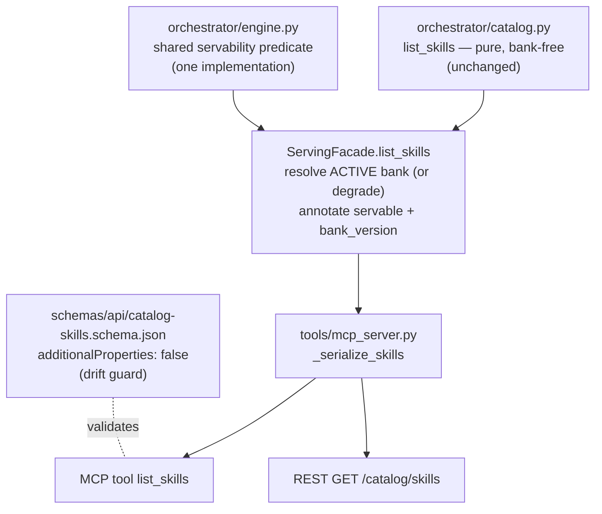

# feat: Add servable flag to list_skills catalog responses

## Summary

Add an additive `servable` boolean to every skill entry returned by the `list_skills` catalog operation, plus a top-level `bank_version` naming the build the flag was checked against. The flag is computed by the same bank-candidates predicate `recommend_next` already uses for its `unservable` field, annotated at the facade layer so `orchestrator/catalog.py` stays a pure, bank-free read. The change flows through the shared serializer to both MCP and REST, with the response schema and README updated in lockstep.

## Problem Frame

`list_skills` advertises every mapped skill for a (country, curriculum, grade) scope regardless of whether the active bank can serve any of them. Only `recommend_next` carries a servability signal (`unservable`), so during the partner-evaluation window a partner reading the catalog sees skills the deployment cannot serve, and catalog honesty is gated on a separate student-scoped call. This was flagged as a deferred open question in `docs/plans/2026-07-29-001-feat-class6-servable-coverage-plan.md` (product-lens, P1): an additive boolean makes honesty immediate and each content increment partner-visible.

---

## Requirements

**Servability signal**

- R1. Every skill entry in a `list_skills` response carries `servable: bool` — true exactly when the checked bank build holds at least one instance for that skill (any format), the same raw bank-pool predicate `rank_serve_candidates` uses for its remediation, stepdown, prereq-probe, and placement candidates.
- R2. The response names the checked build: a top-level `bank_version` field, `null` when no bank could be resolved. A servability claim that doesn't name its build is unauditable.
- R3. The raw bank-pool predicate has exactly one implementation, shared by `rank_serve_candidates`' non-review candidate branches and the catalog annotation (the repo's "one implementation, two callers" rule). `recommend_next`'s review-reason candidate applies an additional certified-format filter (`LOW_GUESS_FORMATS`) on top of this predicate, so a due-review skill can be `unservable: true` there while `servable: true` in the catalog — the two fields answer different questions ("can anything be served" vs. "can a review probe specifically be served") and are not claimed to agree in that one case (see AE3's scope).

**Contract preservation**

- R4. The addition is additive: every existing field and its shape is unchanged; `unit_code` narrowing, unknown-scope-returns-empty, and `content_version` stamping behave exactly as today. Non-breaking is scoped to unknown-field-tolerant consumers, matching the figure-support plan's precedent.
- R5. Catalog availability is unchanged (KD3: the discovery layer stays open regardless): a deployment with no `ACTIVE` bank pointer still answers `list_skills` — all entries `servable: false`, `bank_version: null` — never an error.
- R6. `schemas/api/catalog-skills.schema.json` is updated in the same change as the serializer; the schema's `additionalProperties: false` posture means the existing shape test fails on any drift.

**Surface parity and docs**

- R7. The flag reaches partners over both transports: MCP `list_skills` tool and REST `GET /catalog/skills` (via the shared serializer, per R14 of the serving-integrity contract).
- R8. README's MCP tool table row and REST docs describe the flag and which build it is checked against.

---

## Key Technical Decisions

- **Annotate at the facade, keep catalog.py pure.** `orchestrator/catalog.py` is documented as the student-independent, bank-free discovery layer; threading bank access into it would break that contract for all four catalog reads. `ServingFacade.list_skills` resolves the bank and wraps the catalog result — mirroring how `recommend_next` separates ranking (engine) from bank resolution (facade).
- **Check the ACTIVE build; no new tool parameters.** The MCP/REST `list_skills` surface gains no `bank_version` or `session` parameter — consistent with `recommend_next`'s tool surface, which also checks only the ACTIVE build. The facade method accepts an optional `bank_version` argument (facade-level only, mirroring `recommend_next`'s signature) so in-memory callers with a static `bank_lookup` and `banks_dir=None` can still get honest annotation.
- **Degrade to all-unservable instead of erroring when no bank resolves or fails to load.** The facade wraps the *entire* resolve-and-load sequence — `banks_dir is None` with no explicit `bank_version`, `read_active_bank_version` raising `NoActiveBankError`, and `self.bank_lookup(...)` itself raising (a missing/corrupt bank directory under an otherwise-valid `ACTIVE` pointer, or an unknown version against a static lookup) — and on any of these returns the normal shape with every `servable: false` and `bank_version: null`. This is honest — with no bank actually available, nothing is servable — and preserves R5/KD3, where propagating the error would regress catalog availability on exactly the endpoint that promises to stay open. Note `read_active_bank_version` has no `None` guard today (it would `TypeError` on `banks_dir / ACTIVE_POINTER_NAME`), so the facade must guard before calling it.
- **Positive polarity: `servable`, not `unservable`.** The catalog answers "what can I bind to" — a positive capability read — while the recommendations field stays `unservable` (renaming it would be breaking). The schema description names the deliberate inversion so integrators reading both contracts aren't surprised.
- **New result dataclasses in serving.py, not a mutation of catalog dataclasses.** `catalog.SkillsResult`/`MappedSkill` are frozen and belong to the pure layer; the facade returns its own result type carrying the catalog fields plus `servable` per skill and `bank_version` at the top level — same pattern as `RecommendedSkill`/`RecommendationsResult`.
- **Both new fields are required in the schema.** Repo schema style is exhaustive `required` arrays with `additionalProperties: false` (nullable-but-required for `bank_version`), not additive-optional.

---

## High-Level Technical Design

Where the annotation lives relative to the existing layers — the load-bearing choice is that bank awareness enters one layer above the pure catalog:

`rank_serve_candidates`'s remediation/stepdown/prereq-probe/placement branches keep calling the same raw predicate; only the review-reason branch layers an additional format filter on top (R3).

---

## Implementation Units

### U1. Shared predicate and facade-level servability annotation

- **Goal:** `ServingFacade.list_skills` returns skills annotated with `servable` and the checked `bank_version`, computed by the same predicate `recommend_next` uses, degrading honestly when no bank resolves.
- **Requirements:** R1, R2, R3, R4, R5.
- **Dependencies:** none.
- **Files:** `orchestrator/engine.py`, `orchestrator/serving.py`, `tests/test_serving.py`, `tests/test_catalog.py`.
- **Approach:** Extract the raw bank-pool check (`bank.instances_by_skill.get(skill_id, [])` non-empty — the predicate behind the remediation/stepdown/prereq-probe/placement branches of `rank_serve_candidates`, around line ~823) into a small shared helper in `engine.py`; call it from those branches and from the new facade path. Leave the review branch's additional `LOW_GUESS_FORMATS` filter and the frontier branch's separately-filtered pool as they are (R3). In `serving.py`, `ServingFacade.list_skills` gains an optional `bank_version` parameter and resolves the bank exactly as `recommend_next` does (`read_active_bank_version(self.banks_dir)` + `self.bank_lookup(...)`), with the whole resolve-and-load sequence wrapped so that a `None` `banks_dir` without an explicit `bank_version`, a `NoActiveBankError`, or any exception from `self.bank_lookup(...)` itself (missing/corrupt bank on disk, unknown version in a static lookup) all degrade to all-`servable: false` with `bank_version=None`. Define new frozen result dataclasses in `serving.py` wrapping the catalog result (pattern: `RecommendedSkill`/`RecommendationsResult`); delegate the catalog read itself to `catalog_module.list_skills` unchanged. This changes `ServingFacade.list_skills`'s return type, so `tests/test_catalog.py`'s `test_facade_passthroughs_delegate_to_catalog_module` (which currently asserts `facade.list_skills(...) == catalog.list_skills(...)` by whole-object equality) needs its `list_skills` assertion updated to compare the wrapped result's catalog-derived fields against `catalog.list_skills(...)`, with `servable`/`bank_version` asserted separately — the one deliberate change to that file.
- **Patterns to follow:** `recommend_next`'s bank resolution block (`orchestrator/serving.py:1367-1371`) and its result-dataclass pairing; the KD3 comment block above the facade's catalog delegations.
- **Test scenarios:**
  - Happy path: with the `build-a` fixture active (bank built from only `TPL.FRAC.ADD.LIKE.NUM.001`), `facade.list_skills("IN", "NCERT", 6)` returns `servable=True` for `FRAC.ADD.LIKE` and `servable=False` for every other mapped skill; `bank_version == "build-a"`.
  - `unit_code` narrowing (`IN-NCERT-G6-CH7`) returns each skill with the same `servable` verdict it had unscoped.
  - No `ACTIVE` pointer written: response has the normal shape, every entry `servable=False`, `bank_version is None`, no exception raised.
  - `ACTIVE` pointer names a build directory that is missing or has a corrupt `manifest.json`: `self.bank_lookup(...)` raises internally, and `list_skills` still degrades to all-`servable=False`, `bank_version is None`, rather than propagating the exception.
  - Facade constructed with `banks_dir=None` and a static `bank_lookup`: calling with an explicit `bank_version` annotates against that build; calling without one, or with a `bank_version` the static lookup doesn't have, degrades to all-false rather than raising.
  - Unknown scope (`("XX", "NOPE", 1)`) still returns `skills=[]` with `content_version` stamped and `bank_version` present — the plan-point-6 contract preserved.
  - Parity for non-review recommendations: for a student at (IN, NCERT, 6) against the same build, every skill appearing in both `recommend_next` and `list_skills` with a reason other than `"review"` satisfies `unservable == not servable`.
- **Verification:** new tests pass alongside the existing `test_recommend_next_flags_a_bank_absent_skill_as_unservable_without_dropping_it`; the only existing test this unit deliberately changes is `test_catalog.py`'s `test_facade_passthroughs_delegate_to_catalog_module`, updated per the Approach above — no other existing `test_serving.py` or `test_catalog.py` test changes behavior.

### U2. Wire contract: serializer, schema, and catalog-honesty regression test

- **Goal:** The flag reaches partners over MCP and REST with the schema updated in lockstep, proven by a regression test asserting a zero-instance skill is reported `servable: false` over the wire.
- **Requirements:** R4, R6, R7; enforces R1/R2 at the contract boundary.
- **Dependencies:** U1.
- **Files:** `tools/mcp_server.py`, `schemas/api/catalog-skills.schema.json`, `tests/test_mcp_server.py`.
- **Approach:** `_serialize_skills` adds `servable` per skill entry and `bank_version` at the top level, and its docstring gains the declared-contract citation (repo convention: serializer docstrings state the contract with requirement IDs). The MCP tool docstring documents the flag against the ACTIVE build, modeled on `recommend_next`'s docstring. Schema: add `servable` (boolean, required) to the item properties and `bank_version` (`["string", "null"]`, required) at the top level, with a description mirroring `recommendation-result.schema.json`'s `unservable` wording and one sentence naming the deliberate polarity inversion. `tools/rest_server.py` needs no route change — it reuses `_serialize_skills` — beyond a one-line summary-string touch if the flag is worth naming there.
- **Patterns to follow:** `_serialize_recommendations` (`tools/mcp_server.py:188-208`) for how `unservable` is passed through and documented; `recommendation-result.schema.json`'s `unservable` property block; `_assert_valid(schema_name, obj)` in `tests/test_mcp_server.py:49-60`.
- **Test scenarios:**
  - Catalog-honesty regression: over the in-memory MCP client, `list_skills("IN", "NCERT", 6)` validates against the updated schema; `FRAC.ADD.LIKE` has `servable: true`; `EMPTY_POOL_SKILL_ID` (`FRAC.EQUIV`, the fixture's known zero-instance skill) is present with `servable: false` — advertised but honestly flagged, never dropped.
  - `bank_version` on the wire equals the fixture's activated build (`"mcp-build"`).
  - Existing `test_list_skills_returns_declared_shape` passes with the updated schema (its `additionalProperties: false` validation is the drift guard for R6).
  - Schema meta-validation (`tests/test_fixture_schemas.py`) stays green.
- **Verification:** full `tests/test_mcp_server.py` and `tests/test_rest_server.py` suites green — the REST parity test proves the route surface is untouched while the shared serializer carries the new fields.

### U3. Documentation

- **Goal:** Partners reading README learn the flag exists, what it means, and which build it reflects.
- **Requirements:** R8.
- **Dependencies:** U1, U2 (documents shipped behavior).
- **Files:** `README.md`.
- **Approach:** Update the `list_skills` row's Notes cell in the MCP tool table (three-column `| Tool | Delegates to | Notes |` format, requirement IDs in parens — model on the `recommend_next` row's bank-awareness phrasing). Add a sentence to the REST section's prose (the two-column route table carries no notes) covering `GET /catalog/skills`. Name the no-active-bank degrade behavior so integrators don't misread all-false as a content gap. State that `servable` is a point-in-time read against the `bank_version` named in the same response, and that integrators should re-fetch (or compare `bank_version` against `recommend_next`) rather than cache servability across a bank repoint.
- **Test scenarios:** Test expectation: none — documentation-only unit.
- **Verification:** README accurately describes the shipped response shape, including `bank_version: null` semantics.

---

## Acceptance Examples

- AE1. **Covers R1, R2.** Given the test bank holds instances for only `FRAC.ADD.LIKE` and is `ACTIVE`, when a partner calls `list_skills("IN", "NCERT", 6)` over MCP, then `FRAC.ADD.LIKE` comes back `servable: true`, every other mapped skill `servable: false`, no skill is dropped, and `bank_version` names the checked build.
- AE2. **Covers R5.** Given a deployment with no `ACTIVE` bank pointer, when `list_skills` is called, then the normal response shape returns with every entry `servable: false` and `bank_version: null` — no error.
- AE3. **Covers R3.** Given the same student, scope, and build, when both `recommend_next` and `list_skills` are called, then every skill appearing in both with a `recommend_next` reason other than `"review"` satisfies `unservable == not servable`.

---

## Scope Boundaries

**Non-goals**

- No `servable` on `list_units` or `list_curricula` — the flag is per-skill; aggregating it upward is a separate design question.
- No `bank_version` or `session` parameters on the MCP/REST `list_skills` surface — the ACTIVE build is the contract, matching `recommend_next`.
- No change to `recommend_next`'s `unservable` field name or semantics.

**Deferred to Follow-Up Work**

- Partner communication about the contract addition. The origin question left this unresolved; the addition is non-breaking for unknown-field-tolerant consumers, but a partner validating against the pinned published schema (`additionalProperties: false`, exhaustive `required`, this repo's own style) breaks the moment the two new required fields deploy. Whether integrators get an explicit heads-up, and through what channel, is a decision outside this repo — but the heads-up should precede the deploy that activates the new fields, not follow it.
- The stale clause in `ServingFacade.__init__`'s docstring ("nothing reads banks_dir unless open_session is actually called" — already untrue for `recommend_next`, and more so after U1) can be corrected in passing during U1, but a broader docstring audit is not this plan's job.

---

## Sources & Research

- Origin: deferred open question in `docs/plans/2026-07-29-001-feat-class6-servable-coverage-plan.md` (product-lens, P1).
- Servability predicate: `orchestrator/engine.py` `rank_serve_candidates` (~line 874-974) — remediation/stepdown/prereq-probe/placement branches (~lines 892-925) use the raw `bank.instances_by_skill.get(skill_id, [])` predicate this plan shares; the review branch (~line 886) additionally filters to `constants.LOW_GUESS_FORMATS`; the frontier branch (~line 950-974) uses a separately ceiling/mastery/prerequisite-filtered pool and hardcodes `unservable=False`.
- Bank resolution pattern: `orchestrator/serving.py:1367-1371` (`recommend_next`); `read_active_bank_version` at `orchestrator/serving.py:172-184` — no `None` guard, raises `NoActiveBankError` on missing pointer; `engine.py`'s `load_bank` (~line 248) and `make_bank_lookup`/`make_static_bank_lookup` (~lines 293-315) can themselves raise (missing/corrupt manifest, unknown version) even when the `ACTIVE` pointer itself resolves.
- Serializer and schema conventions: `tools/mcp_server.py:267-288` (`_serialize_skills`), `schemas/api/catalog-skills.schema.json` (exhaustive `required`, `additionalProperties: false`), `recommendation-result.schema.json` (`unservable` description to mirror).
- Fixture arrangements: `tests/test_serving.py:63-90` (`build-a`, single-template bank — natural partial-coverage fixture), `tests/test_mcp_server.py:44-47` (`EMPTY_POOL_SKILL_ID = "FRAC.EQUIV"`), `tests/test_mcp_server.py:776` (schema-validated shape test).
