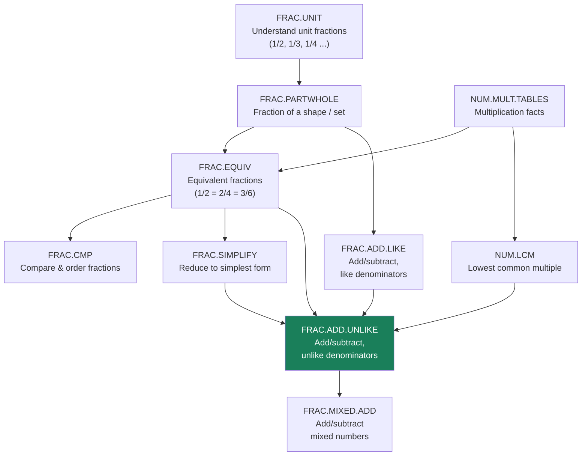
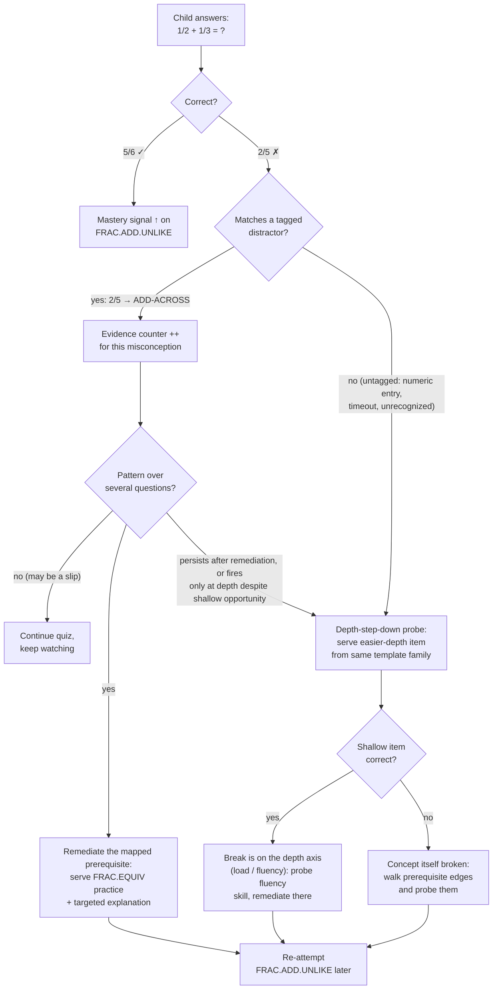
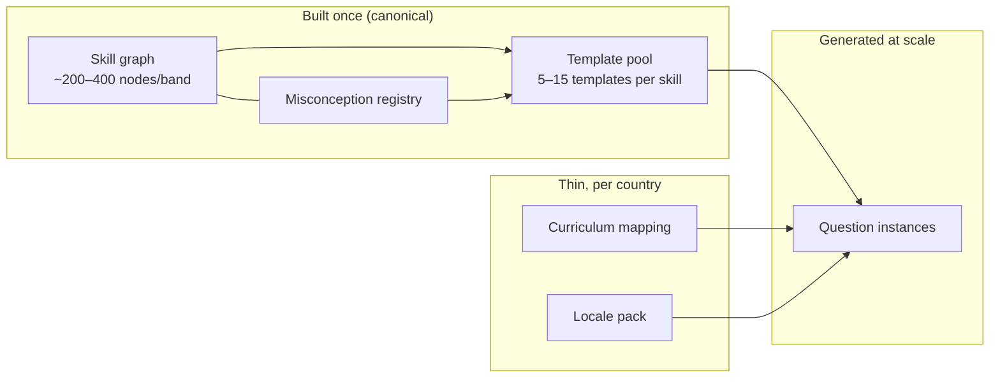
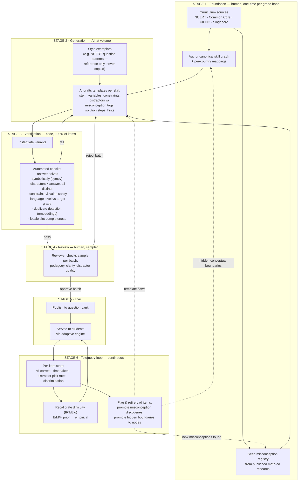
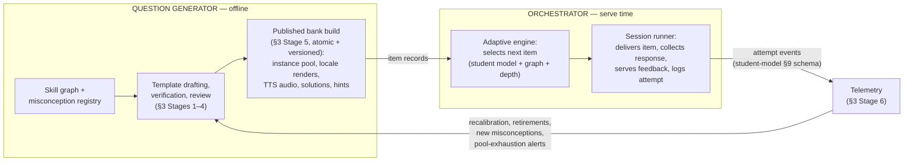

# Mathiqo Question Bank — Core Design

**Scope of this document:** the canonical skill graph (with worked examples), how item templates and misconception-tagged distractors hang off it, the end-to-end content pipeline, the Generator/Orchestrator system split (§5), and the teaching layer (§6).

**Status:** Draft v0.6.2 · July 2026
**Changelog:** v0.2 folded in gaps from cross-checking *ChatGPT Design.md*: question-type taxonomy (§2.7), reasoning/language split (§2.8), additional item metadata. v0.3 adds review feedback: early-grade render-props + audio layer (§2.9), exam contexts as rigor wrappers with multi-skill credit assignment (§2.10), continuous difficulty + hint-adaptive evidence (§2.3), hardened verification (§3 Stage 3), remediation micro-assets + parent summaries in the misconception registry (§2.4). v0.4 resolves the tier-vs-node boundary: the node-split decision rule with a default-to-depth convention (§1.2a), mastery redefined as reliability-up-to-depth on the §2.3 scalar with depth-aware prerequisite checks (§1.3, §2.3), mappings that point at (skill, depth) so spiral curricula fit one canonical node (§1.4), depth-step-down probes and a concept-vs-fluency distinction in diagnosis (§2.5), and telemetry-driven promotion of hidden conceptual boundaries into nodes (§3 Stage 6). v0.4.1 review fixes: step-down probes run only on untagged failures — tagged distractors diagnose directly (§2.5); mastery-at-depth defined with a probability margin, not θ > d (§2.3); `depth_expectation` is a default ceiling, not absolute (§1.4); explicit mastery-migration rule on node splits (§3 Stage 6). v0.4.2 review fixes: step-down escalation when tagged-misconception remediation fails or a tag fires only at depth (§2.5, diagram updated); the 0.8 mastery margin is evaluated on unassisted responses and certified via numeric entry, not MCQ (§2.3); `depth_expectation` made self-extending — mastering the top of a band opens the next (§1.4); node-split migration seeds new nodes from historical above-threshold attempts at low confidence instead of cold-starting, mastery records carry graph-version stamps, and merges get a symmetric migration rule (§3 Stage 6). v0.4.3 review fixes: the fires-only-at-depth escalation trigger conditioned on firing *opportunity*, so structurally depth-gated tags (`only_if`) aren't permanently second-guessed (§2.5, diagram updated); mastery certification generalized from numeric entry to low-guess response formats so Classes 1–3 aren't stranded (§2.3). v0.5 adds §5, the Generator/Orchestrator system split: offline generation through Stage 5, a select-only serving path (the boundary rule), the two-schema contract with bank versioning, and the exhaustion/staleness costs with their mitigations. v0.6 adds §6, the teaching layer: 4-segment micro-lessons (hook, concept, worked example, guided practice) that reuse templates, solution steps, the component library, and the misconception registry; choreographed interactives instead of video; lesson assets in the same pipeline with a permanent 100% human review gate and efficacy telemetry; teaching triggers incl. try-one-cold skip and on-demand "teach me this"; `context: lesson` attempts move θ at low weight and never certify. v0.6.1 review fixes: segment-3 worked examples given a schema home for per-curriculum methods — `solution_steps` keyed by pedagogy variant (§2.2, §6.1, §6.2); lesson-skip re-entry trigger and prerequisite pointer on on-demand lessons (§6.4); lesson efficacy restricted to within-experiment reads with a no-lesson holdout (§6.3); node splits now queue the parent lesson for re-review (§3 Stage 6); instance pools capped, shipping scoped to per-skill packs, audio pre-rendering scoped to early grades (§5, §5.1); future AI tutor named a third system (§5.1); distractor-set storage made a bank requirement (§5.1); "top misconceptions" defined via pick-rate telemetry and the Brahmagupta example corrected (§6.1). v0.6.2 review fixes: the §6.4 rescue trigger explicitly overrides the §6.3 holdout (3-attempt threshold, logged exit, pre-rescue attempts remain valid data); holdout bounded to 5–10% of cold-fail assignments; power stated — v1 reads only the pooled-across-lessons holdout comparison, per-lesson reads gated on pre-registered sample thresholds (§6.3, §6.4).
**Note:** all curriculum grade placements in examples are illustrative and must be verified against the actual syllabus documents before authoring begins.

---

## 1. The Canonical Skill Graph

### 1.1 The core idea

Math itself doesn't change across borders — only *when* it's taught, *what it's called*, and *how questions are dressed* changes. So the design separates three layers:

| Layer | What it holds | Changes per country? |
|---|---|---|
| **Canonical skill graph** | Atomic skills + prerequisite edges | **No** — built once |
| **Curriculum mapping** | Which skill appears in which grade, under which syllabus code, in which exam context | Yes — one thin mapping per country |
| **Localization** | Names, currency, units, contexts, language, number notation | Yes — one locale pack per country |

Questions attach to **canonical skills**, never to "Class 5 India". The mapping layer decides *when a child in a given country sees the skill*; the locale pack decides *how the question reads*. Result: one question bank serves every country, and adding country N+1 costs a mapping + a locale pack, not a new bank.

### 1.2 What is an "atomic skill"?

A skill is atomic when a student can be meaningfully diagnosed as having it or not. "Fractions" is not a skill — it's a chapter. "Add two fractions with unlike denominators" is a skill. Rule of thumb: if a single question can test it, and a student's command of it can be tracked as one mastery state — "reliable up to a depth," not a binary flag (§2.3) — it's atomic. Expect roughly 200–400 atomic skills per grade band (1–5, 6–10).

Each skill node stores:

```yaml
skill_id: FRAC.ADD.UNLIKE
name: "Add fractions with unlike denominators"
description: >
  Add two proper fractions a/b + c/d where b ≠ d,
  expressing the result in simplest form.
strand: NUMBER.FRACTIONS          # top-level organization
canonical_stage: 3                 # abstract ordering index, NOT a grade
prerequisites:
  - FRAC.EQUIV                     # equivalent fractions
  - FRAC.ADD.LIKE                  # add with like denominators
  - NUM.LCM                        # lowest common multiple
misconceptions:                    # known failure modes for this skill
  - MISC.FRAC.ADD-ACROSS
  - MISC.FRAC.FIRST-DENOM
  - MISC.FRAC.NO-SIMPLIFY
```

### 1.2a Node vs. depth: the boundary rule

There are two ways to make math "harder," and they must not be confused: a **new node** (its own mastery state, prerequisite edges, mappings, template pool) and **greater depth within a node** (a harder constraint set on the same templates, §2.3). The decision rule:

> **A new node requires new conceptual apparatus** — a new representation, a new idea, or a new *conceptual* prerequisite the easier version didn't have. Purely quantitative scaling of the same procedure (larger numbers, more steps, more parts) is depth within the node.

Worked examples: adding mixed numbers is a new node (`FRAC.MIXED.ADD`) because it requires mixed↔improper conversion — new conceptual apparatus. Adding fractions with larger denominators, or three fractions instead of two, is more depth of `FRAC.ADD.UNLIKE` — same ideas, more load. Bare computation vs. word problems is same-node: word problems sit higher on the depth axis and use different templates (`cognitive_level: application`), not a new skill.

One refinement: prerequisite edges point to **conceptual prerequisites only**. Range/fluency demands (large denominators presuppose multi-digit multiplication, which is itself a node elsewhere in the graph) are expressed on the depth axis, not as edges — otherwise every depth increment would spawn nodes. The diagnostic cost of this choice (the backward walk can't find fluency breaks) is paid back in §2.5 with depth-step-down probes.

When authors are unsure, **default to depth**. A conceptual boundary hidden inside a tier shows up cleanly in telemetry and can be promoted to a node later (§3 Stage 6); a node that should have been a tier just sits there duplicating templates and cluttering diagnosis. Both directions of migration are lossy for stored mastery, so over-splitting is the worse default.

### 1.3 Worked example: the fractions cluster

A slice of the graph around our running example (arrows mean "is a prerequisite of"):



Why the edges matter for adaptivity (this is the payoff of graph-first design):

- **Sequencing.** A child can't be served `FRAC.ADD.UNLIKE` until each prerequisite — `FRAC.EQUIV`, `FRAC.ADD.LIKE`, `NUM.LCM` — is mastered *at the depth the target item requires* (mastery is depth-indexed, §2.3).
- **Diagnosis.** When a child fails `FRAC.ADD.UNLIKE`, the engine doesn't just say "wrong" — it steps down the failed skill's own depth axis and walks *backwards* along the edges to probe the prerequisites, finding the actual broken link (§2.5).
- **Remediation.** The broken prerequisite, not the failed skill, is what gets re-taught.

### 1.4 Country mapping layer

The same node, mapped into four curricula (illustrative — verify against syllabi):

| Canonical skill | India (NCERT) | US (Common Core) | UK (Nat. Curriculum) | Singapore |
|---|---|---|---|---|
| `FRAC.ADD.UNLIKE` | Class 6 · Ch. "Fractions" | Grade 5 · `5.NF.A.1` | Year 6 | Primary 5 |

A mapping record also carries per-country pedagogy notes and exam-context tags:

```yaml
mapping:
  skill_id: FRAC.ADD.UNLIKE
  country: IN
  curriculum: NCERT
  grade: 6
  depth_expectation: medium    # how far this grade takes the skill; v1 uses tier labels over D (§2.3)
  syllabus_ref: "Class 6, Maths, Ch. 7"
  learning_objective: >          # the curriculum's own phrasing of the outcome
    Adds and subtracts fractions with unlike denominators
    using equivalent fractions
  exam_contexts: [SCHOOL_EXAM, OLYMPIAD_IMO_L1]
  terminology_overrides:
    "simplest form": "lowest form"     # NCERT phrasing
```

Note what this buys you: the **same template pool** serves a US Grade 5 student and an Indian Class 6 student. Only the mapping (when) and locale pack (how it reads) differ.

Why `depth_expectation` exists: **curricula spiral.** The same canonical node is revisited at increasing depth across grades — NCERT might take `FRAC.ADD.UNLIKE` to depth *easy* in Class 5 and *medium* in Class 6. Pointing mappings at (skill, depth) rather than the whole skill lets one node serve that pattern without duplicating the graph. The mapping table above records the grade of first substantial treatment; `depth_expectation` says how far each grade actually takes it, and it acts as the engine's *default* serving ceiling — governing where practice starts and what the default item mix looks like, not what a student may ever see. The ceiling is **self-extending**: mastering the top of a band opens the next band. (Without this, the override is unliftable by construction — a student could never demonstrate the above-ceiling mastery that lifting it requires, because the ceiling would block the demonstration.) An exam context (§2.10, e.g. Olympiad) can also demand more than the band on its own authority. A hard grade ceiling would contradict the platform being adaptive; the default just keeps ordinary practice grade-appropriate. A skill may therefore have several mapping rows per country, one per grade that touches it.

### 1.5 Localization layer

Locale packs are data, not per-question rewrites. A template says `{{name}} bought {{items}} for {{currency}}{{p}}`; the locale pack fills the dressing:

| Slot | India pack | US pack |
|---|---|---|
| `names` | Ravi, Priya, Arjun, Meera | Jake, Emma, Carlos, Maya |
| `currency` | ₹ | $ |
| `units` | metric (kg, km, litre) | US customary (lb, mile) + metric |
| `contexts` | cricket, mangoes, train journeys | baseball, apples, road trips |
| `number_words` | lakh / crore grouping (1,00,000) | million grouping (100,000) |
| `spelling` | "maths", "litre" | "math", "liter" |

---

## 2. Item Templates: Questions as Programs, Not Text

### 2.1 Why templates

A static question is consumed once — kids memorize "the answer to the mango question is 5/6" quickly. A **template** is a parameterized item model: one authored artifact that generates hundreds of vetted variants, each machine-solvable so the answer key is *provably* correct before any child sees it.

### 2.2 Full template example, tied to the skill node above

```json
{
  "template_id": "TPL.FRAC.ADD.UNLIKE.WORD.001",
  "skill_ids": ["FRAC.ADD.UNLIKE"],
  "question_type": "mcq_4",
  "cognitive_level": "application",
  "difficulty_prior": "medium",
  "estimated_time_sec": 75,
  "calculator_allowed": false,
  "diagram_required": false,
  "context_tags": ["food", "sharing"],
  "accepted_answer_forms": "simplest form only (simplifying IS part of this skill; on skills where it isn't, equivalent forms are accepted)",

  "variables": {
    "a": {"type": "int", "range": [1, 8]},
    "b": {"type": "int", "range": [3, 12]},
    "c": {"type": "int", "range": [1, 8]},
    "d": {"type": "int", "range": [3, 12]}
  },
  "constraints": [
    "a < b",  "c < d",
    "b != d",
    "gcd(b, d) == 1",
    "a/b + c/d < 1"
  ],

  "stem": "{{name1}} ate {{a}}/{{b}} of a {{food}} and {{name2}} ate {{c}}/{{d}} of the same {{food}}. What fraction of the {{food}} did they eat altogether?",
  "localization_slots": ["name1", "name2", "food"],

  "answer": "simplify((a*d + c*b) / (b*d))",

  "distractors": [
    {
      "expr": "(a + c) / (b + d)",
      "misconception_id": "MISC.FRAC.ADD-ACROSS"
    },
    {
      "expr": "(a + c) / b",
      "misconception_id": "MISC.FRAC.FIRST-DENOM"
    },
    {
      "expr": "(a*d + c*b) / (b*d)",
      "unsimplified": true,
      "misconception_id": "MISC.FRAC.NO-SIMPLIFY",
      "only_if": "gcd(a*d + c*b, b*d) > 1"
    }
  ],

  "solution_steps": [
    "Find the LCM of {{b}} and {{d}}: it is {{lcm}}.",
    "Convert: {{a}}/{{b}} = {{a2}}/{{lcm}} and {{c}}/{{d}} = {{c2}}/{{lcm}}.",
    "Add the numerators: {{a2}}/{{lcm}} + {{c2}}/{{lcm}} = {{sum}}/{{lcm}}.",
    "Simplify if possible: {{final}}."
  ],
  "hints": [
    "Can you add the fractions as they are? Look at the denominators.",
    "Rewrite both fractions with the same denominator first.",
    "What is the smallest number both {{b}} and {{d}} divide into?"
  ]
}
```

Everything downstream is generated: instantiate variables → check constraints → compute answer and distractors symbolically → drop any variant where a distractor collides with the answer → dress with a locale pack.

The `solution_steps` are stored as an ordered structure (not one text blob), with each step aligned to the hint ladder. This is deliberately forward-looking: the same structure later powers step-level feedback, partial credit, and AI tutoring ("your step 2 is where it went wrong") without re-authoring content.

Where mapped curricula teach *different methods* for the same skill (§1.4 `pedagogy_notes`), `solution_steps` is keyed by pedagogy variant — `solution_steps.NCERT`, `solution_steps.CC` — with a single canonical form as the default when methods coincide. The teaching layer (§6.1, segment 3) is the first consumer that *requires* this: a faded worked example must fade the method the student's curriculum actually teaches, not a generic one.

### 2.3 Difficulty is controlled by constraints, not by writing new questions

The **same template** yields all three difficulty tiers by swapping the constraint set:

| Tier | Constraint change | Example instance | Why it's harder |
|---|---|---|---|
| **Easy** | `d % b == 0` (one denominator divides the other), no simplification needed | 1/2 + 1/4 | LCM is just `d`; one conversion |
| **Medium** | `gcd(b,d) == 1`, small denominators | 1/2 + 1/3 | True LCM needed; two conversions |
| **Hard** | `gcd(b,d) > 1` but `b ∤ d`, larger values, answer must simplify | 5/6 + 3/8 | LCM ≠ b·d; multi-step + simplification |

This gives your E/M/H grading an *explicit, reproducible definition* — a difficulty rubric encoded as constraints — instead of an author's gut feeling. The E/M/H label is stored as `difficulty_prior`; once live, empirical difficulty (IRT/Elo parameters from real answer data) is stored alongside it and takes precedence for the adaptive engine.

Two refinements on top of the tiers:

**Difficulty is a scalar underneath.** Store difficulty as a continuous value `D ∈ [0,1]`; "easy/medium/hard" are just named bands over it (authoring interface and UI labels, not the data model). This lets empirical calibration move an item smoothly rather than jumping buckets, and leaves room to parameterize constraint sets by `D` later (e.g., denominator ranges that widen with `D`). Do **not** author a continuous constraint→difficulty formula up front, though: until telemetry confirms the mapping is even monotonic, a formula like `range(D) = [2+8D, 5+15D]` is pseudo-precision — the tiered constraint sets are the honest v1 authoring tool, and the scalar is where calibration lands.

**Mastery inherits the scalar.** Because difficulty is continuous, mastery per node is not binary either: it is *the depth at which the student is reliable*. In student-model terms this is ability θ per skill read against item difficulty b — "mastered at depth d" means *P(correct at difficulty d | θ) ≥ 0.8*, not merely θ > d. (At θ = d the IRT model predicts ~50% success — a coin flip is not mastery; the margin keeps prerequisite checks from passing students who would fail half the target items.) Two qualifications on how the margin is computed. It is evaluated on **unassisted** responses only: hint-assisted corrects (*Hints are evidence*, below) move θ at reduced weight and never count toward the 0.8 — otherwise the margin certifies students who needed scaffolding to get there. And it is **certified on low-guess response formats** — numeric entry, drag-to-construct, visual counting (§2.9): any format whose answer space makes lucky guessing negligible. A 4-option MCQ hands a pure guesser ~25%, biasing θ upward in any model without a guessing parameter — so MCQ evidence moves θ (it is the diagnostic instrument, §2.7) but does not by itself certify mastery. Stated as "numeric entry only," this rule would strand Classes 1–3, where §2.9's interactive types are the age-appropriate instrument; the format class, not one format, is what matters. Prerequisite checks (§1.3) therefore read "mastered at the depth the target item requires," and a mapped student's ceiling is their grade's `depth_expectation` (§1.4). This is what keeps the graph small (nodes are conceptual units only, §1.2a) while spiral curricula still fit within a node. E/M/H remain authoring conveniences and UI labels — never the data model, for difficulty or for mastery.

**Hints are evidence, not just help.** Each attempt records `time_taken` and `hints_used`. If time-on-item exceeds ~1.5× the item's `estimated_time_sec`, proactively offer hint 1. Mastery updates are then three-way: clean correct > hint-assisted correct > wrong. This keeps struggling students moving without either punishing them like a wrong answer or crediting them like a clean solve.

### 2.4 The misconception registry

Misconceptions are first-class objects in their own registry, shared across all templates that can expose them:

| ID | Belief | Signature error | Remediation target |
|---|---|---|---|
| `MISC.FRAC.ADD-ACROSS` | "Add tops, add bottoms" | 1/2 + 1/3 = **2/5** | `FRAC.EQUIV` — child doesn't see fractions as quantities |
| `MISC.FRAC.FIRST-DENOM` | "Keep the first denominator" | 1/2 + 1/3 = **2/2** | `FRAC.ADD.LIKE` — why like denominators are required |
| `MISC.FRAC.NO-SIMPLIFY` | Answer complete without reducing | 1/4 + 1/4 = **2/8** | `FRAC.SIMPLIFY` |
| `MISC.FRAC.BIGGER-DENOM` | "Bigger denominator = bigger fraction" | "1/8 > 1/4 because 8 > 4" | `FRAC.UNIT` — meaning of the denominator |

Note the last column: **each misconception points back into the skill graph.** That closes the loop — a wrong answer is not a −1 on a score, it's *evidence for a specific broken prerequisite*.

Each registry entry carries two product-facing fields beyond the remediation edge:

- `remediation_asset` — a pointer to a ~30-second micro-explainer (animation or interactive) addressing exactly that misconception (e.g., a visual showing why 1/2 + 1/3 ≠ 2/5). Remediation then escalates: micro-explainer on first confirmed pattern → full prerequisite re-teaching only if the pattern persists. Throwing a child back to a whole chapter for one diagnosed misconception is the sledgehammer this avoids.
- `parent_summary_i18n` — a plain-language rendering for parent/teacher reports: *"Arjun understands adding fractions, but tends to add the denominators when they don't match."* Misconception IDs are internal vocabulary; humans only ever see these summaries. This field is also what makes skill-level analytics sellable to schools.

### 2.5 How diagnosis works at quiz time



One wrong answer never triggers remediation (kids make slips); a *pattern* of the same misconception ID does. This is only possible because distractors carry misconception tags — an untagged wrong answer is diagnostic noise.

Two refinements to the walk:

- **Depth-step-down probes.** When a child fails a deeper item, the engine may serve an easier-depth item from the same template family. Passing shallow while failing deep localises the break to the depth axis — usually load or fluency, not the concept — and the prerequisite walk is skipped. Failing even the shallow item confirms the concept itself is broken, and the walk proceeds. **Ordering rule:** step-down runs only on *untagged* failures (numeric entry, an unrecognized wrong answer, a timeout). A wrong answer that matches a tagged distractor already carries its diagnosis — the engine takes the misconception path (§2.4–2.5) directly, with no step-down probe. Anything else wastes a question re-deriving information the distractor design already paid for. One exception: **tags can mask depth breaks.** Some misconceptions are depth-correlated by construction — `MISC.FRAC.NO-SIMPLIFY` fires only when `gcd(...) > 1` (its `only_if` clause), i.e. almost exclusively at deeper tiers. So the escalation triggers are: (a) a confirmed misconception pattern has been remediated and failures persist at the same depth — clean falsification, and the only trigger available for structurally depth-gated tags; or (b) the same tag fires *only* on deep items **despite shallow opportunities** — shallow items were served where that distractor was present and constructible, and the student answered them correctly. Firing must be measured against firing *opportunity*: a tag whose `only_if` clause makes it constructible only at depth (as with `NO-SIMPLIFY`) can never fire shallow, so its deep-only firing pattern is guaranteed by construction and is not evidence against the tag. Without the opportunity condition, the engine would permanently second-guess every structurally depth-gated tag working exactly as designed.
- **Concept vs. fluency.** Range/fluency dependencies are deliberately not graph edges (§1.2a), so the backward walk cannot find them. When depth-step-down implicates fluency, the engine probes the relevant fluency skill directly (e.g., `NUM.MULT.TABLES` after a large-denominator failure) even though no edge connects it at that depth, and remediates with fluency practice rather than re-teaching the concept.

### 2.6 How the three structures relate



### 2.7 Question types beyond MCQ

MCQ is the diagnostic workhorse (tagged distractors need options to be picked), but a bank that is *only* MCQ fails in two places: Classes 1–3, where reading load must be near zero, and mastery confirmation, where option-cueing inflates scores. The type taxonomy:

| Type | Best for | Notes |
|---|---|---|
| MCQ (4-option) | Diagnosis | Distractors carry misconception tags — the core diagnostic instrument |
| Numeric entry | Mastery confirmation | No option cueing; use after MCQ diagnosis suggests mastery |
| Fill-in-the-blank | Procedure recall | Machine-checkable against answer logic |
| True / False | Cheap concept checks | Weak diagnostically; use sparingly |
| Multi-select | "Select all equivalent fractions" style | Partial-credit capable |
| Match the following | Associations (fraction ↔ picture ↔ decimal) | Wrong matches can carry misconception tags too |
| Arrange in order | Procedure skills, comparing/ordering | Wrong orderings map to comparison misconceptions |
| **Identify the mistake** | Deep understanding | Generate a worked solution seeded with a registry misconception; the child finds the wrong step. Directly reuses the misconception registry — high leverage, cheap to generate |
| Visual counting, drag-and-drop, pattern completion | **Classes 1–3** | Interactive, near-zero reading load; answers still machine-checkable |

Two rules hold across all types: every generated instance must have a machine-checkable answer (Stage 3 applies to interactive types too), and wherever a wrong response *can* be attributed to a known misconception, it is tagged — the diagnostic principle generalizes beyond MCQ distractors.

Grade-band guidance: Classes 1–3 lean heavily on the interactive types; Classes 4–10 mix MCQ + numeric entry as the spine with the others for variety. Templates carry `context_tags` (money, sports, food, travel, games…) so the engine can rotate surface contexts for variety without touching the math.

### 2.8 Reasoning vs. language: the multilingual split

The template's mathematical core — variables, constraints, answer logic, distractor logic — is language-independent. Only three fields carry language: the stem, the hints, and the solution text. These are stored keyed by language:

```json
"stem_i18n": {
  "en-IN": "{{name1}} ate {{a}}/{{b}} of a {{food}} …",
  "hi-IN": "{{name1}} ने {{food}} का {{a}}/{{b}} भाग खाया …"
}
```

Translation happens once per template (cheap), never per generated variant. The locale pack is a separate axis from language: it fills names, currency, units, and contexts *in whatever language the stem is rendered in* — an Indian child may use the platform in English or Hindi, with the same Ravi-and-paratha dressing in both. Each generated instance records its `language` in metadata.

v1 can ship English-only, but the schema carries the `_i18n` keys from day one — retrofitting translation onto flat text stems means touching every template later.

### 2.9 Classes 1–3: visual-first, audio-first

Text stems are the wrong instrument below roughly Class 3 — and §2.7's interactive types need architectural support, not just a type label:

**Render props, not images and not prose.** An early-grade template outputs a structured visual spec consumed by a fixed component library:

```json
"render": { "component": "fraction_circle", "total_slices": "{{b}}", "shaded_slices": "{{a}}" }
```

Every template-as-program property survives: parameterized, constraint-checked, machine-verifiable (the answer *is* `a/b` by construction), and locale-neutral. A library of ~10–15 components — fraction circles and bars, counting sets, number lines, base-10 blocks, clock faces, simple shapes — covers most of Classes 1–3. Two things to refuse: static image banks (unparameterizable, don't scale) and free-form AI-generated SVG per item (unverifiable, visually inconsistent). The component library is hand-built once, like the skill graph.

**Audio layer.** Young children's math intuition runs ahead of their reading. Every template carries a `tts` flag; audio is synthesized from `stem_i18n` (and hints) via TTS — no separate audio authoring, and the multilingual split in §2.8 gives every language a voice for free. Pre-render audio per language for low-bandwidth/offline use.

### 2.10 Exam contexts are rigor wrappers, not new skills

The same canonical node serves very different question genres. Nothing new is added to the graph — templates are tagged, and the tag changes the *dressing and rigor*:

| Exam context | Genre | Template adjustment |
|---|---|---|
| School exam (NCERT, SATs…) | Direct procedural application | Single skill, standard numbers, straightforward phrasing |
| Olympiad / competitive (IMO L1…) | Multi-skill synthesis, traps | Two atomic skills in one stem, adversarial distractors, tighter `estimated_time_sec` |

`skill_ids` is already an array — an Olympiad-style template deliberately spans two nodes (*"A rectangle's sides are 1/2 m and 1/3 m. What is its perimeter?"* = `FRAC.ADD.UNLIKE` + `GEO.PERIMETER`). The adaptive engine filters templates by `exam_contexts` while mastery bookkeeping stays on the canonical nodes.

One caveat the wrapper idea hides: **credit assignment.** A wrong answer on a multi-skill item is ambiguous evidence — the engine can't tell which of the two skills broke. Rule: multi-skill items update mastery on *success* for all their skills, but on *failure* they update nothing and instead queue single-skill probes of each component. Diagnosis always happens on single-skill items.

---

## 3. The Content Pipeline

Design principle: **humans build the small, high-leverage structures (graph, registry, review); AI does the volume work (template drafting); code does the trust work (verification).** Never let AI output reach a child without passing the code gate and a human sample gate.



### Stage-by-stage detail

**Stage 1 — Foundation (human).** The skill graph and misconception registry are small enough to hand-build — a few hundred nodes per grade band — and everything else depends on their quality, so this is where expert time goes. Inputs: official syllabus documents per country, plus published misconception research (math education literature is rich here). Output: versioned graph + registry + mappings. This is a one-time cost per grade band, then maintenance.

**Stage 2 — Generation (AI).** For each skill node, AI drafts 5–15 templates spanning question types (MCQ, numeric entry, word problem), cognitive levels, and E/M/H constraint sets. The prompt context includes: the skill definition, its misconceptions from the registry (so distractors are *designed*, not incidental), the difficulty rubric, and style exemplars. This is where your NCERT idea lives — exemplars teach the *genre* of question (phrasing conventions, typical contexts, exam register) but are never reproduced. Copyright stays clean and content stays original.

**Stage 3 — Verification (code, 100%).** The trust gate. Every generated variant is solved symbolically to confirm the answer key; distractor expressions are evaluated and any variant where a distractor equals the answer (e.g., a symmetric case where two misconception formulas coincide) is dropped automatically. Failure modes this catches: wrong answer keys, ambiguous items, impossible values (negative ages, 7/3 of a pizza eaten), off-grade vocabulary. Items that fail bounce back to Stage 2 with the failure reason attached.

Because Stage 2 is AI, assume some templates arrive with flawed constraint logic — constraints that are unsatisfiable, or that collide distractors with answers far more often than the author intended. For v1's small integer domains the right check is **exhaustive, not statistical**: enumerate every valid variable combination (domains here are tiny — four variables over single-digit ranges is well under 10⁶ combos). One enumeration pass simultaneously proves the constraints are satisfiable, verifies every answer key, and measures the *exact* distractor-collision rate — no sampling error. Auto-drop colliding variants as before, but flag the whole template for regeneration when the collision or constraint-rejection rate is high (say >30%): heavy dropping silently skews the variant distribution away from what the author designed. An SMT solver (Z3) earns its place only when domains stop being enumerable — continuous parameters or symbolic algebra in the upper classes.

**Stage 4 — Review (human, sampled).** Code can't judge pedagogy. A reviewer sees a sample: 100% of variants for a *new* template's first batch, then a declining sample rate (e.g., 10%) once a template has a track record. Reviewers judge: is the question clear to a child of this age? Are distractors plausible? Is the worked solution the method actually taught in the mapped curricula? Batch-level accept/reject keeps review cheap — a rejected batch sends the *template* back, not individual items.

**Stage 5 — Publish.** Approved items enter the bank with full provenance (template version, generator version, reviewer, date) so any later problem can be traced and every sibling item from the same flawed template can be pulled in one operation.

**Stage 6 — Telemetry (continuous, the payoff loop).** Once items are live, reality replaces opinion. Per item: percent correct (against the E/M/H prior — a "hard" item at 92% correct gets relabeled), time taken, discrimination (do strong students get it right more than weak ones — if not, the item is measuring something else, likely reading ability), and distractor pick rates. Two special signals feed backwards: a distractor nobody picks is dead weight (regenerate it), and a *wrong answer pattern you didn't predict* is a newly discovered misconception — it goes into the registry and improves every future template. A third signal corrects the §1.2a default: a **sharp threshold inside a node's depth range** — students reliable below it, unreliable above it, where a specific intervention fixes the crossover — is evidence of a concept masquerading as depth. Promote it: split the node, re-map, and migrate mastery states by a fixed rule — the below-threshold node *keeps* each student's existing mastery (they were demonstrably reliable there); the above-threshold node is *seeded, not assumed*: each student's historical above-threshold attempts (full provenance, Stage 5) are re-scored into a low-confidence prior, and the node is probed on next encounter to confirm or overturn it — never treated as mastered, never wastefully cold-started when the bank already holds relevant evidence. Mastery records carry a **graph-version stamp** so every migration is applied against the graph structure the state was earned under. The symmetric rule for **merges** (node → tier, the rarer direction): the surviving node inherits each student's reliable depth as the *lower* of the merged children's states (mastery of the whole requires both parts), and any depth a child uniquely certified above that is re-probed rather than assumed. Migrations also have a content cost: lessons are addressed to `skill_id` (§6.2), so a **split queues the parent node's lesson for re-review and reassignment** to whichever child inherited its scope — a merge does the same in reverse. Lesson re-review joins the migration checklist alongside mastery migration and re-mapping. This loop is what turns your static E/M/H grading into calibrated, per-item difficulty that adaptive sequencing can actually trust.

### What each stage costs and produces

| Stage | Who | Effort profile | Output |
|---|---|---|---|
| 1 Foundation | Math-ed expert | Weeks, one-time per band | Skill graph, registry, mappings |
| 2 Generation | AI + prompt harness | Hours per skill | Draft templates |
| 3 Verification | Code | Automatic, per item | Provably-keyed items |
| 4 Review | Teacher/reviewer | Minutes per batch | Approved batches |
| 5 Publish | System | Automatic | Versioned live bank |
| 6 Telemetry | Code + periodic human look | Continuous | Calibrated difficulty, retired items, new misconceptions, node splits |

---

## 4. Build order (suggested v1 slice)

Prove the whole pipe on a narrow slice before scaling: **one strand (fractions), one grade band (canonical stages ≈ Classes 3–6), two countries (India + one more to force the localization discipline early)**. That's roughly 25–40 skill nodes, ~15–20 misconceptions, ~150–300 templates — small enough to hand-review entirely, big enough to expose every design flaw. Restrict v1 to two question types (MCQ + numeric entry) and English-only rendering — but with the `_i18n` and type fields already in the schema, per §2.7–2.8. Scale horizontally to other strands only after the telemetry loop (Stage 6) has run on real students at least once.

---

## 5. System split: Generator and Orchestrator

The platform is two systems with one narrow interface. The **Question Generator** runs offline — it is Stages 1–5 of §3 wearing a system name: graph + registry in, verified question bank out. The **Orchestrator** runs at serve time: it gives each student the right item, collects the response, gives feedback, and updates the student model (see *Mathiqo — Student Model*). Nothing generative sits in the serving path: no LLM latency or cost per question, no unverified content within reach of a child, and the bank ships to low-connectivity devices as per-skill packs around the student's frontier (§5.1).



### 5.1 The boundary rule

> **The Orchestrator never constructs mathematics. It only selects.**

Everything a child can see is materialized offline: the instance pool per template, locale dressings, `_i18n` renders, worked solutions, hints, and misconception micro-lesson pointers. "Give feedback" at serve time is a *lookup*, never composition. The moment the runtime "just tweaks a number," generation has silently re-entered the serving path and the Stage 3 verification guarantee is gone. There is no small exception to this rule; small exceptions are how it dies.

Materialization decisions, stated once:

- **Pools are capped, not complete.** Stage 3's enumeration *verifies* every valid variant, but the bank materializes a bounded pool of N per (template, tier, locale) — N sized so the §5.4 seen-filter rarely bottoms out, with the utilization alert catching undersizing. Storing up to 10⁶ variants × locales × audio per template is not a bank, it's a warehouse.
- **Audio scope.** Pre-rendered TTS per instance is kept only where audio is essential — Classes 1–3 (§2.9). Older grades synthesize on device.
- **Shipping is by region, not whole.** A device pulls per-skill packs around the student's frontier and review queue, not every strand at once.
- **Distractor sets are stored with every instance.** The §2.5 escalation trigger reconstructs distractor *opportunity* from what the served instance actually offered; that makes the full distractor set a bank requirement, not a by-product.

One named exception-in-waiting: a future conversational AI tutor (foreshadowed in §2.2) is **not** an Orchestrator feature and not a small exception to this rule. It is a third system with its own trust model — constrained to verified content at its core, generative at the edges — and it gets its own design document before it gets anywhere near a child.

### 5.2 The Orchestrator is two parts

- **Adaptive engine** — decides *what next*: prerequisite gating, depth targeting, review-queue priority, diagnosis flows (§2.5), all read from the student model. Pure decision logic; no UI.
- **Session runner** — does *the doing*: renders the item (including §2.9 render-props), collects the response, applies the assistance rules (hint offer at ~1.5× expected time, §2.3), shows feedback, writes the attempt event.

Keeping them separable means selection policy can be tested headlessly — replayed against logged sessions — without touching a pixel.

### 5.3 The contract

The interface between the two systems is two handshakes, each schema-backed:

| Direction | Artifact | Defined in |
|---|---|---|
| Generator → Orchestrator | **Item record** (the authored template, §2.2) materializes at Stage 5 into the **item instance** actually published — instance + metadata (skills, depth, type, tags, renders, solution, hints), fully computed and locale-dressed | §2.2, §3 Stage 5 (item-record.schema.json for the template; item-instance.schema.json for the published instance shape) |
| Orchestrator → Generator | **Attempt event**: what was served, what happened, model deltas | Student-model doc §9 |

The item-instance schema is Stage 5's concrete elaboration of the "item record" row, not a third interface: everything a served instance carries still traces back to one authored template, and the boundary the Orchestrator never crosses (§5.1) is unchanged. What changed is only that the *published, materialized* shape now has its own schema separate from the *authored, template-level* one, since the two carry different guarantees — a template describes a parameterized item model; an instance is one already-verified, already-dressed variant of it.

Versioning discipline: a bank build is an **atomic, versioned artifact** — never patched in place. The Orchestrator pins the bank version it serves; every attempt event carries `bank_version` alongside `template_version` and `graph_version`, so any answer can be traced to the exact content that produced it. Bank swaps are zero-downtime with the previous build kept warm for rollback.

### 5.4 What the offline choice costs — and how it's paid

- **Pool exhaustion.** A heavy user can see every variant of a template at their depth — and then memorization, the thing templates exist to kill, returns. The Orchestrator keeps a per-student *seen filter* (never repeat an instance while alternatives exist), and telemetry alerts when any (template, depth, locale) pool crosses a utilization threshold — the signal for the Generator to widen constraint ranges or add templates. This is the one cost a runtime generator wouldn't have; it is monitored, not assumed away.
- **Staleness.** A newly discovered misconception or flagged template improves the bank only at the next build. Accept it — it is the price of the verification gate — and give it a **cadence** (weekly builds in v1) rather than ad-hoc pushes. Telemetry findings queue against the next build; nothing edits a live bank.

---

## 6. The Teaching Layer

A question bank measures; it doesn't teach. This section adds teaching — for the frontier skill a student meets for the first time, and for the student who taps a skill on their map and says *teach me this*. The design constraint that shapes everything: **teaching reuses the machinery of §§1–5 rather than becoming a parallel content universe.** About 70% of the layer already exists; only one new asset type is authored.

### 6.1 Anatomy of a lesson

One atomic skill = one micro-lesson of 3–7 minutes (skills are small by construction, §1.2). Four segments, following concrete → pictorial → abstract and *I do → we do → you do*:

| # | Segment | What it is | Where the content comes from |
|---|---|---|---|
| 1 | **Hook** | The problem this skill solves, shown as the failure of what the student already has: "You can add 2/7 + 3/7. Now try 1/2 + 1/3 … stuck? Here's why." | **New** — authored (§6.3) |
| 2 | **Concept** | The idea, built on an interactive visual: fraction bars showing *why* pieces must be same-sized before counting them together. Includes preemptive "watch out" moments from the skill's top misconceptions — top by Stage 6 distractor pick-rate telemetry, registry seed order until telemetry exists (§2.4) | **New** — authored; visuals from the §2.9 component library in interactive mode |
| 3 | **Worked example** | The method, stepped through — *the method the mapped curriculum teaches*, drawn from the template's per-variant `solution_steps` via the lesson's `pedagogy_variant` (§2.2) | **Reused** — a template instance played forward; `solution_steps` are stored structured, per variant, keyed by pedagogy where methods differ (§2.2) |
| 4 | **Guided practice** | Scaffolded attempts, then handoff to practice | **Reused** — the same verified templates at easy depth, hint ladder pre-opened |

Segment 3 gets the research-backed *faded worked example* sequence for free: full solution shown, then instances hiding the last step, then the last two, until it's a bare question — all derivable from stored `solution_steps`, no new authoring.

Guided-practice and lesson attempts are flagged `context: lesson` in the attempt schema (student-model doc §9): they move θ at low weight and **never certify** (§2.3) — teaching mode is not assessment mode.

### 6.2 Format decision: choreographed interactives, not video

A lesson is **data**: a sequence of component-library scenes with synced narration text, audio via the §2.9 TTS layer.

Video is rejected deliberately: it re-records per language (breaking the §2.8 localization model), can't be drafted or regenerated by the pipeline, freezes pedagogy into pixels, and is the single biggest cost line of video-based platforms. A choreographed interactive localizes as a *translation*, regenerates as a *script edit*, and renders through components that already exist. Brilliant is the model here, not Khan Academy.

```yaml
lesson_id: LSN.FRAC.ADD.UNLIKE.NCERT.v1
skill_id: FRAC.ADD.UNLIKE
pedagogy_variant: NCERT            # selected via the mapping layer (§1.4)
segments:
  - type: hook
    scenes:                        # §2.9 component choreography
      - component: fraction_bar
        props: {pieces: 7, shaded: [2, 3], action: combine}
    narration_i18n: {en-IN: "...", hi-IN: "..."}
    tts: true
  - type: concept
    scenes: [...]
    watch_out: [MISC.FRAC.ADD-ACROSS]   # preemptive, from the registry
  - type: worked_example
    template_ref: TPL.FRAC.ADD.UNLIKE.WORD.001
    tier: easy
    fading: [full, hide_last_step, hide_last_two]   # steps from solution_steps.NCERT via pedagogy_variant (§2.2)
  - type: guided_practice
    template_refs: [TPL.FRAC.ADD.UNLIKE.WORD.001]
    tier: easy
    hints: pre_opened
review_status: approved            # 100% human review — see §6.3
provenance: {...}                  # same discipline as items (§3 Stage 5)
```

### 6.3 Pipeline: what's new, what's reused

Lessons flow through the same §3 pipeline with one hard difference at the review gate:

- **Stage 2 (AI drafts):** the lesson script is drafted from the skill node + its misconception list + the mapping's `pedagogy_notes`. Only segments 1–2 are creative work; segments 3–4 are references to existing templates.
- **Stage 3 (code checks):** what code *can* verify — scene props reference real components, template refs resolve at the stated tier, narration slots complete per language, watch-out tags exist in the registry. What code **cannot** verify: that the lesson teaches.
- **Stage 4 (human review): 100%, permanently.** Items earn sampled review because their answer keys are provable; a lesson's correctness is pedagogical, and pedagogy is exactly what Stage 3 can't prove. This never relaxes to sampling.
- **Stage 5 (publish):** lessons ship inside the same atomic bank build (§5.3) — the Orchestrator selects and plays them; it never assembles them.
- **Stage 6 (efficacy telemetry):** the quality signal that replaces provability — but lesson *assignment* is adaptive (§6.4: cold-failers get lessons, cold-passers skip), so any non-randomized baseline measures the selection, not the teaching. The only honest readout is **within-experiment**: randomize at lesson level — script A vs script B, plus a small no-lesson holdout — with assignment and exposure logged (student-model §9 lesson-exposure events). The metric: **first-attempt success rate on real practice immediately after the lesson**, compared across arms only. The holdout is the sole unbiased estimate of lesson lift; A/B between scripts picks the better one. A lesson that loses to its holdout gets rewritten.

  Three bounds keep the experiment honest and humane:

  - **The §6.4 rescue trigger overrides the holdout.** A holdout student who fails the rescue threshold (3 failed practice attempts on the skill) gets the lesson and exits the experiment, exit logged. Their pre-rescue attempts remain valid holdout data. No experiment suspends the promise that no student fails repeatedly without being offered the teaching.
  - **The holdout is small and scoped**: 5–10% of assignments, applied only where a lesson would otherwise have played (cold-fail frontier encounters). Cold-passers are not in the experiment — they were never getting a lesson.
  - **Power, stated before anyone reads noise as signal.** Detecting a ~10-point lift (60% → 70% first-attempt success) needs roughly 350–400 students per arm *per lesson* — far beyond a v1 pilot spread across 25–40 lessons. So v1 reads one number: the holdout comparison **pooled across all lessons** ("do lessons lift practice success on this platform"), which is answerable at pilot scale and is the number partners will ask for. Per-lesson holdout reads and script A/Bs are long-run accumulations; no lesson is rewritten on a per-lesson comparison until its arms clear a pre-registered sample threshold.

### 6.4 When teaching triggers

| Trigger | What plays | Rule |
|---|---|---|
| Frontier skill, first encounter | Full lesson — **after** a "try one cold" diagnostic item | Pass the cold item → skip the lesson entirely. Teaching what a child already knows is how apps get boring; the skip is also free placement evidence |
| Frontier skill failed *after* a lesson skip | The skipped lesson — or segment 2 only, if §2.5 diagnosis has localized the break to concept | The cold-pass skip is one item's evidence; practice failure falsifies it. Rescue threshold: 3 failed practice attempts. No student fails repeatedly without ever being offered the teaching — this trigger **overrides the §6.3 holdout** (the student exits the experiment, logged) |
| Student taps a skill on their map: "teach me this" | Full lesson, on demand | The self-directed case this section exists for. Same asset, not a special one — prerequisites gate *practice serving*, but a lesson may always be watched. If the tapped skill's prerequisites aren't certified, the map says so ("you'll want X first") before playing; the lesson still plays if they insist |
| Confirmed misconception pattern (§2.5) | The registry's 30-second micro-explainer (§2.4) | Already designed; it is the *re-teaching* arm of this layer |
| Lapsed certification (student-model §6) | Refresher variant: segment 3 only (worked example) | Re-earning, not re-learning — the concept was there, it's rusty |
| Depth/fluency break (§2.5) | No lesson — fluency practice on the implicated skill | Teaching is for concepts; drilling is for fluency; confusing them wastes the student's time |

### 6.5 Cost, stated plainly

The v1 slice (§4) needs ~25–40 lesson scripts — one pedagogy variant (NCERT), English-only, with the `_i18n` and `pedagogy_variant` fields in place from day one. At full scale this is 200–400 scripts per grade band **per pedagogy variant**, reviewed by humans at 100% forever — the most review-intensive content in the system, and the honest price of being a learning platform rather than a quiz bank. Two things keep it affordable: only 2 of 4 segments are ever authored, and scripts are text + choreography — regenerable, translatable, and A/B-testable in ways video never is.
